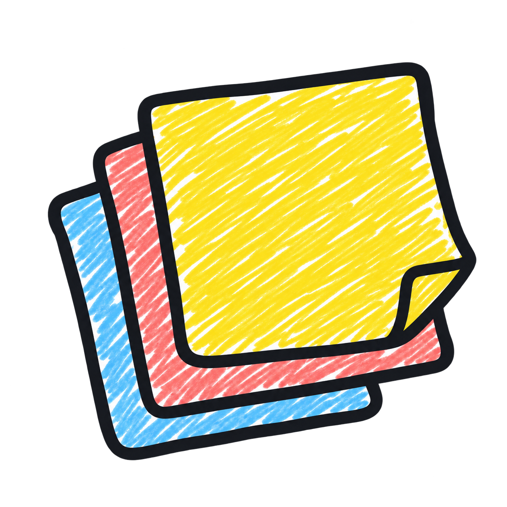
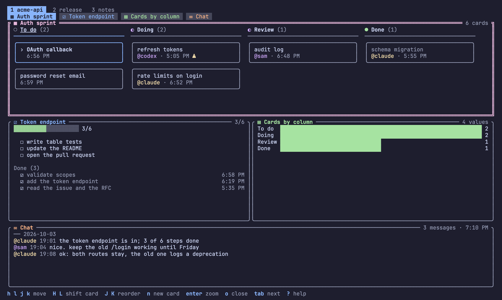
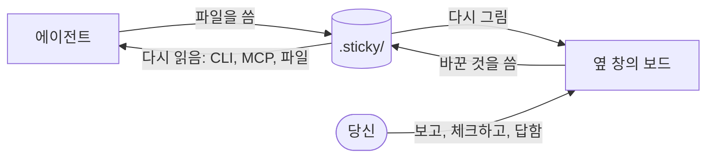
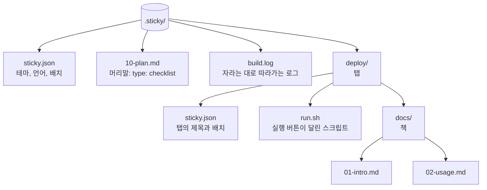
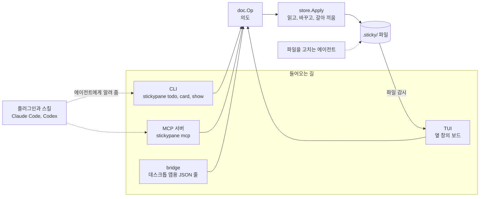
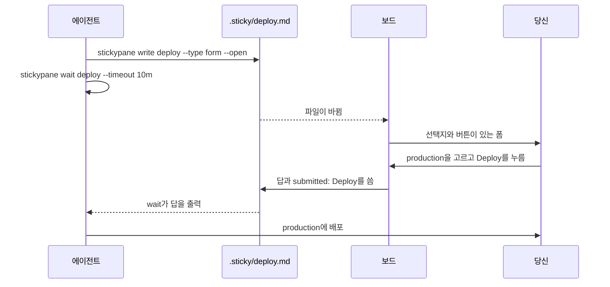

<p align="center"></p>

<h1 align="center">stickypane</h1>

<p align="center"><b>코딩 에이전트의 메모판. 에이전트는 붙이고, 당신은 힐끗 봅니다.</b></p>

<p align="center">
  <a href="https://github.com/LeeSwallow/stickypane/actions/workflows/ci.yml"></a>
  <a href="https://github.com/LeeSwallow/stickypane/releases"></a>
  <a href="go.mod"></a>
  <a href="https://goreportcard.com/report/github.com/LeeSwallow/stickypane"></a>
  <a href="LICENSE"></a>
</p>

<p align="center"><a href="README.md">English</a> · 한국어</p>

<p align="center">
  
  
  
  
  
  
  
  
  
</p>



[소개](#소개) · [설치](#설치) · [시작하기](#시작하기) · [동작 방식](#동작-방식) · [노트 모양](#노트-모양) · [에이전트](#에이전트와-함께-쓰기) · [사용법](#사용법) · [설정](#설정) · [자주 묻는 질문](#자주-묻는-질문) · [기여](#기여)

> 이 문서는 [README.md](README.md)를 커밋 `832183b` 기준으로 옮긴 것입니다. 영문이
> 원본이고, 두 문서가 다르면 영문이 맞습니다. 자세한 내용 가운데 한국어가 없는
> 것은 영문 문서로 이어집니다.

## 소개

코딩 에이전트는 말이 많고, 정작 중요한 것은 그 말과 함께 흘러가 버립니다. 계획이
어디까지 왔는지, 무엇이 끝났는지, 무엇을 정해 달라는지. stickypane은 그런 것을 둘
자리를 만듭니다. 에이전트가 `.sticky/`에 평범한 파일로 메모를 붙이면 옆 창의
보드가 바뀌는 대로 보여 줍니다. 당신은 보드를 힐끗 보고 체크하거나 버튼을
누르고, 에이전트는 같은 파일에서 답을 읽어 갑니다.



> **상태: 설계 단계.** 아직 1.0 전입니다. 파일 이름, 명령 이름, `sticky.json`은
> 1.0 전까지 바뀔 수 있습니다. 에이전트와 하루 써 보고 보드가 어떻게 해 주길
> 바랐는지 [디자인 피드백 이슈](https://github.com/LeeSwallow/stickypane/issues/new?template=design_feedback.yml)나
> [Discussions](https://github.com/LeeSwallow/stickypane/discussions)에 알려 주세요.
> 데스크톱 앱은 만들고 있습니다([#10](https://github.com/LeeSwallow/stickypane/issues/10)).

## 설치

| | |
| --- | --- |
|  | `brew install --cask LeeSwallow/tap/stickypane` |
|  | `go install github.com/LeeSwallow/stickypane/cmd/stickypane@latest` |
|  | [릴리스 페이지](https://github.com/LeeSwallow/stickypane/releases)의 macOS, Linux, Windows용 압축 파일 |

  

프로그램 하나이고 따로 필요한 것이 없습니다. 유니코드와 색을 보여 주는 터미널이면
됩니다. 설치는 `stickypane version`으로 확인합니다. 압축 파일 설치 명령, 체크섬,
소스에서 빌드, 업데이트와 삭제는 영문 [docs/install.md](docs/install.md)에 있습니다.

지우려면 플러그인을 넣었을 때 `stickypane setup --undo`를 먼저 하고(설치할 때와 같은
`--scope`로, MCP 서버를 등록했다면 `--mcp`도 붙여서), 설치한
방법대로 지웁니다. 노트는 각 프로젝트의 `.sticky/`에 평범한 파일로 남습니다.

## 시작하기

**1. 설치합니다.** 위의 방법 가운데 하나로.

**2. 프로젝트에 보드를 만듭니다.** 프로젝트 폴더에서:

```sh
stickypane init
```

`.sticky/`를 만들고 `CLAUDE.md`나 `AGENTS.md`에 짧은 안내문을 남겨, 에이전트가
보드가 있다는 것을 알게 합니다.

**3. 에이전트 옆에 보드를 띄웁니다.** 창을 나눠 새 창에서 `stickypane`을 실행합니다.
`stickypane env`가 지금 터미널에 맞는 명령을 알려 줍니다.

| 터미널 | 명령 |
| --- | --- |
|  tmux | `tmux split-window -h stickypane` |
|  WezTerm | `wezterm cli split-pane --right -- stickypane` |
| Zellij | `zellij run --direction right -- stickypane` |
| Windows Terminal | `wt -w 0 split-pane -V stickypane` |
| 그 밖의 터미널 | 같은 폴더에서 창이나 탭을 하나 더 열고 `stickypane` |

**4. 에이전트를 연결합니다.** 한 번이면 됩니다.

```sh
stickypane setup
```

Claude Code와 Codex에 보드 플러그인을 설치합니다. `stickypane setup --mcp`는 MCP
서버도 등록합니다. 그다음 시키면 됩니다. "이 리팩터 체크리스트를 보드에 띄워 줘."
"배포 전에 보드에서 물어봐." 화면을 한국어로 하려면 `stickypane language ko`.

<details>
<summary>같은 순서를 <code>stickypane help start</code>로 보면</summary>

```text
처음 시작하기

1. 프로젝트에 보드를 만들고, 에이전트에게도 알려 둡니다.
     stickypane init
2. 첫 메모를 붙입니다. 에이전트나 스크립트가 파일을 쓰면 되고, 직접 써도 됩니다.
     echo "- [ ] 보드 써 보기" | stickypane write plan --type checklist --open
   (어떤 모양이 있는지는 stickypane kinds에서)
3. 에이전트 옆 창에 보드를 띄웁니다.
     stickypane
   (내 터미널에서 띄우는 법은 stickypane env가 압니다)
4. 에이전트를 연결합니다. 한 번이면 됩니다.
     stickypane setup
   (또는 setup --mcp, 아니면 init이 CLAUDE.md / AGENTS.md에 남긴 줄)
5. 데스크톱에서 보고 싶다면 앱을 여세요. 같은 보드를 보여 주고
   stickypane bridge도 알아서 띄웁니다.

다음: stickypane help, 그다음 stickypane help <명령>.
```

</details>

## 동작 방식

### 폴더가 곧 보드

`.sticky/`의 파일 하나가 노트 하나입니다. 폴더는 탭이고, 탭 안의 폴더는 여러
페이지로 된 책입니다. 마크다운 노트는 머리말(front matter)로 모양을 정합니다.
노트가 화면 어디에 놓이는지는 `sticky.json`에 따로 적기 때문에, 보드를 정리해도
노트 파일은 다시 쓰이지 않습니다.



```markdown
---
type: checklist
title: 릴리스
---
- [x] 버전 태그 달기
- [ ] 릴리스 노트 쓰기
```

파일 종류와 탭, 책, 스크립트는 [docs/ko/shapes.md](docs/ko/shapes.md)에 있습니다.

### 쓰는 길은 하나

에이전트는 파일을 직접 고쳐도 됩니다. 그 밖의 모든 변경은 한 길로 갑니다. 변경은
"이 항목을 체크" 같은 의도(`doc.Op`)이고, `store.Apply`가 그 의도를 지금 디스크에
있는 파일에 적용해 한 번에 바꿔 씁니다. 그사이 에이전트가 같은 항목을 바꿨다면
덮어쓰지 않습니다.



| | 부분 | 하는 일 |
| --- | --- | --- |
|  | CLI | 에이전트와 스크립트가 쓰는 한 줄 명령 |
|  | MCP 서버 | 같은 명령을 MCP 도구로 |
|  | `.sticky/` | 저장소 안의 평범한 파일로 된 노트 |
|  | 플러그인 | Claude Code와 Codex용 스킬과 슬래시 명령 |

코드의 패키지와 계층은 [docs/architecture.md](docs/architecture.md)(영문)에 있습니다.

### 사용자에게 묻기

에이전트는 폼으로 묻고 답을 기다립니다.



시간 안에 답이 없으면 `wait`는 종료 코드 3으로 끝납니다. 폼의 형식은
[docs/shapes.md](docs/shapes.md#form)(영문)에 있습니다.

## 노트 모양

| 모양 | 용도 | 예시 |
| --- | --- | --- |
| note | 마크다운이면 무엇이든. `mermaid` 블록은 그림으로 | `echo "환경 확인" \| stickypane write deploy-notes --open` |
| board | 칸에 놓인 카드(칸반) | `stickypane card work add "로그인 API" --to Doing` |
| checklist | 체크해 나가는 단계와 진행 막대 | `stickypane todo plan add "테스트 작성"` |
| log | 한 줄에 하나, 최신 줄이 보이게 | `stickypane log worklog --time "테스트 통과"` |
| chat | 누가 언제 무슨 말을 했는지 | `stickypane say chat "41/41 통과"` |
| chart | 막대, 추세선, 날짜 달력 | `stickypane chart tokens add input 1200` |
| form | 고를 것, 채울 줄, 버튼 | `stickypane wait deploy --timeout 10m` |
| script | 실행 버튼이 달린 셸 스크립트 | `stickypane show deploy.sh` |
| api | REST, WebSocket, gRPC 요청(실험) | `stickypane api api.http "Log in"` |
| html | 웹 페이지. 터미널은 글만 보여 줌 | `stickypane show report.html` |

`stickypane kinds`가 목록을, `stickypane help <모양>`이 하나를 자세히 보여 줍니다.
모양마다의 형식, 노트 사이의 링크, 다른 노트에서 계산하는 차트는 영문
[docs/shapes.md](docs/shapes.md)에 있습니다.

## 에이전트와 함께 쓰기

| 방법 | 명령 | 대상 |
| --- | --- | --- |
|  플러그인 | `stickypane setup` | Claude Code, Codex: 스킬 다섯 개, 슬래시 명령, 세션 훅 |
| 안내문 | `stickypane init`이 `CLAUDE.md`나 `AGENTS.md`에 넣습니다 | 그 파일을 읽는 모든 에이전트 |
|  MCP | `stickypane setup --mcp`, 또는 `claude mcp add stickypane -- stickypane mcp` | MCP를 쓰는 모든 클라이언트 |

플러그인의 입구는 `using-the-board` 스킬이고, 일에 맞는 스킬 넷을 알려 줍니다:
`tracking-progress`, `asking-the-user`, `talking-in-chat`, `connecting-notes`.
에이전트용 명령은 [docs/ko/agents.md](docs/ko/agents.md)에, MCP 도구와 `setup`
옵션은 영문 [docs/agents.md](docs/agents.md)에 있습니다.

## 사용법

도움말은 프로그램 안에 있고 화면의 언어를 따릅니다. 아래는 `stickypane help`입니다.

```text
stickypane - 코딩 에이전트의 메모판. 에이전트는 붙이고, 당신은 힐끗 봅니다.

시작
  [path]    경로의 프로젝트 보드를 엽니다 (기본: 여기)
  init      보드를 만들고 에이전트에게 알립니다
  kinds     노트가 가질 수 있는 모양을 나열합니다
  env       보드가 찾은 실행 환경을 알려 줍니다
  version   버전을 출력합니다
  help      이 도움말: 명령, 모양, 처음 시작하기

노트
  list      노트 목록
  index     노트마다 한 줄: 제목, 개수, 요약
  show      노트, 파일, 폴더를 화면에 올립니다
  hide      노트를 접어 둡니다
  cat       노트의 파일을 출력합니다
  write     표준 입력으로 노트를 만들거나 바꿉니다
  todo      체크리스트 항목을 추가, 체크, 체크 해제합니다
  card      보드의 카드를 추가하거나 옮깁니다
  chart     차트의 숫자를 정하거나 더합니다
  log       로그 노트에 한 줄을 덧붙입니다
  say       채팅 노트에 메시지를 더합니다
  set       노트의 키나 보드에서의 자리를 바꿉니다

정리
  mv        노트 이름을 바꾸거나 탭, 책으로 옮깁니다
  link      복사 없이 프로젝트의 파일이나 폴더를 보여 줍니다
  rm        노트, 페이지, 폴더를 삭제합니다 (.trash/로 옮김)
  restore   rm이 마지막으로 지운 것을 되돌립니다
  archive   노트를 archive/로 보관합니다

설정
  theme     테마 목록을 보거나 하나를 고릅니다
  language  화면의 언어 목록을 보거나 하나를 고릅니다
  config    설정을 보거나 읽거나 바꿉니다

에이전트
  setup     Claude Code와 Codex에 보드 플러그인을 설치합니다
  guide     에이전트 안내문을 출력합니다
  answers   폼에 사용자가 답한 것을 출력합니다
  wait      폼의 버튼이 눌릴 때까지 기다린 뒤 답을 출력합니다
  mcp       MCP 서버로 노트를 제공합니다

스크립트
  api       (실험) .http 노트의 요청을 보냅니다
  watch     보드에서 일어나는 일을 바로 출력합니다
  bridge    데스크톱 앱에 보드를 제공합니다

stickypane help <명령>    명령 하나의 설명과 예시
stickypane help <모양>    노트의 파일 형식과 예시
stickypane help start     처음 시작하기
stickypane help --all     모든 명령과 옵션을 한 페이지에
```

키와 마우스는 [docs/ko/usage.md](docs/ko/usage.md)에, 인덱스와 `stickypane watch`는
영문 [docs/usage.md](docs/usage.md)에 있습니다.

## 설정

설정할 것은 없습니다. 보드에서 `S`를 누르면 설정 창이 열리고, `stickypane config`도
같은 일을 합니다.

| 설정 | 기본값 | 바꾸는 것 |
| --- | --- | --- |
| `theme` | `auto` | 색. Catppuccin, Tokyo Night, Gruvbox, Nord, Dracula를 포함해 테마 10개 |
| `language` | `auto` | 화면의 말 |
| `time` | `auto` | 날짜와 시각을 쓰는 방식 |
| `editor` | `auto` | `E`가 여는 편집기 |
| `stale` | `30m` | 움직이지 않는 카드를 표시하는 시점 |

`sticky.json`과 이 컴퓨터에 남는 기록은 [docs/ko/configuration.md](docs/ko/configuration.md)에,
테마 목록은 영문 [docs/configuration.md](docs/configuration.md)에 있습니다.

## 자주 묻는 질문

**에이전트에 플러그인이 꼭 있어야 하나요?** 아닙니다. `.sticky/`에 마크다운 파일을
쓰는 것으로 충분합니다. 플러그인, 안내문, MCP는 에이전트가 읽을 것을 줄여 줄
뿐입니다.

**에이전트와 내가 같은 노트를 바꾸면요?** 나중 변경은 그 순간의 파일에 적용됩니다.
더는 맞지 않으면 아무것도 쓰지 않고 보드가 알려 줍니다.

**tmux에서 마우스가 안 됩니다.** tmux 설정에 `set -g mouse on`을 넣으세요.

**macOS에서 내려받은 프로그램이 열리지 않습니다.**
`xattr -d com.apple.quarantine stickypane`을 실행하거나 Homebrew로 설치하세요.

**어딘가로 무언가를 보내나요?** 보내지 않습니다. `~/.stickypane` 폴더가 이미 있을
때만 거기에 기록하고, 노트 내용은 적지 않습니다
([자세히](docs/ko/configuration.md#이-컴퓨터에-남는-기록)).

질문은 [Discussions](https://github.com/LeeSwallow/stickypane/discussions)에, 버그와
아이디어는 [이슈](https://github.com/LeeSwallow/stickypane/issues/new/choose)에, 보안
문제는 [SECURITY.md](SECURITY.md)대로 비공개로 알려 주세요.

## 기여

지금은 코드보다 "보드가 이렇게 해 주길 바랐다"는 피드백이 더 도움이 됩니다.
이슈, 제안, 풀 리퀘스트, 테스트 방법은 [CONTRIBUTING.md](CONTRIBUTING.md)에
있습니다. 시작하기 좋은 이슈에는 `good first issue`나 `accepted` 라벨이 붙습니다.
코딩 에이전트는 [AGENTS.md](AGENTS.md)를 먼저 읽습니다. 계획은
[ROADMAP.md](ROADMAP.md), 원칙은 [VISION.md](VISION.md), 번역은
[docs/translating.md](docs/translating.md)에 있습니다.

## 라이선스

[MIT](LICENSE). 쓰인 라이브러리와 테마 팔레트는
[THIRD_PARTY_NOTICES.md](THIRD_PARTY_NOTICES.md)에 있고, 릴리스 압축 파일마다
그 라이선스 원문이 들어 있습니다.
