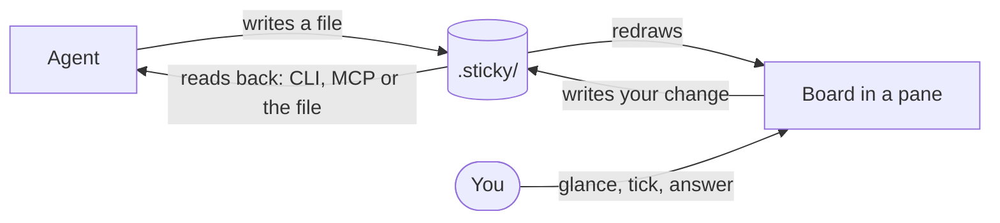
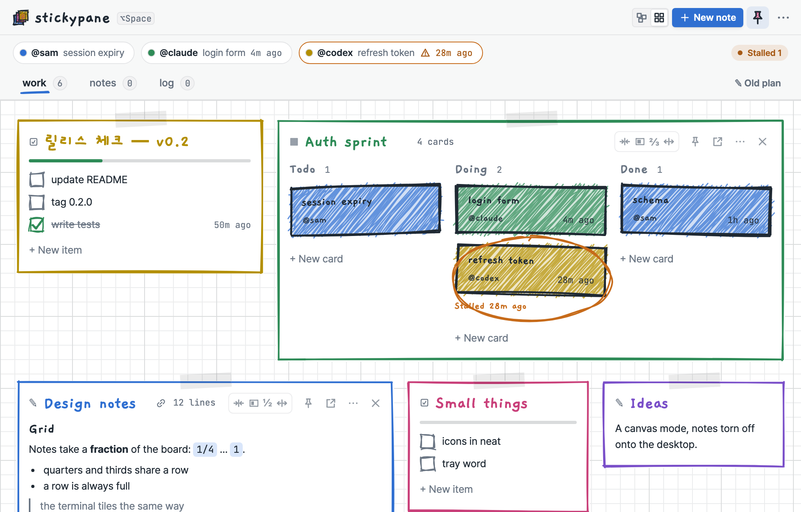
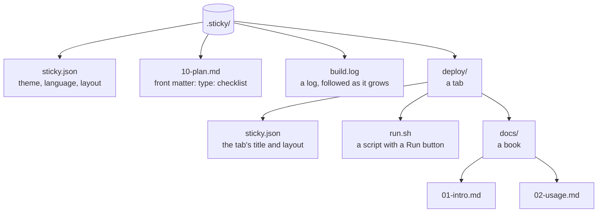
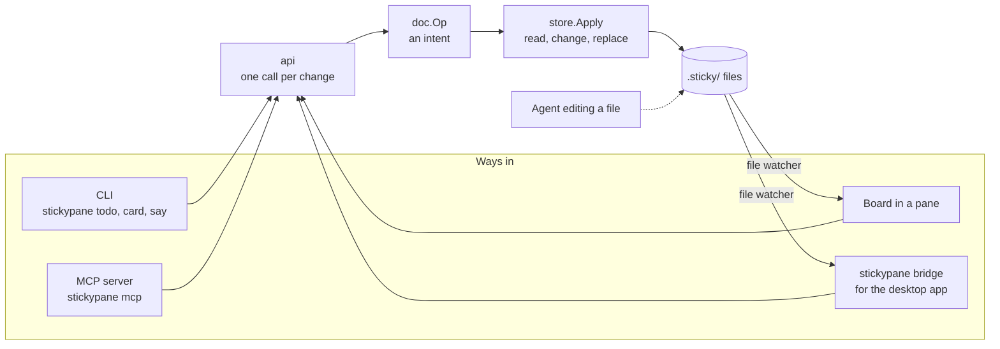
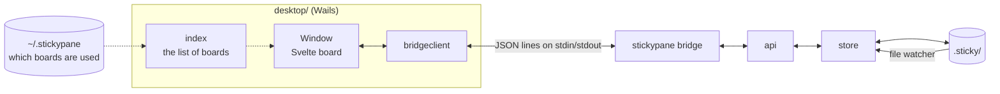
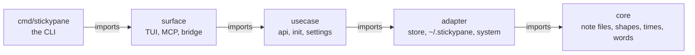
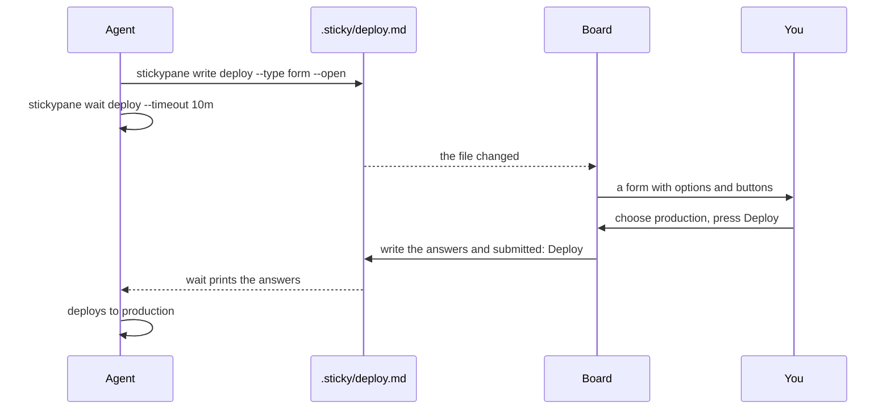

<p align="center"></p>

<h1 align="center">stickypane</h1>

<p align="center"><b>Sticky notes for coding agents. They pin, you glance.</b></p>

<p align="center">
  <a href="https://github.com/LeeSwallow/stickypane/actions/workflows/ci.yml"></a>
  <a href="https://github.com/LeeSwallow/stickypane/releases"></a>
  <a href="go.mod"></a>
  <a href="https://goreportcard.com/report/github.com/LeeSwallow/stickypane"></a>
  <a href="LICENSE"></a>
</p>

<p align="center">English · <a href="README.ko.md">한국어</a></p>

<p align="center">
  
  
  
  
  
  
  
  
  
</p>


[What it is](#what-it-is) · [Install](#install) · [Getting started](#getting-started) · [Desktop app](#the-desktop-app) · [How it works](#how-it-works) · [Note shapes](#note-shapes) · [Agents](#working-with-agents) · [Usage](#usage-reference) · [Configuration](#configuration) · [FAQ](#faq) · [Contributing](#contributing)

## What it is

A coding agent talks a lot, and the parts that matter scroll away: where the
plan stands, what is done, what it needs you to decide. stickypane gives
those a place. The agent pins notes as plain files in `.sticky/`, and a
board in the pane beside it shows them as they change. You glance at the
board, tick a box or press a button, and the agent reads your answer from
the same file.



> **Status: design stage.** stickypane is before 1.0, so file names,
> command names and `sticky.json` may still change. Try it with your agent
> for a day and tell us what you expected the board to do, in a
> [design feedback issue](https://github.com/LeeSwallow/stickypane/issues/new?template=design_feedback.yml)
> or in [Discussions](https://github.com/LeeSwallow/stickypane/discussions).

## Install

| | |
| --- | --- |
|  | `brew install --cask LeeSwallow/tap/stickypane` |
|  | `go install github.com/LeeSwallow/stickypane/cmd/stickypane@latest` |
|  | an archive for macOS, Linux and Windows on the [releases page](https://github.com/LeeSwallow/stickypane/releases) |

  

It is one program with no runtime dependencies, for any terminal that
shows Unicode and color. `stickypane version` checks the install.
[docs/install.md](docs/install.md) has the archive commands, checksums,
building from source, updating and removing.

## Getting started

**1. Install** stickypane, as above.

**2. Connect your agents, once.** From any folder:

```sh
stickypane setup
```

This installs the board plugin for Claude Code and Codex.
`stickypane setup --mcp` also registers the MCP server.

**3. Give the project a board.** In the project's folder:

```sh
stickypane init
```

This makes `.sticky/`. An agent without the plugin gets a short guide in
`CLAUDE.md` or `AGENTS.md`, so it knows the board is there.
`--language ko` sets the board's language. `--view app` opens the board in
the [desktop app](#the-desktop-app), and `--style` picks the app's look.

**4. Open the board beside your agent.** Split the terminal and run
`stickypane` in the new pane. `stickypane env` prints the command for the
terminal you are in.

| Terminal | Command |
| --- | --- |
|  tmux | `tmux split-window -h stickypane`, or a popup: `tmux display-popup -E stickypane` |
|  WezTerm | `wezterm cli split-pane --right -- stickypane` |
| Zellij | `zellij run --direction right -- stickypane` |
| Windows Terminal | `wt -w 0 split-pane -V stickypane` |
|  iTerm2,  Ghostty | on macOS, split with `⌘ D`, then `stickypane` |
| anything else | a second window or tab in the same folder, then `stickypane` |

Then ask for things: "Keep a checklist of this refactor on the board."
"Ask me on the board before you deploy."

<details>
<summary>The same steps, as <code>stickypane help start</code> prints them</summary>

```text
Getting started

1. Connect your agents, once:
     stickypane setup
   (Claude Code and Codex get the board plugin; setup --mcp adds MCP)
2. Give the project a board:
     stickypane init
   (an agent without the plugin gets a short guide in CLAUDE.md or AGENTS.md)
3. Open the board in a pane beside your agent:
     stickypane
   (not sure how in your terminal? stickypane env knows)

Then ask your agent to put something on the board, or pin a note yourself:
     echo "- [ ] try the board" | stickypane write plan --type checklist --open
(stickypane kinds lists the shapes a note can take)

Next: stickypane help, then stickypane help <command>.
```

</details>

## The desktop app

   



**Not released yet.** The app is built and tested in this repository, in
[`desktop/`](desktop/), for macOS and Linux. The DMG and the Linux archive
come with its first release
([#10](https://github.com/LeeSwallow/stickypane/issues/10)); until then
there is nothing to download.

The same board in a window of its own. It draws every note in full,
including tables, Mermaid, math and `.html` pages in a sandbox. A click
makes the same change as a key, so you can tick, answer a form or drag a
card. **+ New note** makes any shape. Notes sit on a grid or anywhere on a canvas, and one can
be torn off into a small window that stays on top. `⌥ Space` shows and
hides the app.

The app comes with its own copy of the `stickypane` command. In a board's settings,
**Terminal and agents** installs the command for your terminals and
connects Claude Code and Codex. After `stickypane init --view app`, a plain
`stickypane` opens the board in the app.

Design and build notes are in [docs/desktop](docs/desktop/README.md).

## How it works

### The folder is the board

Each file in `.sticky/` is one note. A folder is a tab, and a folder inside
a tab is a book of pages. A Markdown note's front matter gives it a shape.
Where each note sits and how wide it is (a share of the screen, from `1/4`
to `1`) are kept apart, in `sticky.json`, so rearranging the board never
rewrites a note.



```markdown
---
type: checklist
title: Release
---
- [x] tag the version
- [ ] write the notes
```

[docs/shapes.md](docs/shapes.md#the-folder-is-the-board) has every file
type, tabs, books and scripts.

### One path for every change

Apart from the agent editing a file itself, every change takes one path. The command line, the MCP server, the board in a pane and the
desktop app's bridge all call `api`. It turns the change into an intent
such as "tick this item" (a `doc.Op`), and `store.Apply` applies it to the
file as it is on disk now, in one step. If the agent changed the same item
in the meantime, nothing is overwritten.



### The desktop app and the bridge

The app in `desktop/` is a separate Go module with a Wails window. It does
not read notes itself. It starts `stickypane bridge` and talks to it in
JSON lines over standard input and output, so the app and the terminal
share one writer.



To list your boards, the app reads `~/.stickypane`, where each stickypane
session notes which board it is on, if that folder exists (see the [FAQ](#faq)).

### Layers

The code under `internal/` is in four folders, and a package imports only
from its own folder or a lower one. `internal/layers` fails the tests
otherwise.



[docs/architecture.md](docs/architecture.md) has every package, its rank
and how a note is read and written.

### Asking the user

An agent asks with a form and waits for the answer.



`wait` exits with code 3 if no one answers in time. The form's format is in
[docs/shapes.md](docs/shapes.md#form).

## Note shapes

| Shape | For | Example |
| --- | --- | --- |
| note | anything in Markdown; a `mermaid` block is drawn | `echo "check env" \| stickypane write deploy-notes --open` |
| board | cards in columns, a kanban | `stickypane card work add "login API" --to Doing` |
| checklist | steps to tick off, with a progress bar | `stickypane todo plan add "write tests"` |
| log | one entry per line, the newest in sight | `stickypane log worklog --time "tests passed"` |
| chat | who said what and when; `say` signs as `agent` unless `--as` names someone | `stickypane say chat "41/41 pass"` |
| chart | bars, a trend line, or a calendar of days | `stickypane chart tokens add input 1200` |
| form | options, lines to fill in, buttons | `stickypane wait deploy --timeout 10m` |
| script | a shell script with a Run button | `stickypane show deploy.sh` |
| api | REST, WebSocket and gRPC requests (experimental) | `stickypane api api.http "Log in"` |
| html | a web page; the terminal shows its text | `stickypane show report.html` |

`stickypane kinds` lists them and `stickypane help <shape>` prints one in
full. [docs/shapes.md](docs/shapes.md) has each format, links between
notes, and charts counted from other notes.

## Working with agents

| Way | How | For |
| --- | --- | --- |
|  plugin | `stickypane setup` | Claude Code and Codex: five skills, slash commands, a session hook |
| guide | `stickypane init` writes it into `CLAUDE.md` or `AGENTS.md` | any agent that reads those files |
|  MCP | `stickypane setup --mcp`, or `claude mcp add stickypane -- stickypane mcp` | any MCP client |

The plugin lives in [`plugin/`](plugin/). Its slash commands are
`/board:status` (what is on the board), `/board:track`, `/board:ask`,
`/board:say` and `/board:setup`. [docs/agents.md](docs/agents.md) has the
skills, the commands for agents, the MCP tools and the setup options.

## Usage reference

The help is in the program, in English or Korean. This is
`stickypane help`:

```text
stickypane - sticky notes for coding agents. They pin, you glance.

Start
  [path]    open the board of the project at path (default: here)
  init      make .sticky/ and tell your agents about it
  kinds     list the shapes a note can take
  env       say what the board found about where it runs
  version   print the version
  help      this help: a command, a shape, or getting started

Notes
  list      list the notes
  index     every note in a line: title, counts, a gist
  show      put a note, a file or a folder on the screen
  hide      fold a note away
  cat       print a note's file
  write     create or replace a note from standard input
  todo      add, tick or untick a checklist item
  card      add or move a card of a board
  chart     set or add to a number of a chart
  log       append a line to a log note
  say       add a message to a chat note
  set       change keys of a note or its place on the board

Arrange
  mv        rename a note or move it into a tab or book
  link      show a file or folder of the project without copying
  rm        move a note, a page or a folder to .trash/
  restore   bring back what rm removed last
  archive   move a note out of sight into archive/

Settings
  theme     list the themes or choose one
  language  list the screen's languages or choose one
  config    list, read or change a setting

Agents
  setup     install the board plugin for Claude Code and Codex
  guide     print the agent guide
  answers   print what the user answered in a form
  wait      wait for a form's button, then print the answers
  mcp       serve the notes over MCP

Scripts
  api       (experimental) send the requests of a .http note
  watch     print what happens on the board as it happens
  bridge    serve the board to the desktop app

stickypane help <command>   one command, with examples
stickypane help <shape>     a note's file format and an example
stickypane help start       getting started
stickypane help --all       every command with every option
```

[docs/usage.md](docs/usage.md) has the keys, the mouse, the editor, the
index, moving notes and `stickypane watch`.

## Configuration

Nothing has to be set. `S` on the board opens the settings, and
`stickypane config` does the same from the command line.

| Setting | Default | Changes |
| --- | --- | --- |
| `theme` | `auto` | the colors; 10 themes, including Catppuccin, Tokyo Night, Gruvbox, Nord and Dracula |
| `language` | `auto` | the board's language: English or Korean |
| `time` | `auto` | how days and times are written |
| `editor` | `auto` | what `E` opens |
| `stale` | `30m` | when a card that has not moved is flagged |

[docs/configuration.md](docs/configuration.md) has the themes,
`sticky.json`, and what stickypane records on this machine.

## FAQ

**Does my agent need the plugin?** No. Writing a Markdown file in
`.sticky/` is enough. The plugin, the guide and MCP tell it the board is there and how to use it.

**What if the agent and I change the same note?** The later change is
applied to the file as it is then. If the item it meant has gone or
changed, nothing is written and the board tells you.

**The mouse does nothing in tmux.** Add `set -g mouse on` to your tmux
config.

**macOS will not open the downloaded program.** Run
`xattr -d com.apple.quarantine stickypane`, or install with Homebrew.

**Does it send anything anywhere?** No. If `~/.stickypane` exists (the
desktop app makes it), stickypane notes there which boards are used, so
the app can list them, and clears out old entries itself. It never writes
note text there, and it never makes the folder
([details](docs/configuration.md#what-stickypane-records-on-this-machine)).

**How is it different from a Markdown kanban?**
[kanban-md](https://github.com/antopolskiy/kanban-md) and
[Backlog.md](https://github.com/MrLesk/Backlog.md) keep a kanban in files;
[sampler](https://github.com/sqshq/sampler) and
[wtf](https://github.com/wtfutil/wtf) are configured dashboards. stickypane
sits between you and an agent: the agent writes the files, you glance at
the board, and your answers go back to the agent.

Questions go to [Discussions](https://github.com/LeeSwallow/stickypane/discussions),
bugs and ideas to the [issue tracker](https://github.com/LeeSwallow/stickypane/issues/new/choose),
and security problems to [SECURITY.md](SECURITY.md). See also [SUPPORT.md](SUPPORT.md).

## Contributing

Design feedback helps most right now: what you expected the board to show,
and what it did. [CONTRIBUTING.md](CONTRIBUTING.md) covers issues,
proposals, pull requests and how to test. Good first picks are labelled
[good first issue](https://github.com/LeeSwallow/stickypane/labels/good%20first%20issue)
or [accepted](https://github.com/LeeSwallow/stickypane/labels/accepted).
Coding agents read [AGENTS.md](AGENTS.md) first. The plan is in
[ROADMAP.md](ROADMAP.md) and the principles in [VISION.md](VISION.md).
Everything else written down is listed in [docs/](docs/README.md).

## License

[MIT](LICENSE), © 2026 LeeSwallow. The libraries and theme palettes it uses
are listed in [THIRD_PARTY_NOTICES.md](THIRD_PARTY_NOTICES.md); every
release archive carries their license texts.
