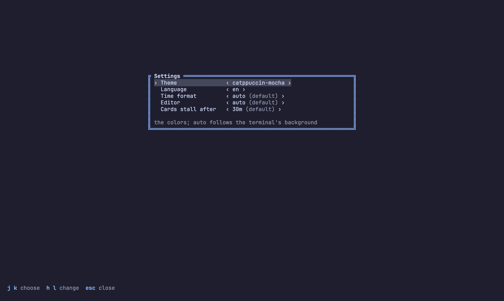

# Configuration

Nothing has to be set: every setting has a default and the board works as
it is. This page is for when you want to change something. Back to the
[README](../README.md).

- [Settings](#settings)
- [Themes](#themes)
- [Languages](#languages)
- [sticky.json: how the board is arranged](#stickyjson-how-the-board-is-arranged)
- [What stickypane records on this machine](#what-stickypane-records-on-this-machine)

## Settings

`S` on the board opens the settings panel: `j` `k` pick a setting, `h` `l`
change it, and it applies at once. `stickypane config` does the same from
the command line.



| Setting | Default | Changes |
| --- | --- | --- |
| `theme` | `auto` | the colors; `auto` follows the terminal's background |
| `language` | `auto` | the screen's words |
| `time` | `auto` | how days and times are written; `auto` follows the locale's country |
| `editor` | `auto` | what `E` opens; `auto` is `$VISUAL`, `$EDITOR`, then the first editor found |
| `stale` | `30m` | when a kanban card that has not moved is flagged; `off` never |

```sh
stickypane config                # every setting, its value, and which are defaults
stickypane config stale 1h
```

A setting at its default is not written; the others go to the root
`sticky.json`.

## Themes

Everything on the screen is drawn from a dozen color roles (text, muted,
accent, selection, good, warn, bad, info, and the six note colors), so a
theme is one palette and the whole board follows it. `T` tries the next
theme, `stickypane theme` lists them and `stickypane theme nord` chooses one;
the choice is kept in `sticky.json` as `"theme"`. With no choice (`auto`) the
board asks the terminal whether it is dark and picks `stickypane-dark` or
`stickypane-light`.

| Theme | For a | Palette from |
| --- | --- | --- |
| `stickypane-dark`, `stickypane-light` | dark, light | stickypane |
| `catppuccin-mocha`, `catppuccin-latte` | dark, light | [catppuccin/nvim](https://github.com/catppuccin/nvim) (MIT) |
| `tokyonight-night`, `tokyonight-day` | dark, light | [folke/tokyonight.nvim](https://github.com/folke/tokyonight.nvim) (Apache-2.0) |
| `gruvbox-dark`, `gruvbox-light` | dark, light | [ellisonleao/gruvbox.nvim](https://github.com/ellisonleao/gruvbox.nvim) (MIT) |
| `nord` | dark | [gbprod/nord.nvim](https://github.com/gbprod/nord.nvim) (WTFPL) |
| `dracula` | dark | [Mofiqul/dracula.nvim](https://github.com/Mofiqul/dracula.nvim) (MIT) |

The palettes are those themes' own values, used the way the themes use
them: blue for focus, mauve for headings, the comment color for what is
muted. A theme never paints the background; the terminal's stays, so pick a
theme made for the background you have.

How the colors are used follows what terminal tools agree on: focus is the
border color, not a different shape alone; the title sits in the top border
in the note's color; the selected line has a background tint; key hints are
the accent; everything secondary is muted; and `faint` is never used, since
it is unreadable on a light background.

## Languages

The screen speaks English and Korean: `stickypane language ko`, or leave it
on `auto` and set `LANG`. Key names and the agent guide stay English.
[translating.md](translating.md) says how to add a language.

## sticky.json: how the board is arranged

Where a note is on the screen is not written into the note. It goes to
`sticky.json`: the root one for the root tab and for the board as a whole,
and one in each tab's folder for that tab's notes, the way Bruno keeps a
folder's settings in the folder. The board writes them as you press keys:

```json
{
  "notes": {
    "10-plan.md": { "open": true, "size": "1/2", "pin": true },
    "build.log": { "title": "CI build", "open": true, "rows": 12 },
    "docs": { "open": true, "color": "blue" }
  },
  "order": ["docs", "10-plan.md", "build.log"],
  "ignore": ["drafts", "*.tmp.md"],
  "theme": "catppuccin-mocha",
  "tab": "deploy",
  "version": 1
}
```

A tab's own file (`deploy/sticky.json`) has `title`, `notes` keyed by the
names inside the tab, and `order`; `theme`, `language`, `ignore` and `tab`
are only in the root file.

| Key in `notes` | Values | Key on the board |
| --- | --- | --- |
| `open` | `true` shows the note, `false` folds it away | `o`, `enter` |
| `size` | the width, a share of the screen: `1/4` `1/3` `1/2` `2/3` `3/4` `1` | `+` `-`, drag the right edge |
| `rows` | the height in lines the note asks for; `-1` is as tall as its content, over what the note or its kind says | `shift+up` `shift+down`, `0`, drag the bottom edge |
| `color` | `yellow` `pink` `blue` `green` `purple` `orange` | `c` |
| `pin` | `true` keeps the note first | `p` |
| `title` | a name for a book, a log or a script | `R` |

Next to `notes`, `theme` names the theme (`T` on the board), `language` the
language of the screen (`stickypane language ko`; `auto` follows `LANG`),
`order` lists the notes you moved with `{` and `}` (the others follow by
name), and `ignore` lists names or patterns the board should not show.
`ignore` is the one part you write by hand.

Two more root keys are for the desktop app, which is in progress (#10); the
terminal ignores them. `view` is `terminal` (the default), `overlay` or
`both`, and `style` is `doodle` or `neat`. A key at its default is not
written.

Keeping this apart from the notes means three things. A log, a script or a
linked README can be opened, sized and named although it has no front matter.
The board never rewrites a note because you rearranged the screen, so it
cannot collide with your agent writing that note. And you can commit the file
to share a layout, or leave it out of git to keep it yours.

The old size names are still read: `page` is `1`, `half` is `1/2`, and
`card` is the narrowest share a 36-cell card fits in (`1/2` of 80 cells,
`1/4` of 160). The board writes a fraction the next time the size changes.

A Markdown note may still carry `open`, `size`, `rows`, `color` and `pin` in
its front matter. That is the note's own proposal, which is how an agent says
"show this now"; what `sticky.json` says wins. A note that neither opens is
folded away, except that a note that appears while stickypane is running is
shown for that run, so what your agent just wrote is in front of you at once.

## What stickypane records on this machine

Only if the folder `~/.stickypane` (or `$STICKYPANE_HOME`) already exists.
stickypane never makes it: the desktop app does, so a person who only uses
the terminal gets nothing in their home. Where it exists, stickypane writes
two things there, to let the desktop app list your boards:

- `events/YYYY-MM-DD.jsonl`, one JSON line per event, `{v: 1, at, type, …}`:
  the time, the type (`session.start`, `session.end`, `project.init`,
  `project.touch`), the project's path, and for a session its process id and
  kind (`tui`, `mcp`, `watch`, `bridge`); for `project.touch` the name of the
  command, at most once a minute per project and command.
- `run/<pid>.json` while a session lives: process id, project path, kind
  and start time. It is removed when the session ends. `run/touch-*` files
  are empty markers that keep the once-a-minute count.

When you open a board, in the terminal or the desktop app, stickypane clears
out what is no longer needed: the `run/` file of a session whose process
has died, events older than 90 days, and markers a day old. It is the
only program that deletes these files.

No note text, no arguments, no file contents. Nothing leaves your machine.
Delete the folder to stop it.
