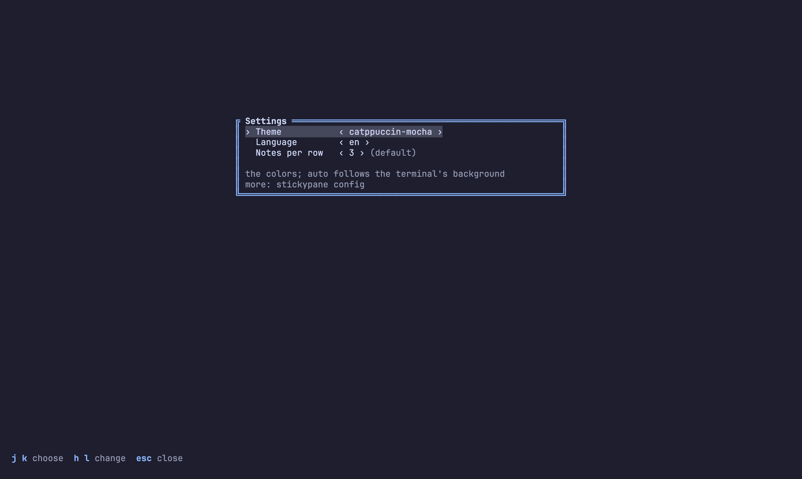

# Configuration

Nothing has to be set: every setting has a default and the board works as
it is. This page is for when you want to change something. Back to the
[README](../README.md).

- [Settings](#settings)
- [Themes](#themes)
- [Languages](#languages)
- [Keys](#keys)
- [sticky.json: how the board is arranged](#stickyjson-how-the-board-is-arranged)
- [What stickypane records on this machine](#what-stickypane-records-on-this-machine)

## Settings

`S` on the board opens the settings panel with the three most people
change: theme, language and columns. `j` `k` pick one, `h` `l` change it,
and it applies at once. `stickypane config` changes those and three more,
which keep their defaults until you set them.



| Setting | Default | Changes |
| --- | --- | --- |
| `theme` | `auto` | the colors; `auto` follows the terminal's background |
| `language` | `auto` | the screen's words |
| `columns` | `3` | how many columns the board has, `1` to `4`; a note with a size spans its share of them. `auto`, the layout of before, is still read |
| `time` | `auto` | how days and times are written; `auto` follows the locale's country. Only `stickypane config` |
| `editor` | `auto` | what `E` opens; `auto` is `$VISUAL`, `$EDITOR`, then the first editor found. Only `stickypane config` |
| `stale` | `30m` | when a kanban card that has not moved is flagged; `off` never. Only `stickypane config` |

```sh
stickypane config                # every setting, its value, and which are defaults
stickypane config theme nord
stickypane config stale 1h
```

`stickypane theme` and `stickypane language` are short for
`stickypane config theme` and `stickypane config language`; alone, they list
the themes and the languages.

A setting at its default is not written; the others go to the root
`sticky.json`.

## Themes

Everything on the screen is drawn from a dozen color roles (text, muted,
accent, selection, good, warn, bad, info, and the six note colors), so a
theme is one palette and the whole board follows it. `T` tries the next
theme, `stickypane theme` lists them and `stickypane config theme nord` chooses one;
the choice is kept in `sticky.json` as `"theme"`. With no choice (`auto`) the
board asks the terminal whether it is dark and picks `stickypane-dark` or
`stickypane-light`.

| Theme | For a | Palette from |
| --- | --- | --- |
| `stickypane-dark`, `stickypane-light` | dark, light | stickypane |
| `catppuccin-mocha`, `catppuccin-latte` | dark, light | [catppuccin/nvim](https://github.com/catppuccin/nvim) (MIT) |
| `tokyonight-night`, `tokyonight-day` | dark, light | [folke/tokyonight.nvim](https://github.com/folke/tokyonight.nvim) (Apache-2.0) |
| `gruvbox-dark`, `gruvbox-light` | dark, light | [ellisonleao/gruvbox.nvim](https://github.com/ellisonleao/gruvbox.nvim) (MIT) |
| `nord` | dark | [gbprod/nord.nvim](https://github.com/gbprod/nord.nvim) (WTFPL) |
| `dracula` | dark | [Mofiqul/dracula.nvim](https://github.com/Mofiqul/dracula.nvim) (MIT) |

The palettes are those themes' own values, used the way the themes use
them: blue for focus, mauve for headings, the comment color for what is
muted. A theme never paints the background; the terminal's stays, so pick a
theme made for the background you have.

How the colors are used follows what terminal tools agree on: focus is the
border color, not a different shape alone; the title sits in the top border
in the note's color; the selected line has a background tint; key hints are
the accent; everything secondary is muted; and `faint` is never used, since
it is unreadable on a light background.

## Languages

The screen speaks English and Korean: `stickypane config language ko`, or leave it
on `auto` and set `LANG`. Key names and the agent guide stay English.
[translating.md](translating.md) says how to add a language.

## Keys

Every key of the terminal board belongs to a named action, and the names
stay when the keys change. `stickypane keys` lists them: the action, its
keys, what it does in the board's language, and `(keys.json)` beside the
ones you changed (`--json` for scripts).

```sh
stickypane keys                          # every action and its keys
stickypane keys set note-archive X       # X archives, x no longer does
stickypane keys set jot N ctrl+n         # several keys; the first is the one hints show
stickypane keys set theme-next           # no keys: the action has none
stickypane keys reset note-archive       # back to x
stickypane keys reset                    # every key as it comes
```

The changes live in `keys.json` in `~/.stickypane` (or
`$STICKYPANE_HOME`), one entry for each action changed. The file is yours
to edit as well:

```json
{
  "jot": ["N", "ctrl+n"],
  "note-archive": ["X"],
  "theme-next": []
}
```

- An action not in the file keeps its keys; `[]` leaves it without one.
- A key is one key for now: a character (`x`, `X`, `?`), a named key
  (`enter`, `tab`, `space`, `esc`, `up`, `pgdown`, `f5`...), or either after
  modifiers (`ctrl+x`, `alt+enter`, `shift+tab`). `shift+x` is written `X`.
  `ctrl+c` always quits and cannot be given away.
- A key belongs to one action. To swap two keys, change both actions in
  the file, or set the one losing the key first.
- What the board cannot use (an unknown action, a key it cannot read, a
  key two actions want, or a file that is not JSON) keeps the keys it
  comes with; the board opens anyway and says on its bottom line which
  entries it left out. `stickypane keys` says why.
- The help (`?`), the bottom line and the messages that name a key
  (`u brings it back`) follow the file.
- An open note's own keys come first: an open kanban takes `h` `j` `k` `l`
  and `H` `J` `K` `L`, a checklist `space` and `n`, before the board's
  actions see them. A board key you give an action that a focused shape
  also uses works everywhere else.
- Having `~/.stickypane/keys.json` turns no records on;
  [What stickypane records](#what-stickypane-records-on-this-machine)
  depends on the desktop app's own files there.

## sticky.json: how the board is arranged

Where a note is on the screen is not written into the note. It goes to
`sticky.json`: the root one for the root tab and for the board as a whole,
and one in each tab's folder for that tab's notes, the way Bruno keeps a
folder's settings in the folder. The board writes them as you press keys:

```json
{
  "notes": {
    "10-plan.md": { "open": true, "size": "1/2", "pin": true },
    "build.log": { "title": "CI build", "open": true, "rows": 12 },
    "docs": { "open": true, "color": "blue" }
  },
  "order": ["docs", "10-plan.md", "build.log"],
  "ignore": ["drafts", "*.tmp.md"],
  "theme": "catppuccin-mocha",
  "tab": "deploy",
  "version": 1
}
```

A tab's own file (`deploy/sticky.json`) has `title`, `notes` keyed by the
names inside the tab, and `order`; `theme`, `language`, `ignore` and `tab`
are only in the root file.

| Key in `notes` | Values | Key on the board |
| --- | --- | --- |
| `open` | `true` shows the note, `false` folds it away | `o`, `enter` |
| `size` | the width, a share of the screen: `1/4` `1/3` `1/2` `2/3` `3/4` `1`, spanning that share of the columns, rounded. A note with a size keeps it; one without takes one column and shares what its row leaves | `+` `-`, drag the right edge |
| `rows` | the height in lines the note asks for; `-1` is as tall as its content, over what the note or its kind says | `shift+up` `shift+down`, `0`, drag the bottom edge |
| `color` | `yellow` `pink` `blue` `green` `purple` `orange` | `c` |
| `pin` | `true` keeps the note first | `p` |
| `title` | a name for a book, a log or a script | `R` |

Next to `notes`, `theme` names the theme (`T` on the board), `language` the
language of the screen (`stickypane config language ko`; `auto` follows `LANG`),
`order` lists the notes you moved with `H` `J` `K` `L` or `{` `}` (the others follow by
name), and `ignore` lists names or patterns the board should not show.
`ignore` is the one part you write by hand.

Two more root keys are for the desktop app, which is in progress (#10); the
terminal ignores them. `view` is `terminal` (the default), `overlay` or
`both`, and `style` is `doodle` or `neat`. A key at its default is not
written.

Keeping this apart from the notes means three things. A log, a script or a
linked README can be opened, sized and named although it has no front matter.
The board never rewrites a note because you rearranged the screen, so it
cannot collide with your agent writing that note. And you can commit the file
to share a layout, or leave it out of git to keep it yours.

The old size names are still read: `page` is `1`, `half` is `1/2`, and
`card` is the narrowest share a 36-cell card fits in (`1/2` of 80 cells,
`1/4` of 160). The board writes a fraction the next time the size changes.

A Markdown note may still carry `open`, `size`, `rows`, `color` and `pin` in
its front matter. That is the note's own proposal, which is how an agent says
"show this now"; what `sticky.json` says wins. A note that neither opens is
folded away, except that a note that appears while stickypane is running is
shown for that run, so what your agent just wrote is in front of you at once.

## What stickypane records on this machine

Only if the desktop app's settings file `overlay.json` is in `~/.stickypane`
(or `$STICKYPANE_HOME`). stickypane never makes the folder or the file: the
app writes the file on its first start, so a person who only uses the
terminal gets nothing recorded, even with the folder there for something
else. Where the file is, stickypane writes two things beside it, to let the
desktop app list your boards:

- `events/YYYY-MM-DD.jsonl`, one JSON line per event, `{v: 1, at, type, …}`:
  the time, the type (`session.start`, `session.end`, `project.init`,
  `project.touch`), the project's path, and for a session its process id and
  kind (`tui`, `mcp`, `watch`, `bridge`); for `project.touch` the name of the
  command, at most once a minute per project and command.
- `run/<pid>.json` while a session lives: process id, project path, kind
  and start time. It is removed when the session ends. `run/touch-*` files
  are empty markers that keep the once-a-minute count.

When you open a board, in the terminal or the desktop app, stickypane clears
out what is no longer needed: the `run/` file of a session whose process
has died, events older than 90 days, and markers a day old. It is the
only program that deletes these files.

No note text, no arguments, no file contents. Nothing leaves your machine.
Delete the folder to stop it.
