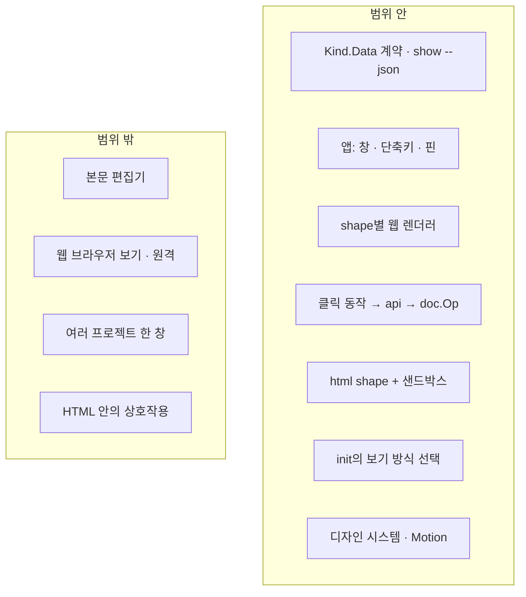

# 01. 제품 개요

> 상태: Draft · 2026-10-28 · 양식: Google Design Doc의 *Context and Scope / Goals and Non-Goals*

## 1.1 한 문장 요약

앱은 **에이전트가 `.sticky/`에 쓰는 것을 화면 위에 떠 있는 창에서 제대로 그려 보여 주고, 사용자가 클릭 한 번으로 답하게 하는** stickypane의 두 번째 화면이다.

## 1.2 맥락

stickypane은 터미널 pane 하나에 board를 그린다. 이 방식은 ssh에서도 되고 설치할 것이 바이너리 하나뿐이라는 장점이 있지만, 터미널이 셀 단위로만 그릴 수 있다는 한계가 있다.

| 터미널에서 잃는 것 | 예 |
|---|---|
| Markdown의 일부만 그린다 | 표·각주·수식·이미지, 코드 하이라이트 (`internal/core/markdown`은 일부만 구현) |
| 다이어그램이 ASCII다 | Mermaid를 `mermaid-ascii`로 그린다 |
| 여러 에이전트의 움직임이 안 보인다 | 카드가 옮겨져도 다시 그려질 뿐, 어디서 어디로 갔는지 보이지 않는다 |
| 좁은 pane에서 board가 답답하다 | 담당자·경과 시간·정체 표시가 한 줄에 겹친다 |
| HTML을 보여 줄 수 없다 | 에이전트가 만든 리포트나 차트 HTML |

한편 코드는 이미 화면과 분리되어 있다. 각 shape의 `model.go`, `ops.go`, `format.go`, `events.go`, `kind.go`는 lipgloss·bubbletea를 import하지 않고, 터미널에 묶인 것은 `view.go`뿐이다. 쓰기는 모두 `doc.Op` → `store.Apply`를 거치고, CLI·MCP는 `internal/usecase/api`로 화면 없이 노트를 바꾼다. 따라서 **화면을 하나 더 다는 데 필요한 것은 구조를 내보내는 계약 하나와 새 렌더러**다.

## 1.3 원칙과의 관계

앱은 [`VISION.md`](../../VISION.md)의 원칙을 하나도 바꾸지 않는다. 각 원칙을 어떻게 지키는지 적는다.

| VISION | 앱에서 |
|---|---|
| 1. The folder is the product | 앱은 폴더를 읽고 쓸 뿐 자기 상태를 갖지 않는다. 창 위치·핀 상태 같은 창 상태만 앱 설정에 둔다 |
| 2. The agent needs nothing new | 에이전트는 앱이 있는지 모른다. HTML 노트도 "`.html` 파일을 쓴다"가 전부다 |
| 3. The user acts on the board, and the agent sees it | 앱에서의 클릭은 터미널의 키와 같은 `doc.Op`가 된다 ([ADR-0001](adr/0001-second-screen-of-the-same-folder.md)) |
| 4. Nothing to configure | 보기 방식은 `stickypane init`이 묻고 board가 `sticky.json`에 쓴다 ([ADR-0004](adr/0004-view-mode-in-sticky-json.md)) |
| 5. Any terminal, any agent | 터미널 pane은 그대로 기본이다. 앱은 고르는 사람에게만 더해진다 ([ADR-0010](adr/0010-terminal-stays-primary.md)) |
| 6. The screen is calm | 디자인과 Motion의 첫 원칙이다 ([03](03-design-system.md), [04](04-motion.md)) |

앱만의 원칙을 셋 더한다.

| # | 원칙 | 뜻 |
|---|---|---|
| O1 | **두 번째 화면** | 앱이 할 수 있는 일은 터미널도 할 수 있다. 터미널이 못 하는 것은 *그리기*뿐이다 |
| O2 | **보는 창** | 앱은 작업하는 곳이 아니라 지켜보고 답하는 곳이다. 긴 편집은 `$EDITOR`로 넘긴다 |
| O3 | **변화가 보인다** | 무엇이 바뀌었는지가 한눈에 보여야 하고, 그 외에는 물러나 있다 |

## 1.4 목표

| # | 목표 | 근거 |
|---|---|---|
| G1 | 모든 shape를 앱에서 그린다. 같은 노트는 두 화면에서 같은 내용이다 | R-04 |
| G2 | Markdown을 완전하게 그린다: GFM 표·작업 목록·각주, 코드 하이라이트, Mermaid, 수식 | R-05 |
| G3 | 클릭 한 번으로 끝나는 동작을 앱에서 한다: 체크, 카드 이동, form 답하기, 스크립트 실행 | R-09 |
| G4 | 여러 에이전트가 한 board를 쓸 때 누가 무엇을 하는지, 무엇이 막혔는지 한눈에 보인다 | R-15 |
| G5 | `.html` 노트를 격리된 채로 보여 준다 | R-12, R-13 |
| G6 | 보기 방식(터미널 / overlay / 둘 다)을 프로젝트마다 `init`에서 고른다 | R-06, R-14 |
| G7 | 전역 단축키로 부르고 숨기며, 핀으로 고정할 수 있다 | R-08, R-10 |

## 1.5 비목표

| # | 비목표 | 이유 |
|---|---|---|
| N1 | 앱에서 노트 본문을 편집하는 에디터 | O2. `$EDITOR`가 더 낫다 |
| N2 | 터미널을 대체하는 것 | ADR-0010 |
| N3 | 여러 프로젝트를 한 창에서 전환하는 것 | 창은 프로젝트당 하나 (R-15) |
| N4 | 원격 접속·공유 보기 | 혼자 쓰는 도구다 (R-14). 네트워크 listener를 열지 않는다 |
| N5 | 웹 브라우저에서 여는 보기 | R-07: "웹으로 보고 싶은 게 아니라" |

## 1.6 반목표

기술적으로 동작해도 이렇게 되면 실패다.

| # | 반목표 |
|---|---|
| X1 | 앱에서만 되는 동작이 생겨 에이전트나 터미널이 그 결과를 모른다 |
| X2 | 앱이 파일을 직접 쓰거나 `sticky.json`·노트 외의 자기 저장소를 갖는다 |
| X3 | HTML 노트가 파일 시스템·Go 바인딩·외부 네트워크에 닿는다 |
| X4 | 늘 깜빡이거나 움직이는 요소가 있어 곁눈으로 거슬린다 |
| X5 | 앱 때문에 `stickypane` 본체의 의존성이나 바이너리 크기가 늘어난다 |

## 1.7 사용 장면

### 장면 A — 세 에이전트가 한 board에서 일한다

1. 사용자가 `claude-1`, `codex-1`, `codex-2`를 띄우고 앱을 핀으로 화면 오른쪽 위에 고정한다.
2. 상단 Glance 줄에 세 에이전트가 색 점·지금 카드·경과 시간으로 보인다.
3. `codex-1`이 `stickypane card work move payments --to Review`를 실행하면 카드가 Doing에서 Review로 미끄러져 가고 1.5초 동안 은은하게 빛난다.
4. 30분째 움직이지 않은 `schema migration` 카드가 한 번 흔들리고 경고색 테두리를 얻는다. Glance 줄의 `codex-2` 칩도 경고색이 된다.
5. 사용자는 `codex-2` 칩을 눌러 그 에이전트의 카드만 남기고 확인한다.

### 장면 B — 에이전트가 묻고 사용자가 답한다

1. 에이전트가 form 노트 "0.2.0은 어떻게 내보낼까요?"를 만든다.
2. 핀을 꺼 둔 상태라면 사용자가 `⌥ Space`로 앱을 부른다. form에 "답 대기" 배지가 있다.
3. 선택지를 누르고 "답하기"를 누른다. 클릭은 `api`를 거쳐 `doc.Op`가 되고 파일에 기록된다.
4. `stickypane wait`로 기다리던 에이전트가 답을 읽는다. 터미널 board에서도 같은 답이 보인다.

### 장면 C — 에이전트가 리포트를 HTML로 남긴다

1. 에이전트가 `.sticky/03-기록/bench.html`에 차트가 들어간 리포트를 쓴다.
2. 앱은 이를 샌드박스 iframe에서 그린다. 스크립트는 그 안에서만 돌고 외부 네트워크는 막혀 있다.
3. 터미널 board에서는 태그를 걷어낸 텍스트와 "앱에서 열면 그려진 모습을 볼 수 있습니다" 안내가 보인다.

## 1.8 범위 지도

