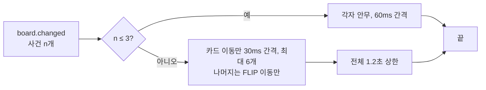

# 04. Motion

> 상태: Draft · 2026-10-28 · 관련 요구: R-16, R-17
>
> 참고: Material 3 *Motion*(지속 시간·easing 토큰), Apple HIG *Motion*(동작 줄이기), Paul Lewis의 FLIP 기법, Excalidraw의 선 그리기 애니메이션, 목업 `overlay-doodle-v3-themes.html`.

## 4.1 원칙

| # | 원칙 | 뜻 |
|---|---|---|
| M1 | **움직임은 변화를 설명할 때만** | 무엇이, 어디서, 어디로 바뀌었는지를 알려 주는 움직임만 쓴다. 장식용 움직임은 없다 |
| M2 | **종이의 물리** | 메모지는 들어 올려지고, 옮겨지고, 탁 붙는다. 선은 펜으로 긋듯 그려진다 |
| M3 | **한 번만** | 상태가 *바뀌는 순간* 한 번 움직이고 멈춘다. 계속 깜빡이거나 숨 쉬는 요소는 없다(반목표 X4) |
| M4 | **사용자의 손이 먼저** | 사용자가 누른 것은 즉시 반응한다. 파일 결과는 뒤에서 맞춘다 |
| M5 | **많으면 줄인다** | 한꺼번에 많이 바뀌면 묶고 줄인다. 화면이 춤추지 않는다 |

## 4.2 토큰

| 토큰 | 값 | 쓰임 |
|---|---|---|
| `--t-short` | 120ms | 호버, 닫기, 선택 표시 |
| `--t-base` | 200ms | 대부분의 상태 변화, 열기, 다른 카드가 밀려나기 |
| `--t-long` | 320ms | 진행 막대, 새 노트 |
| `--t-carry` | 620ms | 카드 들어 옮기기(한 동작 전체) |
| `--ease` | `cubic-bezier(.2,.8,.2,1)` | 표준 감속 |
| `--slap` | `cubic-bezier(.34,1.56,.64,1)` | 붙는 순간의 살짝 넘침 |
| `--exit` | `cubic-bezier(.4,0,1,1)` | 사라짐(가속) |

## 4.3 사건별 안무

사건 이름은 bridge가 보내는 `Kind.Events`의 이름이다([02 §2.4.3](02-system-architecture.md#243-stickypane-bridge-프로토콜)).

| 사건 | 움직임 | 시간 |
|---|---|---|
| `card.moved` (에이전트) | **들어 올림**(scale 1.07, +3° 기울기, 그림자) → 새 자리로 **옮김** → **탁 붙음**(scale .97 → 1, 새 기울기). 이어서 담당자 색 하이라이트가 사라짐. 다른 카드는 FLIP으로 밀려남 | 620ms + 1.5s |
| `card.added` | 위에서 떨어져 붙음(−26px, scale 1.06, +4° → 제자리, `--slap`) | 380ms |
| 카드가 정체로 바뀜 | 한 번 흔들림(−2.5° → +2° → −1° → 0), 경고색 동그라미가 펜으로 그려짐 | 520ms |
| `item.ticked` | 체크가 펜으로 그어짐 → 60ms 뒤 취소선이 그어짐 → 요약 숫자 바뀜 | 240 + 260ms |
| `item.unticked` | 체크와 취소선이 옅어지며 사라짐 | 120ms |
| `item.added` | 아래로 펼쳐지며 fade | 200ms |
| form 제출 | 버튼이 눌렸다 돌아오고, 배지가 "답 대기" → "답했어요 ✓"로 바뀜 | 200ms |
| 새 노트("+ 새 노트" 또는 에이전트) | 떨어져 붙음(노트 크기), 테이프가 마지막에 붙음 | 380ms |
| 노트 내용 변경(그 외) | 노트 제목 옆에 손으로 그린 점(●)이 그려짐. 터미널의 "갱신 표시"와 같은 뜻. 노트 둘레가 한 번 은은하게 빛났다가 가라앉는다 | 200ms, 빛 1.5s |
| `log.appended` | 새 줄이 아래에서 밀려 올라오며 나타남(줄마다 40ms 간격) | 200ms |
| 카드·노트가 사라짐(`card.removed`, `note.removed`) | 사라지기 전 모습의 사본이 제자리에서 기울며 옅어지고, 남은 것들은 FLIP으로 자리를 메운다 | 200ms |
| 노트 삭제 | 살짝 기울며 옅어짐(떼어 냄) | 200ms |
| 크게 보기 열기 / 닫기 | 노트가 제자리에서 창 크기로 커진다(FLIP, scale 대신 실제 크기로) / 원래 자리로 줄어든다 | 320ms `--ease` / 200ms |
| 책 페이지 넘기기 | 메모지 한 장이 옆으로 넘겨지고(살짝 기울며 x 이동) 다음 장이 드러난다 | 240ms |
| 노트 크기 바꾸기 | 그리드가 FLIP으로 재배치된다 | 200ms |
| 탭 바꾸기 | 밑줄이 다음 탭으로 그어짐, 본문 교차 fade | 200ms |
| 앱 열기 | 위에서 10px, −0.6°, scale .98 → 제자리 | 200ms `--slap` |
| 앱 닫기 | 위로 8px, scale .98, fade | 120ms `--exit` |
| 핀 켜기 | 핀 버튼이 꾹 눌림(빗금 채움) | 120ms |

단정 스타일에서는 기울기·흔들림·펜 긋기를 빼고, 같은 시간에 이동·fade만 남긴다.

## 4.3.1 시작 인트로 — "꾸물꾸물"

[사용자 결정] 앱이 켜질 때 한 번, 메모지들이 꾸물꾸물 움직이며 자리를 잡는다(R-37). 앱에만 있고 터미널에는 없다.

| 순서 | 움직임 | 시간 |
|---|---|---|
| 1 | 홈·보드 창 가운데에 아이콘의 세 장(파랑 → 빨강 → 노랑)이 차례로 떨어져 붙으며 꾸물댄다: 각 장이 −3° ↔ +2° 두 번 흔들리고, 손그림 외곽선이 seed를 바꿔 2–3번 다시 그려진다(Excalidraw의 "boiling line") | 0–450ms |
| 2 | 세 장이 창 왼쪽 위 로고 자리로 줄어들며 날아간다 | 450–650ms |
| 3 | 보드의 노트들이 위에서부터 30ms 간격으로 한 번씩 꿈틀(±1.5°, scale 0.98→1)하며 나타난다. 최대 8장까지, 나머지는 fade | 650–900ms |

- 그날 처음 뜨는 창에서 **한 번만**(이 컴퓨터에 마지막으로 재생한 날을 기억한다). 그날의 다른 창, 창을 숨겼다 다시 부를 때(⌥ Space)는 3번(노트 꿈틀)만 짧게(250ms).
- 클릭하거나 키를 누르면 바로 끝 상태로 건너뛴다.
- 반복하지 않는다(M3). 동작 줄이기면 인트로 없이 바로 끝 상태(opacity만 120ms). 움직임을 끄면 아무것도 없다.
- 단정 스타일에서는 흔들림과 선 다시 그리기를 빼고 떨어짐과 fade만 남긴다.

## 4.4 묶음 재생

에이전트 여럿이 동시에 쓰면 bridge 알림 하나에 사건이 여러 개 들어온다.

- 진행 중인 안무가 있는데 새 알림이 오면, 진행 중인 것은 끝 상태로 건너뛰고 새 것을 시작한다(쌓이지 않는다).
- 창이 숨겨져 있는 동안 온 사건은 재생하지 않는다. 다시 열면 바뀐 노트에 ● 표시만 남는다.

## 4.5 사용자의 행동

- 클릭하면 **즉시** 그 상태로 그린다(optimistic). bridge가 `ok`를 주면 그대로, `error`(버전 불일치)를 주면 최신 상태로 200ms 동안 되돌린다.
- 사용자가 끈 카드를 다른 열에 놓으면 그 자리에 탁 붙고(`--slap` 200ms), 에이전트용 하이라이트는 켜지 않는다. 자기 행동은 이미 보고 있기 때문이다.

## 4.6 동작 줄이기

`prefers-reduced-motion: reduce`(OS 설정)이거나 앱 설정의 "움직임"을 "줄이기"로 하면:

- 이동·흔들림·떨어짐·펜 긋기를 모두 **opacity 변화(180ms)**로 바꾼다.
- 하이라이트는 빛나는 대신 2초 동안 굵은 외곽선으로 남는다.
- 창 열기·닫기도 fade만.

"움직임"을 "끄기"로 하면 아무것도 움직이지 않는다: 바뀐 결과만 그려지고 ● 표시가 남는다. 이 설정은 이 컴퓨터의 것(`~/.stickypane/overlay.json`의 `motion`: `""` · `"reduce"` · `"off"`)이다.

## 4.7 구현 메모

- 카드 이동은 FLIP: 바뀌기 전 위치를 재고 → DOM을 바꾸고 → 차이만큼 `transform`으로 되돌린 뒤 0으로 애니메이션. Svelte의 `animate:flip`이 기본 이동을, Web Animations API가 들어 올림 키프레임을 맡는다.
- 펜 긋기는 rough.js가 만든 SVG path의 `stroke-dashoffset` 애니메이션.
- 애니메이션은 `transform`·`opacity`·`stroke-dashoffset`만 쓴다(레이아웃을 다시 계산하지 않음).
- 손그림 선은 노트·카드 id에서 나온 seed로 그려 다시 그려도 모양이 같다. 크기가 바뀔 때만 다시 그린다.
- 코드는 `desktop/frontend/src/lib/motion/`에 있다. `plan.ts`(순수: 이전 보드·다음 보드·`board.changed`로 무엇이 어떻게 언제 움직이는지, §4.4의 묶음 규칙 포함), `keyframes.ts`(순수: 움직임별 키프레임, 단정·줄이기·끄기), `play.ts`(DOM: 바뀌기 전에 재고, 그려진 뒤 `data-frame`·`data-card`·`data-item`·`data-pen`·`.line`으로 찾아 움직임), `director.ts`(보드 창이 `board.changed`를 받을 때 순서대로 부름), `intro.ts`·`stage.ts`·`Intro.svelte`(시작 인트로). 컴포넌트는 이 함수들을 부르기만 한다.
- 개발 페이지 `?demo=motion&scene=<move|add|tick|log|stall|glow|note|remove|many|all>&intro=<full|short|fade>&motion=<reduce|off>&style=neat`에서 사건마다 재생해 볼 수 있다.
