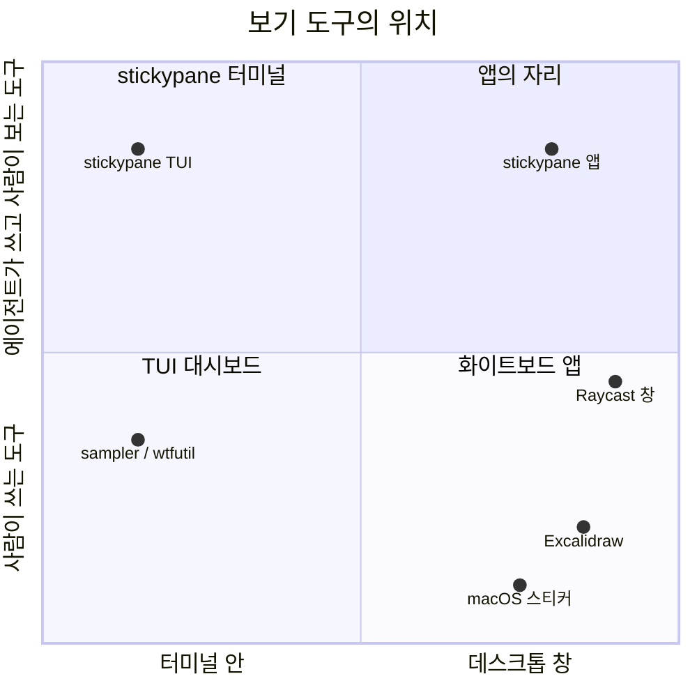

# 05. 대안 검토

> 상태: Draft · 2026-10-28 · 양식: Google Design Doc의 *Alternatives Considered*

## 5.1 지형도

[미검증] 위치는 설계자의 주관이다.

## 5.2 검토한 대안

### A1. 화면을 어디에 띄우나

| 대안 | 장점 | 단점 | 판정 |
|---|---|---|---|
| 터미널만 (현행) | 설치 하나, ssh | 렌더링 한계(01 §1.2) | 기본으로 유지 |
| localhost 웹 페이지 | 구현 쉬움 | 사용자가 원하지 않음(R-07), 서버가 필요해 VISION 4와 충돌, 다른 로컬 프로세스의 접근 면 | **기각** |
| VS Code 확장 패널 | 에디터 옆 | 에디터 하나에 묶임(VISION 5), overlay가 아님 | 기각, 나중에 같은 bridge로 가능 |
| **전용 데스크톱 앱 창** | 어떤 앱 위에도 뜸, webview로 무엇이든 그림 | 설치 하나 더 | **채택** ([ADR-0001](adr/0001-second-screen-of-the-same-folder.md)) |

### A2. 앱 셸

| 대안 | 언어 | 서버 | 크기 | 판정 |
|---|---|---|---|---|
| Electron | JS | 없음 | 크다(Chromium 번들) | 기각 |
| Tauri | Rust + JS | 없음 | 작다(시스템 webview) | 차선. Rust가 레포에 들어온다 |
| **Wails** | Go + JS | 없음 | 작다(시스템 webview) | **채택**. 레포 언어 그대로 ([ADR-0003](adr/0003-wails-app-shell.md)) |
| 네이티브(SwiftUI 등) | Swift 등 | 없음 | 작다 | 기각. Markdown·Mermaid를 다시 만들어야 한다 |

bridge를 stdio로 두었기 때문에([ADR-0002](adr/0002-bridge-over-stdio.md)) 셸은 나중에 바꿔도 본체가 바뀌지 않는다.

### A3. 본체와 앱을 어떻게 잇나

| 대안 | 판정 |
|---|---|
| 앱이 `internal/*`를 직접 import | 불가. Go의 `internal` 규칙상 다른 모듈은 import할 수 없다. 같은 모듈에 두면 Wails가 본체 `go.mod`에 들어간다(반목표 X5) |
| 기존 MCP 서버 재사용 | 도구가 에이전트용 텍스트다. 구조화된 `Data`와 변화 알림이 없다 |
| HTTP/WebSocket 서버 | listener를 연다. VISION 4·N4와 충돌 |
| **`stickypane bridge` stdio JSON** | **채택**. 자식 프로세스라 접근 면이 없고, 본체가 진실의 원천으로 남는다 |

### A4. 앱에서 할 수 있는 일

| 대안 | 판정 |
|---|---|
| 보기 전용 | 기각. VISION 3의 루프에서 빠져 터미널로 돌아가야 한다 |
| 터미널의 모든 키 동작 | 기각. 앱이 "작은 터미널"이 된다(O2) |
| **클릭 한 번 동작 + 생성(카탈로그), 긴 편집은 `$EDITOR`** | **채택** (빠른 끄적이기는 R-36으로 뺐다) |

### A5. HTML 노트의 상호작용

| 대안 | 판정 |
|---|---|
| HTML 안의 버튼·폼이 파일에 쓴다 | 기각. 에이전트가 쓴 스크립트에 쓰기 권한을 주게 된다. 형식이 shape마다 달라진다 |
| **HTML은 보기 전용, 상호작용은 form** | **채택**([사용자 결정] R-11, [ADR-0006](adr/0006-html-notes-view-only.md)) |

### A6. 보기 방식 설정 위치

| 대안 | 판정 |
|---|---|
| 사용자 전역 설정(`~/.config`) | 기각. 프로젝트마다 다르게 하고 싶다(R-12) |
| 환경 변수 | 기각. VISION 4 |
| **`sticky.json` 루트 키** | **채택**. 혼자 쓰므로 커밋되어도 문제없다(R-13) |

### A7. 디자인 방향

| 대안 | 판정 |
|---|---|
| 깔끔한 대시보드(목업 v1) | **단정 스타일로 남김**. 손글씨가 불편한 사람을 위해 |
| **손그림 doodle(목업 v2·v3)** | **기본 스타일로 채택**. "붙여서 간단히 쓸 수 있다"가 핵심이고(R-20), 아이콘과 같은 문법이다(R-22) |

### A8. 프런트엔드 렌더러

| 영역 | 채택 | 검토한 대안 | 이유 |
|---|---|---|---|
| UI 프레임워크 | Svelte 5 | React + Motion, Vue, 바닐라 | 번들이 작고, `animate:flip`·transition이 내장. React+Motion은 좋은 차선 |
| Markdown | unified(remark-parse, remark-gfm, remark-math, remark-rehype, rehype-sanitize) | markdown-it, marked | AST 단계에서 sanitize·플러그인 조합이 쉽다 |
| 코드 하이라이트 | Shiki | highlight.js, Prism | VS Code 문법(TextMate)과 테마를 그대로 쓴다 |
| 다이어그램 | Mermaid | — | 노트가 이미 Mermaid를 쓴다 |
| 수식 | KaTeX | MathJax | 빠르고 작다 |
| 손그림 | rough.js | 직접 구현 | Excalidraw가 쓰는 검증된 라이브러리 |

모든 라이선스는 MIT 계열이라고 알고 있으나 버전을 고를 때 확인한다 [미검증].

### A9. 글꼴

| 역할 | 채택 | 검토한 대안 |
|---|---|---|
| 손글씨 | Gaegu | Nanum Pen Script(획이 가늘어 작은 크기에서 약함), Excalifont(한글 없음), Hi Melody |
| 본문 | Pretendard | IBM Plex Sans KR, Noto Sans KR(파일이 크다), 시스템 글꼴(OS마다 다름) |
| 고정폭 | JetBrains Mono | D2Coding(라틴이 오래됨), Sarasa Mono K(파일이 크다) |

## 출처

- [Wails](https://wails.io/), [Tauri](https://tauri.app/), [Electron](https://www.electronjs.org/)
- [rough.js](https://roughjs.com/), [Excalidraw](https://excalidraw.com/), [Excalifont](https://plus.excalidraw.com/excalifont)
- [unified](https://unifiedjs.com/), [Shiki](https://shiki.style/), [Mermaid](https://mermaid.js.org/), [KaTeX](https://katex.org/)
- [Gaegu (Fontsource)](https://fontsource.org/fonts/gaegu/about), [Pretendard](https://github.com/orioncactus/pretendard), [JetBrains Mono](https://www.jetbrains.com/lp/mono/)
