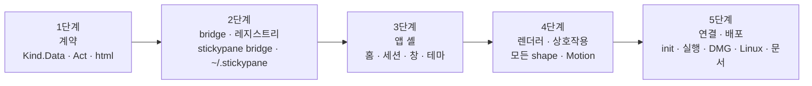

# 06. 로드맵과 검증

> 상태: 1–5단계 구현됨, 미출시 · 2026-10-29 · 양식: 기술 리포트의 *Evaluation* 절

## 6.1 단계 개요

각 단계는 그것만으로 쓸모가 있어야 하고, 본체의 검증 명령을 통과해야 한다.

## 6.2 단계별 범위와 완료 조건

### 1단계 — 계약 (본체만)

- `widget.Action`, `Kind.Data`, `Kind.Act` 추가.
- 9개 shape 모두 `Data`, 상호작용 shape(checklist, board, form, chat, script, api)는 `Act`.
- 새 shape `html`(`internal/core/widget/html/` 6파일 + `internal/core/kinds` 한 줄). 터미널에서는 태그를 걷은 텍스트.
- `api.Apply(name, version, action)`: 버전 확인 → `Act` → `Tend` → `store.Apply`.

**완료 조건**: 각 shape의 `Data`가 예제 노트(`Kind.Example`)에서 golden JSON과 같다. `Act`로 만든 Op를 적용한 파일이 같은 키를 TUI에서 누른 결과와 같다. 버전이 다르면 거절한다.

### 2단계 — bridge와 레지스트리 (본체만)

- 스크립트 실행을 `internal/surface/app`에서 낮은 레이어로 내린다.
- `internal/adapter/registry`: `~/.stickypane/events/YYYY-MM-DD.jsonl` 덧붙이기, `run/<pid>.json` 만들고 지우기, `STICKYPANE_HOME`. 명령 표에서 프로젝트를 다루는 명령이 부른다([08 §8.4](08-app-home-and-sessions.md#84-레지스트리--sticky)).
- `internal/surface/bridge`(layer 50)와 `stickypane bridge` 명령.
- `sticky.json` 루트 키 `view`, `style`. `stickypane init`은 아직 묻지 않는다.

**완료 조건**: 레지스트리 쓰기가 실패해도 명령이 성공한다(읽기 전용 HOME으로 테스트). 동시에 여러 프로세스가 덧붙여도 줄이 섞이지 않는다. 테스트가 bridge를 파이프로 띄워 `board.load` → 다른 프로세스가 `stickypane card … move` → `board.changed`에 `card.moved`가 오는지 확인한다. `note.act`가 파일을 바꾸고 `stickypane watch`도 같은 사건을 본다.

### 3단계 — 앱 셸 (`desktop/` 모듈)

- Wails v3 프로젝트, **홈 창**(세션 목록과 빈 상태 [08 §8.2–8.3](08-app-home-and-sessions.md#82-첫-실행--설명-없이-바로-목록)), 트레이, SQLite 색인(사라진 것 정리, 날짜별 묶음), 프로젝트별 프레임 없는 창, 전역 단축키(기본 `⌥ Space`), 핀(always-on-top), 포커스를 잃으면 숨김(핀 꺼짐일 때), 프로젝트당 창 하나, 단일 인스턴스.
- bridge 자식 프로세스 수명 관리, 프로토콜 버전 확인.
- 디자인 토큰, 글꼴 번들, 색 테마 10개, 스타일 테마 2개, 아이콘.
- 렌더러: note(Markdown 전부), checklist, board — 보기만.

**완료 조건**: 홈에 이 Mac의 stickypane 프로젝트가 활동 날짜별로 보이고, 폴더를 지운 프로젝트는 다음 실행 때 자동으로 빠진다. 실제 프로젝트에서 앱을 띄워 에이전트가 쓴 변경이 1초 안에 보인다. 테마를 바꾸면 터미널도 바뀐다.

### 4단계 — 렌더러와 상호작용

- 나머지 shape 렌더러(form, chart, logview, script, chat, api, html 샌드박스).
- 클릭 동작(체크, 카드 드래그, form 답, 실행), "+ 새 노트"(카탈로그), `$EDITOR`로 열기.
- Motion 전체([04](04-motion.md)), 동작 줄이기.

**완료 조건**: [01 §1.7](01-product-overview.md#17-사용-장면)의 장면 A·B·C를 손으로 재현한다. HTML 격리 검사(아래)를 통과한다.

[구현] 장면 A·B·C는 창 없이 닿는 데까지 자동으로 본다. `desktop/internal/bridgeclient/scenes_test.go`가 이 저장소의 `stickypane`을 빌드해 임시 프로젝트(임시 `HOME`·`STICKYPANE_HOME`)에서 bridge로 띄우고, 다른 프로세스에서 에이전트처럼 `card … move`, `write --type form` + `wait --json`, `.html` 파일 쓰기를 하며, 앱 쪽이 받는 `board.changed`·`board.load`·`note.act` 결과를 확인한다. `-update`로 받은 것을 `frontend/src/scenes/fixtures/`에 쓰고, `frontend/src/scenes/scenes.test.ts`가 그것으로 Glance 줄의 멈춤, 카드 carry, form의 답 대기와 보낸 동작, html 샌드박스를 본다. 창에서 손으로 하는 확인은 [09 §9.6](09-distribution.md#96-검증)의 점검표에 있다.

### 5단계 — 연결과 배포

- `stickypane init --view/--style`, 사람이 터미널에서 직접 실행할 때만 묻는다(ADR-0004).
- `stickypane`(인자 없음)이 `view`에 따라 앱을 연다([02 §2.5.3](02-system-architecture.md#253-보기-방식에-따라-띄우기)).
- 손그림 DMG([09](09-distribution.md)), Linux tar.gz, goreleaser·Homebrew cask, `THIRD_PARTY_NOTICES.md`(글꼴·npm), README·README.ko·에이전트 가이드에 HTML 노트 한 줄, `ROADMAP.md` 목표 문장.

**완료 조건**: 이 Mac에서 DMG를 마운트하면 손그림 설치 화면이 보이고, 앱을 Applications로 옮겨 열면 세션 목록(또는 빈 상태)이 뜬다. `stickypane init`에서 앱을 고르면 `stickypane`으로 창이 뜬다. Linux 산출물은 CI에서 빌드된다.

## 6.3 검증 게이트 (모든 단계 공통)

| 게이트 | 명령·방법 |
|---|---|
| 본체 | `go vet ./... && go test -race ./... && test -z "$(gofmt -l .)"` |
| 레이어 | `internal/layers` 테스트(새 패키지 `bridge`, `widget/html`에 rank) |
| 라이선스 | 본체 `sh scripts/licenses.sh`. 앱은 Go 모듈과 npm 의존성을 같은 허용 목록으로 검사하는 스크립트 추가 |
| 프런트엔드 | 타입 검사, 단위 테스트(Data → DOM), 테마 10개 × 스타일 2개 스냅샷 |
| 크기 조절 | `node desktop/scripts/e2e-resize.mjs webkit`: dev 화면에서 그리드 가장자리와 캔버스 손잡이를 진짜 마우스 이벤트로 끈다(WebKit, CI macOS 작업). jsdom에는 레이아웃과 포인터가 없다 (#66) |
| 대비 | 테마마다 본문·카드 글자 대비 4.5:1 자동 검사 |
| 문서 | 에이전트 가이드 55줄 이하, 스킬 테스트 통과 |

### HTML 격리 검사 (반목표 X3 자동화)

악의적인 `.html` 노트 묶음을 테스트 자료로 둔다: `fetch`·`img src=https://`·`window.parent`·`top.location`·Wails 바인딩 호출·`localStorage`. 각각이 막히는지 webview에서 확인한다.

[구현] 묶음은 `frontend/src/demo/probe.ts` 한 페이지다(이미지·스타일시트·@import·배경·스크립트·프레임·object·refresh·form, 그리고 페이지 자신의 스크립트로 fetch·parent·top.location·바인딩·localStorage). `node desktop/scripts/html-isolation.mjs`가 dev 서버와 요청을 세는 서버를 띄워 headless Chromium에서 이 노트를 열고, 서버에 요청이 하나도 오지 않았는지, 페이지 스크립트가 돌지 않았는지, 창의 제목·주소·저장소가 그대로인지 본다(Playwright는 앱 의존성이 아니라 전역 설치를 쓴다). 창과 프레임의 정책을 함께 풀면 실패하는 것을 확인했다. WebKit 실기 확인은 09 §9.6 점검표에 있다.

## 6.4 측정하지 않은 것

- Linux에서 Wails 창의 always-on-top, 전역 단축키(특히 Wayland), 트레이 동작 [미검증]. Windows는 범위 밖([ADR-0014](adr/0014-macos-and-linux-only.md)).
- 노트 수백 개일 때 bridge의 `board.load` 시간과 webview 렌더 시간 [미검증].
- Mermaid의 손그림 look 지원 여부와 품질 [미검증].
