# 07. 요구사항·결정 기록

> 상태: 살아 있는 문서 · 2026-10-28 시작 · 양식: Requirements Traceability Matrix
>
> 사용자가 말한 요구를 **시간순 원문**으로 남기고, 그 요구가 어떤 결정으로 이어졌는지 추적한다. 원문은 의미가 바뀌지 않는 범위에서 오타만 고쳤다.

## 7.1 요구의 흐름

```mermaid
flowchart TD
  R02["R-02 터미널에만 갇혀야 하나"] --> R03["R-03 tauri 같은 것"]
  R03 --> R04["R-04 같은 유스케이스 + 시각화 레이어"]
  R04 --> D_DATA["Kind.Data · Act · bridge"]
  R05["R-05 overlay · 최고의 JS 모듈 · Markdown"] --> D_FE["webview 렌더러"]
  R06["R-06 init에서 보기 방식 선택"] --> D_VIEW["sticky.json view"]
  R07["R-07 웹 말고 overlay 커스텀 앱"] --> D_APP["Wails 앱"]
  R10["R-10/11 HTML 보기 · 상호작용은 form"] --> D_HTML["html shape · 샌드박스"]
  R12["R-12/13 프로젝트마다 · 혼자 씀"] --> D_VIEW
  R14["R-14 여러 에이전트 칸반"] --> D_GLANCE["Glance 줄 · 정체 표시"]
  R15["R-15 디자인 패턴 · Motion"] --> D_DS["03 · 04"]
  R20["R-20 doodle · 붙여서 간단히"] --> D_DOODLE["손그림 스타일 · 끄적이기"]
  R21["R-21/23 테마 선택"] --> D_THEME["색 × 스타일 두 축"]
  R22["R-22 아이콘"] --> D_DOODLE
  R18["R-18/23 오픈소스 글꼴"] --> D_FONT["Gaegu · Pretendard · JetBrains Mono"]
  R25["R-25 이슈 · 앱까지 진행"] --> D_ROAD["06 로드맵"]
  R26["R-26 기본 시작 · 랜딩"] --> R32["R-32 랜딩 설명 없음"]
  R32 --> D_HOME["08 홈 · 세션 목록"]
  R27["R-27 활성 세션 보기"] --> D_HOME
  R28["R-28 ~/.stickypane · SQLite"] --> D_REG["ADR-0013 레지스트리"]
  R29["R-29 삭제 자동 정리 · 날짜별 기록"] --> D_REG
  R30["R-30 macOS · Linux만"] --> D_PLAT["ADR-0014"]
  R31["R-31 doodle DMG"] --> D_DMG["09 · ADR-0016"]
```

## 7.2 요구 목록

| ID | 사용자 원문 (요지) | 해석 | 상태 | 반영 위치 |
|---|---|---|---|---|
| R-01 | "여기에 heymoa 플러그인 쓰지마" | 작업 방식 제약 | **반영** (프로젝트 로컬 설정, 작업자 메모리) | — |
| R-02 | "stickypane이 꼭 터미널에만 갇혀있어야할까?" | 다른 화면의 가능성 | 검토 → R-03 | 01 §1.2 |
| R-03 | "적당히 tauri 같은 노트를 추가해볼까?" | 데스크톱 앱 | **반영** (셸은 Wails) | [ADR-0003](adr/0003-wails-app-shell.md) |
| R-04 | "같은 usecase를 유지하면서 시각화 레이어를 추가가능해?" | 폴더·Op 유지, 화면만 추가 | **반영** | [ADR-0001](adr/0001-second-screen-of-the-same-folder.md), [ADR-0005](adr/0005-kind-data-and-act.md) |
| R-05 | "overlay 웹 뷰같은걸 추가해서 시각화 영역을 제대로… 렌더링도 최대한 best js의 모듈 활용하고 마크다운 시각화도 제대로" | webview + JS 렌더러 | **반영** | [ADR-0012](adr/0012-frontend-stack.md), 01 G2 |
| R-06 | "설정으로 어떻게 시각화할건지 선택(init 시)" | init에서 보기 방식 선택 | **반영** | [ADR-0004](adr/0004-view-mode-in-sticky-json.md) |
| R-07 | "웹으로 보고 싶은게 아니라 overlay가 되는 커스텀 앱에서 보여지는 느낌" | 브라우저가 아닌 전용 창 | **반영** | 01 N5, 05 A1 |
| R-08 | "내가 생각한 요구사항 만족해?" / "뭐가 UX에 좋을까?" | 조작 범위를 설계자에게 맡김 | [설계자 판단] 클릭 한 번 동작 + `$EDITOR` | 05 A4 |
| R-09 | "잘 모르겠군" (단축키 토글 vs 핀) | 설계자에게 맡김 | [설계자 판단] 둘 다, 기본은 단축키 토글 | [ADR-0007](adr/0007-hotkey-toggle-and-pin.md) |
| R-10 | "데스크탑 뷰를 추가한다면 html도 읽고 처리가능하게 할 수 있나?" | HTML 노트 | **반영** | [ADR-0006](adr/0006-html-notes-view-only.md) |
| R-11 | "마크다운 식으로 보여주는 용의 html 기능 하나를 더 추가, 그리고 버튼, 상호작용은 미리 form을 만들어놓고 생성하는 식으로" | HTML은 보기 전용, 상호작용은 form | **반영** | [ADR-0006](adr/0006-html-notes-view-only.md) |
| R-12 | "프로젝트 마다 다르게 해야하지 않을까?" | 보기 방식은 프로젝트별 | **반영** | [ADR-0004](adr/0004-view-mode-in-sticky-json.md) |
| R-13 | "보통 혼자 쓰지" | `sticky.json` 커밋돼도 무방 | **반영** | 05 A6 |
| R-14 | "동시에 여러 에이전트를 돌릴수 있도록 칸반을 커스텀하게 더 추가하기도 했지" | 한 board를 여러 에이전트가 씀 | **반영**: 프로젝트당 창 하나, Glance 줄 | 03 §3.6 |
| R-15 | "dashboard용 유려한 디자인 패턴과, Motion 설계해줘" | 디자인 시스템과 Motion | **반영** | [03](03-design-system.md), [04](04-motion.md) |
| R-16 | "일단은 설계 방향성부터 제대로 정하자" | 방향 먼저 | **반영** | 03 §3.1, 04 §4.1 |
| R-17 | "띄워서 한번 보여줘봐" | 목업 | 목업 v1~v3 | README |
| R-18 | "적절한 font도 찾아봐 활용가능한걸로" | 글꼴 | **반영** | 03 §3.5, [ADR-0011](adr/0011-bundled-open-fonts.md) |
| R-19 | "../keyharbor 처럼 핵심 결정사항이나 아키텍처 방향성 기술 문서들을 잘 정리해서 작성해놔" | 문서 세트 | **반영** | 이 문서 세트 |
| R-20 | "깔끔해서 좋긴한데… 약간 doodle 형식의 excalidraw 처럼 붙혀서 간단히 쓸수 있다가 포인트야" | 손그림 방향, 끄적이기가 핵심 | **반영** | 03 §3.1, 목업 v2 |
| R-21 | "UI가 맘에 들긴하거든? 근데 테마 선택가능하게 해야할듯" | 테마 선택 | **반영**: 색 테마 공유 | [ADR-0008](adr/0008-two-theme-axes.md) |
| R-22 | "우리 아이콘은 이걸로 가자!" (파랑·빨강·노랑 메모지 세 장, 크레용 빗금) | 아이콘과 그 문법 | **반영** | 03 §3.2 |
| R-23 | "우리가 오픈소스로 사용 가능한 폰트 ㄱㄱ 그리고 이런 테마는 선택가능한 테마로 둬야할듯" | OFL 글꼴, doodle은 고를 수 있는 스타일 | **반영** | [ADR-0008](adr/0008-two-theme-axes.md), [ADR-0011](adr/0011-bundled-open-fonts.md) |
| R-24 | "ㄱㄱㄱ" (기본 스타일 질문에) | 설계자에게 맡김 | [설계자 판단] 기본 스타일은 손그림 | 03 §3.3 |
| R-25 | "이제 이 이슈 파고 app 서비스 지원까지 한번 프로젝트 진행해보자!" | 이슈와 구현 | 진행 중 | [06](06-roadmap-and-verification.md) |
| R-26 | "이걸 구현하기 위한 goal을 설정해봐 마무리와 검증까지의 모든 파이프라인이 제대로 되고 각 문서들이 제대로 작성되는지까지! 그리고 앱은 기본 시작부터, 랜딩 페이지?(heymoa의 자산을 활용해서 어떻게 사용자에게 설명하면 좋을 지 분석)" | 실행 goal, 앱 첫 실행 랜딩 | goal은 **반영**, 랜딩은 R-32로 **대체** | goal 파일, [08 §8.2](08-app-home-and-sessions.md#82-첫-실행--앱-안의-랜딩), §8.7 |
| R-27 | "stickypane이 있는 활성 세션들을 볼수 있는 구조로 만들어봐" | 홈의 세션 목록 | **반영** | [08 §8.3](08-app-home-and-sessions.md#83-세션-목록--홈) |
| R-28 | "json으로 관리하기 힘들 수 있으니 sqlite 기반으로 변경할 안같은것도 고려해봐 난 home 폴더에 .sticky 같은 폴더 만들고 거기에 관리하는 느낌이 좋을 것 같네" | 홈의 레지스트리, SQLite | **반영**: `~/.stickypane/`(이름은 `.sticky` 충돌 때문에 [설계자 판단]), 사건 파일 + 앱의 SQLite 색인 | [ADR-0013](adr/0013-home-registry-events-and-sqlite.md) |
| R-29 | "중간에 삭제되거나하는 이슈는 전부 해결가능하게 해야해 (초기 불러올때 삭제된거 자동 제거, 날짜별로 기록 및 관리)" | 지워진 것 정리, 날짜별 기록 | **반영** | [08 §8.4.4](08-app-home-and-sessions.md#844-지워진-것-처리) |
| R-30 | "일단 리눅스 맥 지원으로 지원 영역 줄이고 여기서 테스트 해보자" | macOS·Linux, 이 Mac에서 확인 | **반영** | [ADR-0014](adr/0014-macos-and-linux-only.md) |
| R-32 | "아니다 초반 랜딩페이지 설명은 필요없을 듯" | 첫 실행 랜딩 없음 | **반영**: 홈은 처음부터 세션 목록, 비면 빈 상태 한 장. R-26의 랜딩 부분을 **대체** | [08 §8.2](08-app-home-and-sessions.md#82-첫-실행--설명-없이-바로-목록) |
| R-33 | "한글 / 영어 기능까지 추가해서 구현" | 앱 한국어·영어 | **반영**: 본체 `language` 키 공유, 앱 설정에서 전환 | [03 §3.9](03-design-system.md#39-언어) |
| R-34 | "노트 페이지네이션이나 크게/ 작게 보기도 하라지 않았나?" | 터미널의 크기·높이·확대·책 페이지를 앱에도 | **반영** (이 대화에서 앞서 요청된 기록은 없으나 터미널 기능과 맞춤) | [03 §3.7](03-design-system.md#37-노트-크기--크게-보기--페이지), 02 `note.view` |
| R-35 | "터미널에 있는 기능들을 보고 어떻게 설계해야할지 확인해" | 터미널 기능 대응 | **반영** | [10](10-terminal-parity.md) |
| R-36 | "끄적이기 빼고 생성으로 해" | 앱의 빠른 끄적이기를 없애고 카탈로그 생성으로 | **반영**: "+ 생성"(`A`). 터미널 `N`은 그대로 | 03 D1, [10 §10.3](10-terminal-parity.md#103-노트-만들기--관리) |
| R-37 | "stickypane 처음 켜질 때 약간 꾸물꾸물하는 애니메이션" → "그 느낌 맞아 앱에만 넣어줘" | 앱 시작 인트로 | **반영**: 앱에만 | [04 §4.3.1](04-motion.md#431-시작-인트로--꾸물꾸물) |
| R-38 | "좀 격자노트 같은 설계가 좋긴해 다크모드까지 가능하게 설계" | 격자 노트 바탕, 시스템·다크·라이트 모드 | **반영** | [03 §3.4](03-design-system.md#34-다크-모드와-격자-노트) |
| R-39 | "노트를 stickyModal 처럼 여기저기 붙일 수 있게 하는 기능은 안되려나?(overlay가 활성화 됐을 때, 터미널 UI와 별개 취급)" → 둘 다(캔버스 + 떼어내기) | 앱 자유 배치 | **반영** | [03 §3.6.1](03-design-system.md#361-자유-캔버스와-떼어낸-노트), [ADR-0017](adr/0017-free-canvas-and-torn-notes.md) |
| R-40 | "이 컴퓨터에만" + "물론 내용은 공유되어야하지만" | 위치는 머신 로컬, 내용은 같은 파일 | **반영** | 같은 곳 |
| R-31 | "dmg 기반으로 설치하는 UI도 doodle 양식이 드러나게 이쁘게 꾸며봐" | 손그림 DMG | **반영** | [09 §9.2](09-distribution.md#92-dmg-설치-화면), [ADR-0016](adr/0016-dmg-doodle-installer.md) |

## 7.3 실행 기록

구현하면서 정한 세부를 J-번호로 남긴다. 버전, API 선택, 프로토콜 필드, 스키마 변경, 사람 확인 결과.

| ID | 날짜 | 내용 | 반영 위치 |
|---|---|---|---|
| J-01 | 2026-10-28 | 설계 검토(builder check)의 다섯 질문을 정했다: 레지스트리 이름 `~/.stickypane`(`store.Find` 충돌), 레지스트리는 폴더가 있을 때만 기록, `note.open`은 GUI 편집기 또는 OS 기본 앱, `init`은 TTY에서만 묻고 `--view/--style` 플래그, Glance의 지금 카드 = 마지막 열이 아닌 카드 중 가장 최근에 움직인 것 | 08 §8.4, 02 §2.4.3, ADR-0004·0013, 03 §3.6 |
