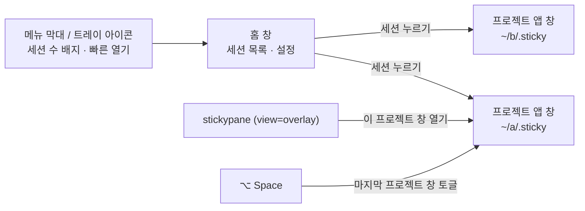
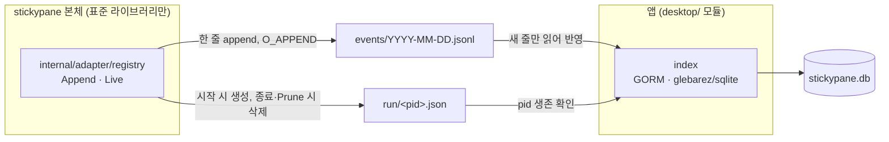
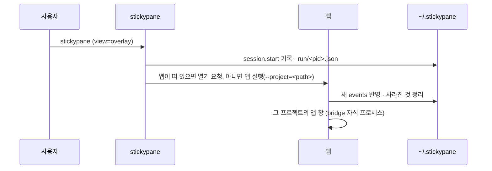

# 08. 앱 홈 · 세션 레지스트리

> 상태: Draft · 2026-10-28 · 관련 요구: R-26, R-27, R-28, R-29, R-30, R-32
>
> 참고: macOS 메뉴 막대 앱(Raycast, 1Password 8의 첫 실행), Excalidraw의 빈 캔버스 안내, SQLite WAL 문서, XDG Base Directory.

## 8.1 앱의 표면

앱에는 창이 두 종류 있다.



| 표면 | 언제 | 내용 |
|---|---|---|
| 홈 창 | 앱을 실행하거나 Dock·트레이에서 열 때 | 세션 목록(비어 있으면 빈 상태 한 장) |
| 프로젝트 앱 창 | 세션을 누르거나 `stickypane`이 열 때 | [03 §3.6](03-design-system.md#36-창-구성)의 board |
| 트레이 아이콘 | 앱이 떠 있는 동안 | 활성 세션 수, 최근 프로젝트 5개, 홈 열기, 종료 |

## 8.2 첫 실행 — 환영과 세 단계

[사용자 결정] R-32("랜딩·설명 없이 바로 목록")를 바꾼다(#63): 보드가 하나도 없을 때의 홈은 빈 메모지 한 장이 아니라 **설계된 첫 화면**이다. 보드가 하나라도 생기면 §8.3의 목록이 홈이다.

```text
┌ ●●● stickypane ────────────────────────────────────┐
│            [세 장 로고]                              │
│          stickypane                                 │
│   에이전트와 같이 보는 메모 보드                         │
│                                                     │
│  ┌① 보드 열기──┐ ┌② 에이전트 연결┐ ┌③ 터미널 명령──┐     │
│  │ 폴더를 고르면 │ │ Claude Code와 │ │ 어느 터미널에서 │     │
│  │ 거기에 보드를 │ │ Codex가 노트를 │ │ 나 stickypane │     │
│  │ 만들어요     │ │ 붙여요        │ │ (선택)        │     │
│  │ [폴더 고르기] │ │ ○ 아직 · [연결]│ │ ● 설치됨       │     │
│  └────────────┘ └─────────────┘ └──────────────┘     │
│                  앱 언어 [한국어|English|시스템]         │
└─────────────────────────────────────────────────────┘
```

- 로고는 인트로의 세 장(§4.3.1)이 내려앉는 자리다. 그 아래 이름(손글씨 display)과 한 줄 소개.
- 단계 카드는 크레용으로 칠한 메모지(§3.11.3의 카드, 기울기 ±1.5°까지)이고 번호는 손글씨 동그라미. 카드마다 **지금 상태**를 확인해 보인다: ① 보드가 있는지, ② 에이전트가 연결됐는지(`setup --dry-run`이 더 할 일이 없다고 하면 연결됨), ③ 터미널 명령이 앱의 것인지. 끝난 카드는 ✓와 "됐어요", 아직이면 동작 버튼 하나.
- ①의 **폴더 고르기**는 지금과 같다: `.sticky/`가 있으면 열고, 없으면 "이 폴더에 보드를 만들까요?"를 묻고 앱 안의 `stickypane init`을 돌린다. 홈 폴더와 루트에는 만들지 않는다.
- ②·③의 동작은 설정 창의 **터미널과 에이전트** 묶음과 같은 서비스다(실행할 명령을 먼저 보이고 확인).
- `stickypane`을 찾지 못하면 카드 위에 설치 한 줄(`brew install --cask LeeSwallow/tap/stickypane`)과 복사 버튼.
- 말투는 "~해요" 체.
- 새 보드의 환영 노트는 그 보드의 언어로 쓴다. 앱이 보드를 만들 때는 **창이 그리는 언어**(앱 언어, 시스템이면 시스템에서 고른 언어)를 `init`에 넘긴다(#63: 시스템 언어가 한국어인데 앱이 언어를 넘기지 않아 영어 환영 노트가 생기던 것). `stickypane init`은 `--language`, 보드의 `sticky.json`, 환경(`STICKYPANE_LANG`·`LANG`·시스템) 순서로 언어를 고른다. 보드에 언어를 적지 않으므로 그 보드는 계속 앱 언어를 따른다. 환영 노트는 너비 `2/3`(front matter `size`)라 보드 전체를 덮지 않는다. "+ 새 노트"의 모양 예시도 창이 그리는 언어로 온다(`kinds.list {language}`).

### 8.2.1 앱 언어와 보드 언어

[사용자 결정] 언어 설정은 두 가지이고, 이름으로 구분한다(#47).

| 설정 | 어디서 | 어디에 저장 | 무엇에 쓰나 |
|---|---|---|---|
| **앱 언어** | 홈 창 아래, 보드 설정 **이 컴퓨터** 탭 | `~/.stickypane/overlay.json`의 `language` | 홈 창, 트레이 메뉴, 언어를 정하지 않은 보드의 창 |
| **보드 언어** | 보드 설정 **이 보드** 탭 | 보드의 `sticky.json`의 `language` | 그 보드의 창과 떼어 낸 노트, 터미널 보드 |

- 보드 언어의 세 번째 선택지는 "시스템"이 아니라 **앱 따라**다. 보드가 언어를 정하지 않으면 앱 창은 앱 언어로 그린다. 앱 언어도 "시스템"이면 bridge가 환경에서 읽은 언어를 쓴다. 터미널은 앱 언어를 모르므로 환경을 따른다.
- 두 설정 아래에 한 줄씩 무엇에 쓰이는지 적는다. 앱 언어: "홈 창과, 언어를 정하지 않은 보드가 이 언어를 써요." 보드 언어: "정하지 않으면 이 컴퓨터의 앱 언어를 따라요."
- 보드 창에서 앱 언어를 바꾸면 overlay.json에 저장한다. 보드 언어가 정해져 있으면 그 창은 보드 언어로 계속 그린다.

## 8.3 보드 목록 — 홈

[사용자 결정] stickypane이 있는 활성 세션들을 볼 수 있다(R-27). 줄 대신 **보드 카드**다(#63).

```text
┌ ●●● stickypane                      [🔍 찾기____] [+ 보드 추가] ⋯ ┐
│ 지금 작업 중                                                     │
│ ┌──────────────────┐ ┌──────────────────┐ ┌──────────────────┐ │
│ │▆▆▆▆▆▆ (팔레트 띠)  │ │▆▆▆▆▆▆            │ │▆▆▆▆▆▆            │ │
│ │stickypane   ● 2분 │ │keyharbor  ● 12분 │ │ts-voca     14:02 │ │
│ │노트 6 · 멈춤 1     │ │노트 3            │ │노트 9            │ │
│ │@claude @codex 터미널│ │                  │ │                  │ │
│ │~/P/P/stickypane   │ │~/P/P/KeyHarbor   │ │~/P/P/ts-voca     │ │
│ └──────────────────┘ └──────────────────┘ └──────────────────┘ │
│ 오늘 …  이전 …                                                   │
└─────────────────────────────────────────────────────────────────┘
```

| 묶음 | 기준 |
|---|---|
| 지금 작업 중 | 살아 있는 stickypane 프로세스(TUI · bridge · mcp · watch)가 있거나, 지난 30분 안에 `.sticky/`가 바뀐 프로젝트 |
| 오늘 | 마지막 활동이 오늘인 나머지 |
| 이전 | 그 전. 카드 안에 날짜("어제", "10월 27일") |
| 사라진 프로젝트 | 폴더나 `.sticky/`가 없어져 자동으로 정리된 것. 한 번 알리고 실행 취소할 수 있다 |

- 카드: 위에 그 보드 팔레트의 노트 색 여섯 칸 띠, 이름(손글씨), 마지막 활동, 노트 수·멈춤 수, 활동 중인 에이전트 Chip, 실행 중인 것 Badge, 경로(홈은 `~`, 넘치면 앞을 줄임). 카드 전체가 버튼이다.
- 노트 수·팔레트·에이전트는 **그 보드를 이 컴퓨터에서 마지막으로 열었을 때** 셸이 `board.load`의 답에서 적어 둔 것이다(`overlay.json`의 `boards.<경로>`; 앱은 보드 파일을 직접 읽지 않는다). 아직 연 적이 없는 보드는 이름·경로·시각만 보이고 띠는 경로에서 정한 노트 색 하나다.
- 찾기 칸은 이름과 경로에서 찾는다(`/`로 포커스). 맞는 것이 없으면 "맞는 보드가 없어요".
- 창 폭에 따라 카드 1–3열(최소 240px).

화면은 디자인 시스템(03 §3.11)으로 짓는다: 제목줄은 TitleBar(⋯에 설정… · 창 닫기 · stickypane 종료), 셸의 알림과 창 자신의 실패는 제목줄 아래 Toast로, "없어진 프로젝트 N개를 목록에서 뺐어요 · 되돌리기"와 한 번만 나오는 "창을 닫아도 stickypane은 계속 실행돼요 · stickypane 종료"도 Toast다. 폴더에 보드를 만들기 전에는 Confirm으로 묻는다. 제목줄 ⋯의 **설정…**은 설정 창(03 §3.12)을 연다.

## 8.4 레지스트리 — `~/.stickypane/`

[사용자 결정] 홈 폴더에 `.sticky` 같은 폴더를 만들어 관리한다(R-28). JSON으로는 관리가 힘들 수 있으니 SQLite를 고려한다(R-28).

[설계자 판단] 이름은 `~/.sticky`가 아니라 **`~/.stickypane/`**이다. `store.Find`는 현재 폴더에서 위로 올라가며 처음 만나는 `.sticky`를 board로 쓰므로, `~/.sticky`가 있으면 홈 아래에서 `.sticky`가 없는 모든 프로젝트가 레지스트리를 board로 열고 자동 `init`도 멈춘다.

[설계자 판단] 기록은 **`~/.stickypane/`이 있을 때만** 남긴다. 폴더는 앱이 첫 실행에 만든다(`STICKYPANE_HOME`을 직접 정해도 된다). 터미널만 쓰는 사람의 홈에는 아무것도 생기지 않는다. 기록을 쓰고 지우는 것은 본체뿐이다(`registry.Prune`, board를 열 때). 앱은 읽기만 한다(#32, #24).

```text
~/.stickypane/                       (STICKYPANE_HOME으로 바꿀 수 있다)
├── events/
│   ├── 2026-10-27.jsonl        stickypane 본체가 덧붙이는 기록, 날짜별
│   └── 2026-10-28.jsonl
├── run/
│   └── 48211.json              살아 있는 stickypane 프로세스 하나에 파일 하나
├── stickypane.db               앱의 SQLite 색인 (WAL)
└── overlay.json                창 위치 · 크기 · 핀 · 단축키 (앱 설정)
```

### 8.4.1 누가 무엇을 쓰나



- **본체**는 SQLite를 모른다. `~/.stickypane/`이 있으면, 프로젝트에서 무엇인가 할 때(`init`, TUI 시작·종료, `bridge`, `mcp`, `watch`, 노트를 바꾸는 명령) 그날의 `events/*.jsonl`에 한 줄을 덧붙이고, 오래 사는 프로세스는 `run/<pid>.json`을 만든다. 실패해도 명령은 실패하지 않는다(best-effort).
- **앱**이 SQLite 색인을 소유한다. 시작할 때와 홈을 열 때 새 줄만 읽어 반영한다. `events/`·`run/`의 파일은 지우지 않는다. 기록 형식은 본체의 골든 파일(`internal/adapter/registry/testdata/home`)이 고정하고, 앱의 테스트도 같은 파일을 읽는다.

이렇게 나누는 이유:
1. 본체는 "표준 라이브러리 먼저" 규칙을 지키고 바이너리가 커지지 않는다(반목표 X5).
2. 여러 프로세스가 동시에 쓰는 곳은 append-only 파일이라 잠금 다툼이 없다. 한 줄은 `PIPE_BUF`(4KiB)보다 짧게 유지한다.
3. 날짜별 기록이 파일 자체로 남는다(R-29). `stickypane.db`를 지워도 `events/`에서 다시 만든다. **진실의 원천은 파일이고 SQLite는 색인이다**(VISION 1의 정신).

### 8.4.2 사건 형식

```json
{"v":1,"at":"2026-10-28T14:02:11+09:00","type":"session.start","project":"/Users/min/Projects/Personal/stickypane","pid":48211,"kind":"tui"}
{"v":1,"at":"2026-10-28T14:05:40+09:00","type":"project.touch","project":"/Users/min/Projects/Personal/stickypane","cmd":"card"}
{"v":1,"at":"2026-10-28T15:30:02+09:00","type":"session.end","project":"/Users/min/Projects/Personal/stickypane","pid":48211}
```

| type | 언제 |
|---|---|
| `project.init` | `stickypane init` |
| `project.touch` | 노트를 바꾸는 명령. 같은 프로젝트·같은 명령은 1분에 한 번만 |
| `session.start` / `session.end` | TUI, `bridge`, `mcp`, `watch`의 시작과 정상 종료 |

시각은 `internal/core/when`으로 쓴다(AGENTS.md).

### 8.4.3 SQLite 스키마

```sql
CREATE TABLE project (
  id          INTEGER PRIMARY KEY,
  path        TEXT NOT NULL UNIQUE,     -- 프로젝트 루트(.sticky의 부모), 정규화된 절대 경로
  title       TEXT,                     -- bridge board.load의 title, 그전에는 폴더 이름
  first_seen  TEXT NOT NULL,            -- RFC 3339
  last_seen   TEXT NOT NULL,
  removed_at  TEXT                      -- 사라진 것으로 정리한 시각. NULL이면 살아 있음
);
CREATE TABLE day (                      -- 날짜별 기록 (R-29)
  project_id  INTEGER NOT NULL REFERENCES project(id) ON DELETE CASCADE,
  date        TEXT NOT NULL,            -- YYYY-MM-DD, 로컬 날짜
  events      INTEGER NOT NULL DEFAULT 0,
  first_at    TEXT NOT NULL,
  last_at     TEXT NOT NULL,
  PRIMARY KEY (project_id, date)
);
CREATE TABLE session (
  pid         INTEGER NOT NULL,
  project_id  INTEGER NOT NULL REFERENCES project(id) ON DELETE CASCADE,
  kind        TEXT NOT NULL,            -- tui | bridge | mcp | watch
  started_at  TEXT NOT NULL,
  ended_at    TEXT,
  PRIMARY KEY (pid, started_at)
);
CREATE TABLE ingest (                   -- 어디까지 읽었나
  file        TEXT PRIMARY KEY,         -- events/2026-10-28.jsonl
  offset      INTEGER NOT NULL
);
CREATE TABLE meta (key TEXT PRIMARY KEY, value TEXT);  -- schema_version 등
```

### 8.4.4 지워진 것 처리

[사용자 결정] 중간에 삭제되는 문제를 모두 해결한다. 처음 불러올 때 삭제된 것은 자동으로 제거한다(R-29).

| 상황 | 처리 |
|---|---|
| 프로젝트 폴더나 `.sticky/`가 없어짐 | 앱 시작과 홈을 열 때마다 확인 → `removed_at`을 기록하고 목록에서 뺀다. 홈에 "없어진 프로젝트 n개를 목록에서 뺐어요 · 되돌리기"를 한 번 보인다. 30일 뒤 행을 지운다 |
| 사라졌던 폴더가 다시 생김 | 다음 사건이나 확인 때 `removed_at`을 비운다 |
| 프로젝트 폴더를 옮김 | 옛 경로는 사라진 것으로, 새 경로는 새 프로젝트로 잡힌다. [설계자 판단] 같은 `sticky.json` title과 같은 노트 목록이면 "옮긴 것 같아요 · 합치기"를 제안한다(나중 단계) |
| 프로세스가 죽어 `run/<pid>.json`이 남음 | 앱: pid가 살아 있지 않거나, 살아 있어도 다른 프로그램이면(시작 시각 비교) 살아 있는 세션으로 보이지 않고 `session.ended_at`을 채운다. 파일은 본체가 다음에 board를 열 때 지운다 |
| `events/*.jsonl` 마지막 줄이 잘림 | 줄바꿈으로 끝나지 않은 마지막 줄은 다음에 읽는다(offset을 그 앞에 둔다). JSON이 깨진 줄은 건너뛰고 세어 둔다 |
| `events/` 파일을 사용자가 지움 | `ingest` 행을 지운다. 이미 반영한 기록은 남는다 |
| `stickypane.db`가 깨지거나 지워짐 | 이름을 바꿔 두고 `events/` 전체에서 다시 만든다 |
| 오래된 기록 | `events/`는 90일 뒤 본체가 지운다. 앱은 그 파일의 `ingest` 행만 잊는다. `day` 표는 남는다 |
| 스키마 변경 | `meta.schema_version`으로 순서대로 이전(`gormstore` 의 migrations). 앱이 모르는 더 새 버전이면 다시 만들기 |

## 8.5 앱이 띄워지는 길



열기 요청은 단일 인스턴스 앱에 두 번째 실행의 인자를 넘기는 방식으로 한다(Wails v3 single instance). macOS는 `open -b io.github.leeswallow.stickypane --args --project=<절대 경로>`, Linux는 PATH의 `stickypane-app --project=<절대 경로>`. `view`가 `overlay`(`init --view app`)면 앱만 열고, 앱이 없으면 받을 곳을 말하고 터미널 보드를 연다. `both`면 앱과 터미널 둘 다다. 본체의 `openApp` 포트 뒤에 있어 테스트는 아무것도 띄우지 않는다.

## 8.6 플랫폼

[사용자 결정] 지원은 **macOS와 Linux**로 줄인다(R-30). Windows는 본체 터미널 board만 지금처럼 지원하고, 앱은 만들지 않는다.

| | macOS | Linux |
|---|---|---|
| webview | WKWebView | WebKitGTK |
| 전역 단축키 | 지원 | X11 지원, Wayland는 컴포지터에 따라 안 될 수 있다 [미검증] → 트레이와 `stickypane`으로 대신 연다 |
| 트레이 | 메뉴 막대 | StatusNotifierItem(데스크톱 환경에 따라) [미검증] |
| 배포 | DMG, Homebrew cask | tar.gz + `.desktop`, AppImage는 나중 |
| 이번 확인 | 이 Mac에서 직접 | CI의 빌드와 테스트만 [미검증 → 실기 확인 필요] |

## 8.7 HeyMoa 자산 분석 (참고로만 남김)

첫 실행 랜딩을 위해 `/Users/min/Projects/HeyMoa`의 랜딩(`heymoa-web/components/heymoa/landing/`, `DESIGN.md`)과 데스크톱 온보딩(`apps/desktop/renderer/onboarding.html`)을 분석했으나, 랜딩을 두지 않기로 해(R-32) 구조는 쓰지 않는다. 남겨 쓰는 것은 두 가지다.

| 쓰는 것 | HeyMoa 위치 | stickypane에서 |
|---|---|---|
| keyframe은 `prefers-reduced-motion: no-preference` 안에만, 기본은 끝 상태 | `components/heymoa/landing/motion.tsx` | [04 §4.6](04-motion.md#46-동작-줄이기) |
| "~해요" 체, 누를 수 있는 CTA 하나만 두는 빈 상태 | `messages/ko/help.json`, `DESIGN.md` 빈 상태 | §8.2 빈 상태 |
