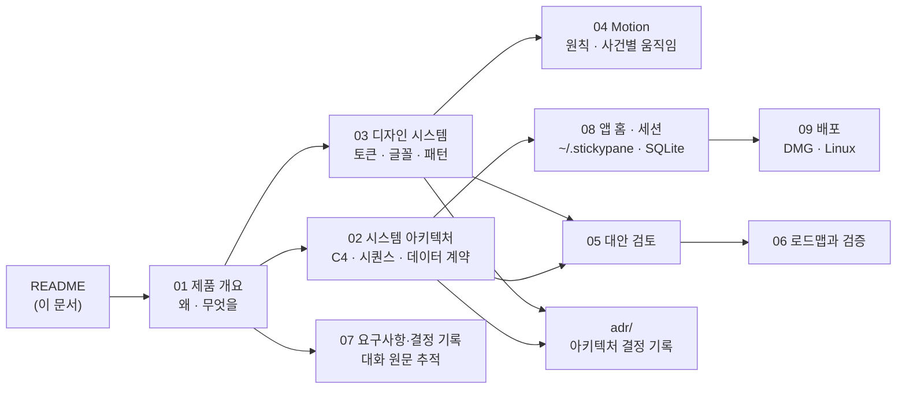

# stickypane 앱 기술 문서

| 항목 | 내용 |
|---|---|
| 문서 상태 | **구현됨, 미출시** — `feat/10-overlay-app`에 만들어졌고 테스트를 거쳤다. DMG는 첫 앱 릴리스와 함께 나온다 |
| 최종 갱신 | 2026-10-29 |
| 대상 독자 | stickypane 기여자, 앱 구현자, 디자인 검토자 |
| 바뀐 기존 문서 | [`ROADMAP.md`](../../ROADMAP.md)의 목표 문장과 "Next: the desktop app ships" ([ADR-0010](adr/0010-terminal-stays-primary.md)) |

앱(코드는 `desktop/`, 보기 설정 값은 `overlay`)은 `.sticky/` 폴더를 터미널이 아닌 **화면 위에 떠 있는 전용 데스크톱 창**에 보여 주는 두 번째 화면이다. 같은 폴더를 읽고 같은 `doc.Op`로 쓰므로 에이전트는 아무것도 새로 배우지 않는다. 터미널이 그릴 수 없는 것(제대로 된 Markdown, 코드 하이라이트, 다이어그램, HTML, 여러 에이전트의 움직임)을 webview와 JS 렌더러로 그린다.

## 문서 구성

| # | 문서 | 내용 | 참고한 양식 |
|---|---|---|---|
| 01 | [제품 개요](01-product-overview.md) | 의도, 기존 원칙과의 관계, 목표·비목표·반목표, 사용 장면 | Google Design Doc의 *Context and Scope / Goals and Non-Goals* |
| 02 | [시스템 아키텍처](02-system-architecture.md) | 컨텍스트·컨테이너·컴포넌트, 핵심 시퀀스, `Kind.Data` 계약, 레이어, HTML 격리, 배포 | C4 Model + arc42 (Building Block / Runtime / Deployment View) |
| 03 | [디자인 시스템](03-design-system.md) | 디자인 원칙, 토큰, 글꼴, 창·대시보드·shape별 패턴, 접근성 | Apple HIG, Linear·Raycast의 창 구성, IBM Carbon 토큰 체계 |
| 04 | [Motion](04-motion.md) | 움직임 원칙, 시간·곡선 토큰, 사건별 안무, 묶음 재생, 동작 줄이기 | Material 3 *Motion*, Apple HIG *Motion*, FLIP 기법 |
| 05 | [대안 검토](05-alternatives.md) | 앱 프레임워크, 상호작용 범위, HTML 처리, 설정 위치, 렌더러·글꼴 | Google Design Doc의 *Alternatives Considered* |
| 06 | [로드맵과 검증](06-roadmap-and-verification.md) | 단계별 범위, 완료 조건, 검증 게이트 | 기술 리포트의 *Evaluation* 절 |
| 07 | [요구사항·결정 기록](07-requirements-log.md) | 사용자가 말한 요구를 시간순으로 정리하고 결정으로 연결 | Requirements Traceability Matrix |
| 08 | [앱 홈 · 세션 레지스트리](08-app-home-and-sessions.md) | 홈 창, 활성 세션 목록, `~/.stickypane/` 레지스트리와 SQLite 색인, 지워진 것 처리, 플랫폼 | SQLite WAL, XDG |
| 09 | [배포와 설치 화면](09-distribution.md) | macOS 손그림 DMG, Linux tar.gz, 서명 | — |
| 10 | [터미널 기능 대응표](10-terminal-parity.md) | 터미널에서 되는 모든 일을 앱에서 어떻게 하는지, 더할 bridge 메시지 | Feature parity matrix |
| — | [ADR 목록](adr/README.md) | 되돌리기 어려운 결정 하나당 문서 하나 | Michael Nygard, *Documenting Architecture Decisions* |

목업: 디자인·Motion 방향을 브라우저에서 재생해 볼 수 있는 목업이 `.superpowers/brainstorm/*/content/overlay-direction.html`에 있다(커밋 대상 아님).

## 표기 규칙

- **[사용자 결정]**: 사용자가 대화에서 직접 정한 것. 근거는 [07](07-requirements-log.md)의 요구 ID(`R-nn`)로 연결한다.
- **[설계자 판단]**: 사용자가 맡긴 영역에서 설계자가 정한 것. 사용자가 뒤집을 수 있다.
- **[미검증]**: 문서·소스로만 확인했고 실제로 실행하거나 측정하지 않은 사실.
- 다이어그램은 Mermaid로 작성한다.

## 기존 문서와의 관계

| 기존 문서 | 관계 |
|---|---|
| [`VISION.md`](../../VISION.md) | 그대로 유효. 앱이 각 원칙을 어떻게 지키는지는 [01 §1.3](01-product-overview.md#13-원칙과의-관계) |
| [`ROADMAP.md`](../../ROADMAP.md) | 목표 문장의 "with no desktop"이 바뀐다. 터미널은 기본 화면으로 남는다 ([ADR-0010](adr/0010-terminal-stays-primary.md)) |
| [`docs/architecture.md`](../architecture.md) | 레이어 표에 `Kind.Data`가 추가된다. 앱은 별도 모듈이라 이 표에 들어가지 않는다 ([02 §2.6](02-system-architecture.md#26-레이어와-모듈)) |
| `plugin/guide.md` | 에이전트 가이드는 바뀌지 않는다. HTML 노트 한 줄만 추가된다 |
