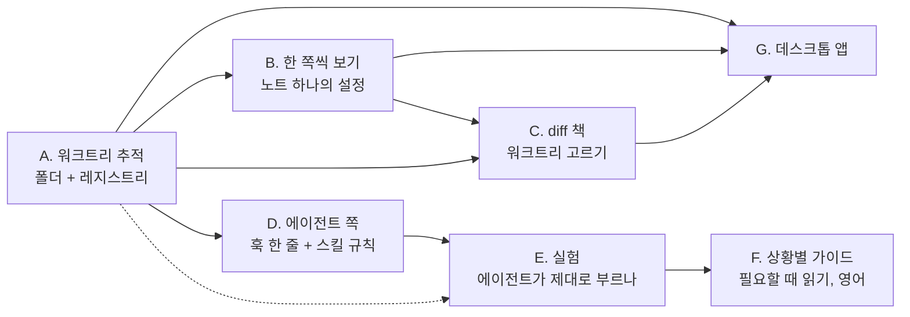

# proposal: 워크트리마다 책 한 권, 에이전트는 알맞은 모양으로

라벨: proposal, needs triage
상위 이슈: 없음 (총괄)

## 문제

에이전트는 git 워크트리에서 자주 일한다. 브랜치마다 하나씩, 동시에 여러 개. 보드는 워크트리가 있는 줄 모른다.

- `.sticky/`는 gitignore 대상이다. 새 워크트리에는 보드가 없다. 에이전트는 빈 채로 시작하거나, 아무도 안 보는 보드에 `init`을 한다.
- 브랜치의 흔적은 칸반 카드에 손으로 적은 `@feat/chart-ui` 태그뿐이다. 워크트리가 어디 있는지, 아직 있는지는 어디에도 없다.
- 에이전트 셋이 워크트리 셋에서 일해도 한눈에 볼 곳이 없다. 한 워크트리의 노트를 한 화면에서 넘겨 볼 수도 없다.
- 워크트리가 뭘 바꿨는지 보려면 사용자는 보드를 떠나 `git diff`로 간다.
- 에이전트가 쓰는 모양이 Markdown 하나로 쏠린다. 그림은 글로, 숫자는 문장으로, 결정은 채팅 질문으로 간다. 도형(mermaid), `chart`, `log`, `script`, `api`, `html`이 맞는 자리에서도 모른다. 선택과 승인이 `form`과 `wait`를 거쳐야 하는데 거치지 않는다. 근거는 `docs/history/specs/2026-11-23-shape-usecases.md`에 모았다.

## 제안

저장소 하나에 보드 하나를 두고 워크트리들이 같이 쓴다. 그 안에서 워크트리마다 **책**(폴더 하나가 노트 하나로 보이고, 파일이 **쪽**이다)이 하나 생긴다. 쪽은 저마다 모양이 달라도 된다. 보드는 git을 따라간다. `git worktree list`를 읽어 폴더를 만들고, 옮겨지거나 지워진 것을 알아챈다. 가는 길에 두 가지를 더한다. 노트를 **한 쪽씩** 보는 설정, 그리고 워크트리의 변경을 읽는 **diff** 책. 에이전트에게는 한 줄만 알려 주고, 가이드는 상황별로 다시 짜서 필요할 때 읽게 한다. 데스크톱 앱도 같은 것을 그린다.



사용자가 탭에서 보는 모습:

```
┌ worktrees/feat-chart-ui · 01-할일.md ────────── 2/4 ┐
│ [ ] 차트 색 고치기                                   │
│ [x] 막대 간격 맞추기                                 │
│ [ ] 범례 위치                                        │
│                                                      │
│ ,  .  previous / next page                           │
└──────────────────────────────────────────────────────┘
 pages: 00-개요.md (note) · 01-할일.md (checklist)
        02-build.log (log) · diff (changed files)
```

사용자가 바란 것, 이슈마다 어디서 풀리는지:

| 바람 | 어디서 |
| --- | --- |
| 에이전트가 모양을 제대로 쓴다 (도형, chart, log, script, api, html) | F, E |
| 선택과 승인이 form과 wait로 흐른다 (행동 전에 승인) | F, E |
| 워크트리 책, 쪽마다 모양이 다르다 | A, B |
| diff, 그리고 워크트리를 고르는 화면 | C |
| 데스크톱에서도 같은 모습 | G |
| 가이드는 필요할 때 읽고, 영어로 | F |

조사 뒤에 고친 점(R1~R11)은 각 하위 이슈에 들어간다. 여기에는 총괄에 걸린 것만 적는다.

- 상태는 `open|closed`로 저장하고, 보여 줄 때 `running`(git이 `locked`라고 함)과 `waiting`(답 없는 form의 수)을 더 계산한다. 에이전트가 새로 쓸 것은 없다 (A, R1).
- 폴더 이름은 브랜치가 아니라 워크트리의 디렉터리 이름으로 짓는다. 폴더는 첫 쓰기에서 만들고, 첫 동기화에서는 레지스트리에만 적는다. 서브에이전트의 임시 워크트리가 닫힌 폴더로 보드를 채우지 않게 하려는 것이다 (A, R2, R3).
- 훅은 `CLAUDE_PROJECT_DIR`이 아니라 입력의 `cwd`로 워크트리를 찾는다 (D, R4).
- diff는 둘로 쪼갠다. 먼저 워크트리별 바뀐 파일 목록과 겹침 경고, 본문은 그 뒤다. 기준은 늘 `main`이 아니라 기본 브랜치와의 merge-base다 (C, R6, R7).
- 승인 form은 매번 새로 만든다. `wait`가 3으로 끝나면(시간 초과) "아니오"다. 낡은 `submitted`가 남은 form은 옛 답을 곧바로 돌려준다 (F, E, R8).
- `chart set`은 앞 값을 덮어쓰고 추세를 남기지 않는다. 실험은 `chart add`나 `log`로 적는다 (E, R9).
- 워크트리 둘이 `api.http` 하나를 나눠 쓰면 `@base`의 포트가 부딪친다. 워크트리마다 환경 파일을 둔다. `docs/shapes.md`에 한 줄 (G 또는 문서, R10).
- `.worktreeinclude`가 gitignore된 `.sticky/`를 워크트리로 복사할 수 있다(확인 필요). 그러면 "워크트리 자기 보드가 이긴다"가 낡은 사본을 읽는다. 복사된 보드를 무시할지는 A의 계획에서 정한다 (A, C, R5).

## 대안

- **워크트리마다 보드.** `.sticky/`가 gitignore라 워크트리가 지워지면 노트도 죽는다. 사용자는 보드 여러 개를 지켜봐야 한다.
- **레지스트리만, 폴더 없음.** 가장 싸지만 워크트리별 쪽이 없다. 요청한 것이 아니다.
- **워크트리 위치의 저장 형식.** JSON을 고른다. YAML이나 TOML은 모듈이 새로 필요하다. SQLite는 몇 줄을 위해 바이너리 파일과 모듈을 들인다. 노트 front matter는 경로가 한 컴퓨터의 사실이고 git이 이미 알고 있어서 맞지 않는다.
- **명령이 새 노트를 워크트리 폴더로 기본 배정.** 모든 명령을 건드리고, 에이전트가 이름 안 준 곳에 파일이 생긴다. D는 훅 한 줄로 이름만 알려 준다.
- **가이드를 한국어로 번역.** 독자가 모델이라 `docs/translating.md`에 따라 영어로 둔다. 번역이 낫다는 근거는 E에서 먼저 재고, 그 전에는 옮기지 않는다.

## 바뀌는 것

새로 생기는 것: `.sticky/worktrees/<name>/` 폴더, `~/.stickypane/worktrees.json`과 `events/<date>.jsonl`, `sticky.json`의 `paging` 설정, `diff` 모양(`internal/core/widget/diff`), 상황별 가이드의 주제와 색인.

바뀌는 것: 모든 명령이 워크트리에서 `.sticky/`를 찾는 방식(찾는 코드는 한 곳, 확인 필요), `plugin/scripts/session-start.sh`, `plugin/rules/touching-the-board.md`의 규칙 한 줄, `plugin/skills/`와 `plugin/rules/`(다시 자름), `stickypane guide`의 색인, 데스크톱의 `internal/surface/bridge`와 `desktop/frontend/src/shapes/`.

VISION.md와의 관계: 폴더가 제품으로 남는다. 한 컴퓨터의 것(경로)은 `~/.stickypane`에 둔다. 설정할 것이 없다. 에이전트는 한 줄만 배운다. 가이드 55줄 한도(`plugin/guide.md`와 `plugin/rules/`)는 지킨다. 테스트가 세는 `Guide()`는 지금 55줄이라 여유가 없다(D에서 확인). 한 줄을 넣으려면 한 줄을 덜어야 한다.

AGENTS.md의 규칙은 모든 하위 이슈에 그대로 걸린다. 노트의 변경은 `doc.Op`를 `store.Apply`로 적용하고, 시각은 `internal/core/when`으로 쓰고, 표준 라이브러리를 먼저 쓰고, 계층(`internal/layers`)을 지킨다. 새 패키지는 폴더, 서열, `docs/architecture.md`의 한 줄을 받는다.

## 순서와 하위 이슈

A → B → C, D는 A와 함께, E는 A와 D 뒤, F는 E로 전후를 잰 뒤, G는 A·B·C 뒤. 이슈마다 풀 리퀘스트 하나.

- **A. 보드가 git 워크트리를 따라간다.** 어느 보드를 쓰는지, `worktrees/<name>/` 폴더, `~/.stickypane/worktrees.json`. 가장 먼저 한다.
- **B. 노트를 한 쪽씩 본다.** `sticky.json`의 `"paging": "single"`, `,` `.`로 쪽 넘김. 독립이고, C의 바탕이다.
- **C. 워크트리의 변경을 읽는 diff 책.** 워크트리 고르는 첫 쪽, 파일마다 한 쪽. A와 B에 기댄다.
- **D. 에이전트가 자기 워크트리를 한 줄로 안다.** 세션 훅 한 줄, 규칙 한 줄. A에 기댄다.
- **E. 에이전트가 보드를 제대로 부르는지 재는 실험.** 경우별로 스킬이 불렸나, 맞는 모양과 자리인가. A와 D에 기댄다. 모델 호출은 돈이 들어 첫 실행은 메인테이너가 승인한다.
- **F. 가이드를 상황별로 다시 짜고 필요할 때 읽게 한다.** 영어. 모양 고르기와 승인 흐름이 들어간다. E로 전후를 재야 해서 E 뒤에 한다.
- **G. 데스크톱 앱이 터미널과 같은 것을 그린다.** 그리기만 하고 논리는 Go에 둔다. A, B, C에 기댄다.

경계: 워크트리를 만들고 옮기고 지우는 일은 Orca, Claude Code, `git`이 한다. 보드는 따라가기만 한다. 컴퓨터 사이의 보드 동기화도 이번 범위가 아니다.

## 열린 질문

- 에이전트가 자기 폴더 이름을 어떻게 아는가. 제안은 세션 훅의 한 줄(`worktree: feat-chart-ui → worktrees/feat-chart-ui/`)이고 명령은 그대로다. 명령이 새 노트를 폴더로 기본 배정하는 길은 더 크다. 사용자가 정한다.
- `todo` 같은 명령이 노트 이름에 폴더를 받는가(확인 필요).
- 폴더를 `store`가 만드는가, 유스케이스 계층이 만드는가. 계층 규칙이 정한다 (A).
- `from:` 차트가 중첩 폴더 안을 세는가(확인 필요).
- diff의 쪽은 파일이 아니다. 책이 이걸 어떻게 받을까. 파생 파일을 쓰는 길과, 책이 쪽의 출처를 직접 받는 길이 있다. 후자를 권한다 (C).
- `.worktreeinclude`로 복사된 `.sticky/`를 무시할지 (A, C).
- `paging`과 `diff.page`가 데스크톱 `bridge.Protocol`을 올리는가. 옛 화면이 깨지면 안 된다 (G, 확인 필요).
- `claude plugin eval`과 `codex exec --json`의 인자와 동작(확인 필요). 실험을 CLI로 할지 Agent SDK로 할지는 모듈이 새로 생기므로 이유와 라이선스 검토가 필요하다 (E).
- 근거 자료 하나가 열리지 않았다(`docs.langchain.com/oss/python/human-in-the-loop`, 404). 유스케이스 문서에 표시했다. 다른 도구에 대한 주장은 조사한 문서에 출처가 있고, 직접 돌려 본 것은 없다.

## 에이전트 브리프

- **목표:** 워크트리 책, 한 쪽씩 보기, diff, 한 줄 안내, 상황별 가이드, 앱 표시를 하위 이슈 A~G로 나눠 하나씩 낸다. 이 이슈로는 코드를 바꾸지 않는다.
- **먼저 읽을 것:** `VISION.md`, `AGENTS.md`, `docs/architecture.md`, `docs/shapes.md`, `docs/agents.md`, `docs/history/specs/2026-11-23-worktree-design.md`, `docs/history/specs/2026-11-23-worktree-issues/english-draft-and-revisions.md`(끝의 R1~R11), `docs/history/specs/2026-11-23-shape-usecases.md`.
- **할 것:**
  - 하위 이슈 A~G를 순서대로 하나씩 연다. 이슈마다 풀 리퀘스트도 하나.
  - 하위 이슈마다 이 총괄 이슈를 가리키게 한다.
  - 하위 이슈를 시작할 때 그 이슈의 `(확인 필요)`부터 확인해 지운다.
  - 끝내기 전에 다음을 돌린다.

    ```sh
    go vet ./... && go test -race ./... && test -z "$(gofmt -l .)"
    ```

  - 화면이 달라지는 일은 실제 빌드로 캡처해 확인한다.
- **하지 말 것:**
  - 노트 파일을 직접 쓰기. 변경은 `doc.Op`를 `store.Apply`로.
  - 시각을 손으로 적기. `internal/core/when`으로.
  - 모듈 더하기(이유와 `sh scripts/licenses.sh`가 먼저).
  - 닫힌 워크트리 폴더 지우기.
  - 가이드 55줄 넘기기, 같은 규칙을 둘 이상의 주제에 쓰기.
  - 확인 안 한 명령이나 파일 이름을 이슈에 쓰기.
  - 푸시, main 머지, 태그, 브랜치 삭제는 먼저 묻는다.
- **끝난 조건:** 하위 이슈 A~G가 열려 있고, 각 의존이 이 이슈의 순서와 맞는다. 위 세 검사가 통과한다. 하위 이슈에 `(확인 필요)`가 남아 있다면 이유가 적혀 있다.
