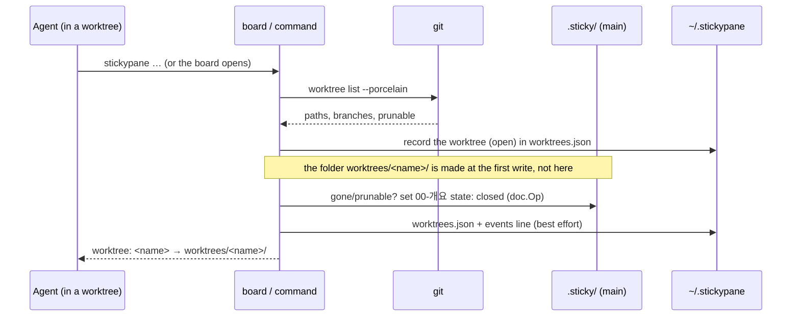

# proposal: 보드가 git 워크트리를 따라간다

라벨: proposal, needs triage
상위 이슈: 총괄 이슈 (워크트리를 보드에서 다룬다)

## 문제

에이전트는 워크트리 하나에 브랜치 하나씩, 여러 개를 동시에 돌린다. 그런데 보드는 워크트리가 어디 있는지도, 지워졌는지도 모른다.

- `.sticky/`는 gitignore 대상이라 새 워크트리에는 보드가 없다. 에이전트가 거기서 `stickypane`을 부르면 빈 보드가 새로 생기거나 아무것도 찾지 못한다.
- 브랜치의 흔적은 칸반 카드에 손으로 쓴 `@feat/chart-ui` 태그뿐이다.
- 사용자가 가장 먼저 묻는 것은 "누가 나를 기다리나"인데, 워크트리별로 갈라 볼 자리가 없다.

## 제안

**어느 보드.** `git worktree list --porcelain`은 메인 워크트리를 맨 앞에 적는다. 저장소의 보드는 그 워크트리의 `.sticky/`다. 다른 워크트리에서 도는 프로세스도 이 보드를 쓴다. 다만 그 워크트리 루트에 자기 `.sticky/`가 있으면 그쪽이 이긴다. 터미널 화면과 앱뿐 아니라 모든 명령이 같은 방식으로 `.sticky/`를 찾는다. 찾는 코드는 `internal/adapter/store`의 `Find`와 `Resolve`에 한 곳에 모여 있어 바꿀 곳도 한 곳이다 (확인 필요: 다른 곳에서 따로 찾는 코드가 없는지).

**폴더.** 워크트리 하나는 책(폴더) 하나, `worktrees/<이름>/`이다. 쪽은 어떤 모양의 파일이든 된다. 첫 노트는 `00-개요.md`다. 브랜치가 무엇을 위한 것인지와 상태를 적는 사람용 글이고, 경로는 적지 않는다. 상태는 front matter에 둔다: `state: open|closed`, 닫힐 때 `closed: <시각>` (시각은 `when`을 거쳐 보드가 쓴다).

- `<이름>`은 브랜치가 아니라 **워크트리 디렉터리 이름**이다. Claude Code는 브랜치를 `worktree-<이름>`, 위치를 `.claude/worktrees/<이름>`에 두므로, 브랜치로 이름을 지으면 접두어가 폴더에 그대로 남는다.
- 이름이 겹치면 경로의 짧은 해시를 뒤에 붙인다 (`feat-a-3f9c`).
- 메인 워크트리에는 폴더를 만들지 않는다. 그 보드가 곧 보드다.
- 워크트리를 브랜치로 알아본다. 디렉터리 이름은 폴더 이름용이고, 같은 워크트리인지는 브랜치로 가른다. 브랜치 없는 분리(detached) 워크트리는 경로로 알아본다.
- 브랜치가 돌아오면 닫힌 폴더를 다시 열고 `state: open`으로 바꾼다. 브랜치 이름이 바뀌면 사라진 것과 새로 생긴 것으로 읽고, 옛 폴더는 닫힌 채 남는다.

**폴더는 처음 쓸 때 만든다.** 동기화할 때가 아니다. Claude Code의 서브에이전트는 임시 워크트리를 만들었다가 변경이 없으면 끝나자마자 지운다. 그때마다 폴더를 만들면 닫힌 폴더가 하루에 수십 개 쌓인다. 그래서 동기화는 모든 워크트리를 기록부에만 적는다. 폴더는 에이전트나 사용자가 그 안에 처음 쓸 때 생긴다. 이미 있는 폴더는 보드가 지우지 않는다. 폴더는 `filelock`이 잡는 노트 폴더 잠금 안에서 만든다. 두 에이전트가 동시에 만들어도 하나만 남는다.

**워크트리가 어디 있는지.** 두 파일을 `~/.stickypane`(또는 `$STICKYPANE_HOME`)에 둔다. 쓰는 곳은 `internal/adapter/registry` 하나다. 형식은 JSON, 표준 라이브러리(`encoding/json`)만 쓴다.

- `worktrees.json`: 지금 상태. `version`과, 보드별로 `{name, path, branch, state}` 목록. 보드를 가르는 열쇠는 메인 워크트리의 `git rev-parse --git-common-dir`(절대 경로)다. 경로는 한 컴퓨터의 사실이므로 이 파일에만 있고, 커밋하는 `.sticky/`에는 들어가지 않는다.
- `events/<날짜>.jsonl`: 내력. `worktree.open`, `worktree.close`, `worktree.move`를 한 줄씩, 이름과 경로를 붙여 적는다.

기록은 지금 레지스트리가 쓰는 조건 그대로다. 데스크톱 앱이 `overlay.json`을 쓴 곳에서만, 실패해도 명령이 실패하지 않게 쓴다. 기록이 꺼져 있으면 보드는 매번 git을 읽고, `closed`는 `00-개요.md`에 남는다. 잃는 것은 없다. git이 없거나 저장소가 아니면 이 모든 일을 하지 않고 보드는 지금과 같다.

**git과 맞추기.** 보드가 열릴 때와 워크트리의 에이전트가 명령을 낼 때 `git worktree list --porcelain`을 읽는다. 보드와 git이 다르면 git이 맞다.

| git이 말하는 것 | 보드가 하는 일 |
| --- | --- |
| 기록에 없는 워크트리 | 기록부에 `open`으로 적는다. 폴더는 만들지 않는다 |
| 폴더 없는 워크트리에 처음 쓴다 | 그때 폴더와 `00-개요.md`를 만든다 |
| 브랜치는 같고 경로가 바뀜 | 경로를 고친다. `worktree.move` |
| 사라졌거나 `prunable` | 기록부와 `00-개요.md`에 `closed`. 폴더는 남긴다 |
| 워크트리도 기록도 없는 폴더 | 그대로 둔다 (사람이 만든 것) |
| `locked`이거나 마운트만 빠짐 | `open`으로 둔다 |

**파생 상태.** 저장하는 상태는 `open|closed`뿐이다. 보드를 보여줄 때 둘을 더 계산한다. 에이전트가 새로 쓸 것은 없다.

- `running`: git이 워크트리를 `locked`로 보고한다. Claude Code는 에이전트가 도는 동안 워크트리를 잠근다. 다른 도구(Orca, Conductor 등)도 그러는지는 확인하지 못했다 (확인 필요).
- `waiting`: 그 워크트리 폴더 안에서 아직 답이 없는 form의 개수.

**계층.**

- git을 부르는 일은 `adapter`다. `runner`와 나란한 새 패키지 `internal/adapter/git`을 둔다.
- 기록부와 내력을 쓰는 일은 `internal/adapter/registry`에 둔다.
- 맞추는 규칙은 유스케이스다. 새 패키지 `internal/usecase/worktree`.
- `core`는 노트의 state 필드만 새로 안다.
- 폴더를 `store`가 만들지 유스케이스가 만들지는 열린 질문이다.

### 사용자가 옮겨 넣은 노트

워크트리 책은 보드가 만든 파일만의 폴더가 아니다. 사용자가 보드의 노트를 책에 옮겨 넣을 수 있다(`m`, `stickypane mv plan worktrees/feat-chart-ui/`).

- 보드는 사용자가 옮겨 넣은 노트를 건드리지 않는다. 워크트리가 닫혀도 그 노트는 폴더에 남는다.
- 옮겨 넣은 노트도 폴더 안의 페이지이므로 에이전트는 그 노트를 쓸 수 있다. 에이전트가 새로 만들지 않고 폴더 안의 기존 노트를 먼저 쓰게 할지는 #144에서 정한다.
- 책을 고르기 쉽도록 옮기기 후보에 워크트리 책을 브랜치와 상태와 함께 보이는 일은 #148에서 한다.
- `mv` 뒤에도 노트의 설정(크기, 열림, 한 페이지씩 보기)이 따라오는지는 #148에서 확인한다.

## 대안

| 안 | 뜻 | 왜 아닌가 |
| --- | --- | --- |
| 워크트리마다 보드 | 격리는 되지만 | `.sticky/`가 gitignore라 워크트리와 함께 사라진다. 사용자가 보드 여럿을 봐야 한다 |
| 기록부만, 폴더 없음 | 가장 싸지만 | 워크트리별 쪽이 없다. 요청한 것이 그것이다 |
| 브랜치로 폴더 이름 | 설계 초안 | 도구가 붙이는 접두어(`worktree-`)가 폴더에 남는다 |
| 동기화 때 폴더 생성 | 설계 초안 | 서브에이전트의 임시 워크트리가 닫힌 폴더로 쌓인다 |

기록 형식 대안: YAML이나 TOML은 모듈이 하나씩 늘고 사람이 아닌 보드가 쓴다. SQLite는 몇 줄을 위해 바이너리 파일과 모듈이 든다. 노트 front matter에 경로를 두는 것은, 경로가 한 컴퓨터의 사실이고 git이 이미 알고 있어 문서에 속하지 않는다.

## 바뀌는 것

| 곳 | 무엇 | 순위 (docs/architecture.md) |
| --- | --- | --- |
| `internal/adapter/git` (새) | `git worktree list --porcelain`을 돌려 읽는다 | 4 (확인 필요: `store`가 부르려면 `store`(10)보다 낮아야 한다) |
| `internal/adapter/registry` | `worktrees.json`을 쓰고 `events/`에 `worktree.*`를 더한다 | 5 (그대로) |
| `internal/adapter/store` | `Find`/`Resolve`가 메인 워크트리의 `.sticky/`를 찾는다 | 10 (그대로) |
| `internal/usecase/worktree` (새) | 위 표의 규칙과 파생 상태 | 35 (확인 필요: `api`(40)가 부르고 `arrange`(30)보다 위) |
| `internal/core/widget`의 노트 state | `state`, `closed` 필드 | 그대로 |
| `docs/architecture.md` | 새 두 패키지에 순위와 한 줄씩 | |
| `README.md` | 워크트리가 폴더로 보인다는 한 줄 | |

새 패키지는 `internal/layers`가 순위를 요구한다. 폴더, 순위, architecture 표의 한 줄이 함께 있어야 테스트가 통과한다.

## 하지 않을 것

- 워크트리를 만들고 옮기고 지우는 일. Orca, Claude Code, `git`이 한다. 보드는 따라간다.
- diff 보기(바뀐 파일과 코드). 별도 기능이고 여기서 정한 워크트리 경로를 쓴다.
- 컴퓨터 사이 보드 동기화.
- 닫힌 폴더를 보드가 지우는 일.
- 사람이 만든 노트를 바꾸는 일.
- 경로를 노트 안에 적는 일. 경로는 레지스트리에만 둔다.
- 에이전트가 따로 배울 것. 에이전트는 세션 시작 줄 하나로 자기 폴더를 안다 (이슈 D). 가이드는 55줄 안에 둔다.
- 새 모듈.

## 열린 질문

1. 폴더를 `store`가 만들까, 유스케이스가 만들까. 층이 정한다.
2. `adapter/git`의 순위 4가 맞나. `store`의 `Find`가 git을 부르게 할지, 찾기를 유스케이스로 올릴지.
3. `.worktreeinclude`가 gitignore된 `.sticky/`를 워크트리에 복사할 수 있다 (확인 필요). 그러면 "워크트리 자기 보드가 이긴다"가 낡은 복사본을 읽는다. 복사된 보드는 무시할지 정해야 한다.
4. `locked`가 "에이전트가 도는 중"인지는 Claude Code에서만 확인됐다. 다른 도구는 `running`을 못 띄운다.
5. 폴더가 다시 열릴 때 옛 체크리스트를 보관 표시할까. 원격 브랜치가 지워진 워크트리가 같은 이름으로 다시 열리면 옛 할일이 새 작업과 어긋난다.
6. 보드의 `진행.md`가 `from:`으로 중첩 폴더 안을 세는지. 이 이슈가 `진행.md`를 만들지는 않는다.
7. `01-할일.md`를 첫 쓰기 때 같이 만들까, `00-개요.md`만 만들까.
8. 닫는 기준은 git이 `prunable`이라 하거나 목록에 없을 때뿐이다. 이걸로 충분한가.

## 테스트 계획

테스트가 명세이므로 먼저 쓴다.

- **고정 입력.** `internal/adapter/git/testdata/`에 `git worktree list --porcelain`의 가짜 출력을 둔다: 메인 하나, 일반 워크트리, `locked`, `prunable`, 분리된 것, 경로에 공백이 든 것. 실제 `git`을 부르는 테스트는 임시 저장소에서 한 번만.
- **골든 홈.** `internal/adapter/registry/testdata/home`처럼 `worktrees.json`과 `events/*.jsonl`의 모양을 골든으로 고정한다. `overlay.json`이 없는 홈에서는 아무것도 쓰이지 않는지도 본다.
- **규칙 표.** 표의 줄마다 한 테스트: 기록 없는 워크트리, 첫 쓰기에서 폴더 생성, 경로 이동, `prunable`, 사람이 만든 폴더, `locked`.
- **이름.** 브랜치 `worktree-x`가 디렉터리 이름 `x`로 지어지는지. 같은 이름에 해시가 붙는지. 브랜치가 돌아오면 닫힌 폴더가 열리는지.
- **어느 보드.** 다른 워크트리에서 메인의 `.sticky/`를 찾는지. 자기 `.sticky/`가 있으면 그것이 이기는지.
- **경합.** 두 프로세스가 같은 폴더를 만들어도 하나만 남는지 (`go test -race`).
- **시각.** `closed:` 시각이 `when`을 거치고 `time.Now`를 직접 읽지 않는지 (기존 `test/`의 검사가 잡는다).
- **층.** `internal/layers`가 새 패키지의 순위를 받아들이는지.
- **git이 없을 때.** 저장소가 아니거나 `git`이 없으면 보드가 지금과 똑같은지.

## 에이전트 브리프

**목표.** 위 표대로 보드가 워크트리를 따라가게 한다. 그 밖의 것은 하지 않는다.

**먼저 읽을 것.**

- `VISION.md`, `AGENTS.md`
- `docs/architecture.md` (층, 레지스트리)
- `internal/adapter/registry/registry.go`
- `internal/adapter/store/store.go` (`Find`, `Resolve`, `Apply`)
- `internal/adapter/filelock`
- `docs/history/specs/2026-11-23-worktree-design.md`

**할 일.**

1. 테스트부터. `testdata`에 가짜 `git worktree list --porcelain` 출력과 레지스트리의 골든 홈 같은 골든 `worktrees.json`을 둔다.
2. `internal/adapter/git`, `internal/usecase/worktree`를 만들고 `internal/adapter/registry`에 쓰기를 더한다.
3. 노트에 닿는 모든 변경은 `doc.Op`을 `store.Apply`로 건넨다. 시각은 `internal/core/when`으로 쓴다.
4. 새 패키지에 순위를 주고 `docs/architecture.md` 표에 한 줄을 더한다. README를 고친다.

**하지 말 것.**

- 노트 파일을 직접 쓰지 않는다.
- 시각을 만드는 곳에서 `time.Now`를 읽지 않는다.
- 모듈을 더하지 않는다.
- 닫힌 폴더를 지우지 않는다.
- 사용자가 만든 노트를 바꾸지 않는다.
- 이슈 D(세션 시작 줄)와 C(diff)의 일을 끌어오지 않는다.

**끝난 조건.**

- `go vet ./... && go test -race ./... && test -z "$(gofmt -l .)"`가 모두 통과한다.
- 실제 두 번째 워크트리에서 폴더가 첫 쓰기에 나타나고, 워크트리와 함께 옮겨지고, 워크트리가 지워지면 닫힌다. 화면을 캡처해 확인한다 (프로젝트 규칙: 실제 앱에서 확인).
