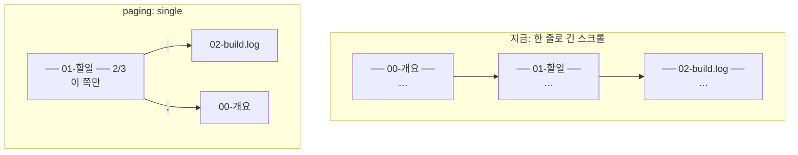

# proposal: 노트 하나를 한 쪽씩 넘겨 본다

라벨: proposal, needs triage
상위 이슈: 총괄 이슈 (워크트리를 보드에서 다룬다)

## 문제

책(폴더 노트)은 모든 쪽을 이어 붙여 하나의 긴 스크롤로 그린다. `,` 와 `.` 는 스크롤을 쪽의 첫 줄로 옮길 뿐이다. 워크트리의 개요, 할 일, 로그나 설계 노트 묶음을 훑을 때 넘기면 될 것을 스크롤해야 한다. 사용자는 노트에 포커스를 둔 채 쪽을 넘기고 싶어 한다. 긴 글을 자동으로 쪼개자는 얘기는 아니다. 노트 하나를 어떻게 볼지 고르는 설정이다.

## 제안

노트 하나의 `sticky.json` 항목에, `size` 와 `open` 옆에 값을 하나 둔다.

```json
"notes": { "worktree-a": { "open": true, "paging": "single" } }
```

- 이름은 `paging` 이다. 루트 `sticky.json` 에 이미 배치용 `view` 키가 있어 피했다.
- 기본값은 값이 없는 상태이며 지금과 똑같이 동작한다. `single` 이 아닌 값은 기본으로 읽는다.
- 토글 키는 책에 포커스가 있을 때 쓴다. 키 이름은 `page-mode` 로 하고 기본 키는 `v` 로 제안한다. `keymap.go` 의 기본 키 중에는 쓰이는 곳이 없다. 노트 종류가 자기 키로 쓰는지는 (확인 필요). 줌한 노트에서도 되도록 `zoom: true` 로 둔다.
- 토글은 보드가 쓴다. 사람이 파일을 손으로 고치지 않는다. 기본으로 돌아가면 키를 지워 흔적을 남기지 않는다(`SetRoot` 와 같은 방식).
- `single` 이면 현재 쪽 하나만 그린다. `,` `.` 는 쪽을 바꾸고 스크롤을 0 으로 되돌린다.
- 테두리의 `n/N` 은 지금처럼 `2/4` 로 보인다. `Summary` 가 이미 만들어 주므로 그대로 둔다.
- 쪽이 창보다 길면 `j` `k` 와 휠로 그 쪽 안에서 스크롤한다. 쪽 끝에서 다음 쪽으로 넘어가지는 않는다.
- 쪽마다 모양이 달라도 된다. 현재 쪽은 자기 종류의 키를 그대로 받는다.



## 대안

- 토글 키를 따로 두지 않고 `,` `.` 를 재활용하기: 키는 늘지 않지만 같은 키가 설정에 따라 다르게 움직여서, 키만 봐서는 지금 어느 모드인지 알 수 없다.
- 보드 전체 설정(루트 `sticky.json`)으로 두기: 설정은 하나로 끝나지만 책은 노트마다 쓰임이 다르다. 개요는 훑어 읽고 로그는 이어 읽는다. 그래서 노트 단위로 둔다.
- 긴 글을 쪽으로 자동 분할하기: 하지 않는다. 쪽은 파일이 정하고, 이 제안은 보는 방식만 바꾼다.

## 바뀌는 것

- `internal/adapter/store/view.go`: `View` 에 `Paging string` 필드(`json:"paging,omitempty"`)를 더한다. `empty()` 도 함께 고친다. 모르는 키는 이미 그대로 보존되므로 이전 보드는 안전하다.
- `internal/surface/app/book.go`: `book` 이 `single` 인지 알게 하고, 이 모드에서 `Draw` 는 `b.current()` 하나만 그린다. 규칙 줄(이름)은 그대로 둘지 (확인 필요). 이때 `starts` 는 그린 쪽 하나만 담으므로 `pageAt`, `settle`, `Click` 이 이를 가정하는지 (확인 필요).
- `internal/surface/app/reload.go`: `turn` 이 `single` 이면 쪽의 시작 줄이 아니라 스크롤 0 으로 보낸다. 책을 만드는 곳(`&book{...}`)에서 노트의 `View` 를 넘긴다.
- `internal/surface/app/keymap.go`: 이름 있는 액션 하나(`page-mode`)를 `actions()`, `boardHelp`, `keyGroups` 의 `scroll` 에 더한다. 이름이 있으므로 `keys.json` 에서 키를 바꿀 수 있다.
- `internal/surface/app/mainscreen.go`: `turnPage` 옆에 토글 함수를 둔다. 값은 `m.setView(...)` 로 쓴다(`manage.go` 가 `Color`, `Rows` 를 쓰는 방식).
- `docs/usage.md` 의 키 표, `docs/shapes.md` 의 Books 단락, `README.md`, `plugin/guide.md` 또는 `plugin/rules/` 는 동작에 맞춰 고친다. 줄 수 제한(55줄)을 지킨다.
- 데스크톱 앱도 같은 `sticky.json` 을 읽는다. 모르는 값을 무시하는지 (확인 필요).

## 하지 않을 것

- 긴 글을 쪽으로 자동으로 쪼개지 않는다.
- 설정 파일을 새로 만들지 않는다.
- 기본 동작을 바꾸지 않는다. 값이 없으면 지금과 같다.
- 책이 아닌 노트에는 적용하지 않는다.
- 쪽 끝에서 스크롤로 다음 쪽까지 넘어가는 동작은 넣지 않는다.

## 열린 질문

- 토글 키: `v` 가 맞는가. 노트 종류가 쓰는 키와 겹치는지 (확인 필요).
- 데스크톱 앱이 모르는 `paging` 값을 무시하는지 (확인 필요). 무시하지 않으면 `Protocol` 을 올려야 하는가. 브리지의 `protocol` 값은 현재 1 이다(`cmd/stickypane/bridge_test.go`). 정의가 어디 있는지는 (확인 필요).
- `single` 에서도 규칙 줄(쪽 이름)을 그릴 것인가, 테두리의 `n/N` 만으로 충분한가.
- 줌 상태에서 `zoomScroll` 과 `anchors` 를 쪽을 넘길 때 어떻게 갱신할 것인가.

## 테스트 계획

테스트는 `internal/surface/app/books_test.go` 에 더한다.

1. 기본 동작이 그대로인지 먼저 확인한다. 값이 없는 책의 `Draw`, `turn`, 테두리가 지금과 같아야 한다.
2. 토글: 키를 누르면 `sticky.json` 에 `"paging": "single"` 이 쓰이고, 다시 누르면 키가 지워진다.
3. `single` 에서 현재 쪽만 그려지고, 테두리가 `n/N` 을 보인다.
4. `,` `.` 로 쪽이 바뀌고 스크롤이 0 으로 돌아가며, 끝에서 더 넘어가지 않는다.
5. 쪽 종류가 섞인 책(노트, 체크리스트, 로그)에서 현재 쪽이 자기 키를 받는다.
6. 창보다 긴 쪽이 `j` `k` 로 스크롤된다.
7. 알 수 없는 `paging` 값은 기본으로 읽힌다.

## 에이전트 브리프

- 목표: 위 설정을 넣는다. 기본 동작은 그대로 둔다.
- 먼저 읽을 것: `internal/surface/app/book.go`, `reload.go`(`turn`), `keymap.go`, `mainscreen.go`(`turnPage`), `internal/adapter/store/view.go`, `docs/shapes.md`(Books), `books_test.go`.
- 할 일: 기본 동작 테스트부터 쓴다. 그다음 토글, 테두리 `n/N`, 모양이 섞인 책, 긴 쪽 순으로 쓴다. `docs/usage.md` 의 키 표와 README 를 고친다. 아직 아무도 쓰지 않는 키인지는 `keymap.go` 로 (확인 필요).
- 하지 말 것: 노트의 글을 스스로 쪽으로 쪼개지 않는다. 설정 파일을 더하지 않는다. 시간은 `internal/core/when` 으로만 쓴다(해당 없으면 무시).
- 끝난 기준: `go vet ./... && go test -race ./... && test -z "$(gofmt -l .)"` 가 통과한다. 진짜 보드에서 토글하는 화면을 캡처하거나 녹화한다. 데스크톱 앱이 같은 보드를 문제없이 연다.
