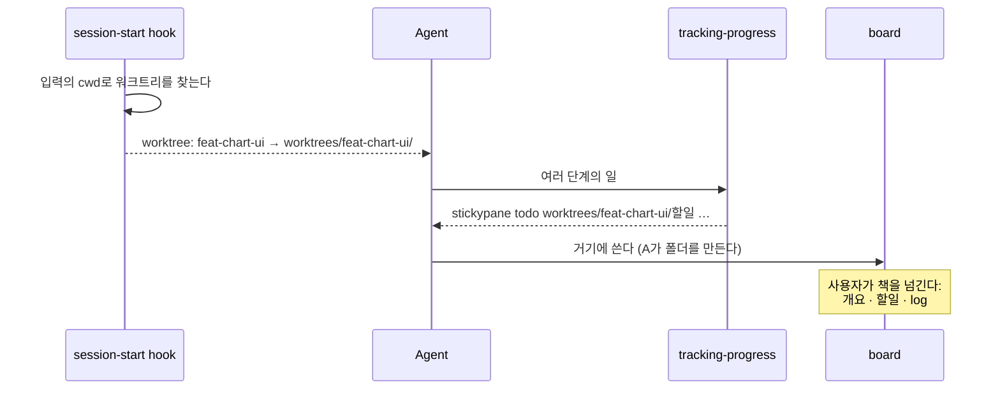

# proposal: 에이전트가 자기 워크트리를 한 줄로 안다

라벨: plugin, proposal, needs triage
상위 이슈: 총괄 이슈 (워크트리를 보드에서 다룬다)
선행: A

## 문제

보드는 워크트리마다 폴더를 가질 수 있다(A). 그런데 에이전트는 자기가 어느 워크트리에 있는지, 어느 폴더에 적어야 하는지 모른다. 모르니 노트를 보드 맨 위에 쓰고, 사용자는 워크트리 폴더에서 아무것도 못 본다.

지금의 세션 훅(`plugin/scripts/session-start.sh`)은 그걸 알려 주지 못한다.

- 훅은 `board-context.sh`로 `$PWD`에서 위로 `.sticky/`를 찾는다. `.sticky/`는 gitignore라 새 워크트리에는 없다. 그러면 `board-context.sh`가 3으로 끝나고 훅은 아무 말도 하지 않는다. 워크트리 안의 세션은 보드가 있다는 말조차 못 듣는다.
- 훅은 stdin의 훅 입력을 읽지 않는다. Claude Code에서 `CLAUDE_PROJECT_DIR`는 워크트리 안에서도 프로젝트 루트에 머문다(`2026-11-23-worktree-issues-draft.md`의 R4). 그래서 이 변수로는 워크트리를 알 수 없고, 훅 입력의 `cwd`를 써야 한다.

에이전트가 읽는 글에는 한도가 있다. 가이드(`plugin/guide.md`와 `plugin/rules/`)는 55줄까지다. `internal/usecase/initcmd/initcmd_test.go`의 `TestGuideIsShortAndCoversEveryShape`가 `Guide()`의 줄바꿈을 센다. `Guide()`는 `guide.md`, 두 rules(제목 줄 뺀 것), 닫는 표식을 이은 글이다. 실제로 세어 보니 지금 55줄이다. 파일별 `wc -l`은 6 + 26 + 24 = 56이지만, rules의 제목 줄까지 센 값이라 테스트가 세는 값과 다르다. 한도에 이미 닿아 있으니 한 줄을 더하려면 한 줄을 덜어야 한다. 스킬은 파일당 80줄 이하, 첫 `stickypane` 명령이 본문 600바이트 안에 있어야 하고, 실제 명령 이름만 써야 한다(`test/plugin_test.go`).

## 제안

새 스킬도, 바뀌는 명령도 없다. 에이전트가 새로 배우는 것은 한 줄이다.

1. **한 줄 안내 (수준 1).** 세션 훅이 워크트리 안에서 한 줄을 더 찍는다.

   ```
   worktree: feat-chart-ui → worktrees/feat-chart-ui/
   ```

   워크트리는 훅 입력 JSON의 `cwd`로 찾는다(R4). `CLAUDE_PROJECT_DIR`는 쓰지 않는다. `cwd`가 없거나 읽지 못하면 지금처럼 `$PWD`로 되돌아간다. 이름은 A의 R2에 따라 브랜치가 아니라 워크트리 디렉터리 이름이다. 주 워크트리에서는 줄을 찍지 않는다. 폴더가 아직 없어도 줄은 찍는다.

   보드를 찾는 방법도 A를 따른다. 워크트리에 자기 `.sticky/`가 없으면 `git`이 알려 주는 주 워크트리의 `.sticky/`를 쓴다. 이 부분의 `git` 호출(`git -C <cwd> rev-parse --git-common-dir` 등)이 맞는지는 A의 구현과 맞춰 정한다(확인 필요).

2. **폴더가 준비되어 있음 (수준 2).** 에이전트가 처음 쓰는 순간 폴더가 생긴다(A의 R3). 에이전트는 폴더를 만들 필요 없이 명령에 폴더 이름만 붙이면 된다.

   ```sh
   stickypane todo worktrees/feat-chart-ui/할일 add "차트 축 고치기"
   ```

   `todo` 같은 명령이 노트 이름에 폴더를 받는지는 확인되지 않았다(확인 필요). 안 받으면 이 이슈보다 먼저 A나 별도 이슈에서 고친다.

3. **끝에서 한 번 더 일러 주기 (수준 3).** 끝날 때 도는 훅(예: `Stop`)이 워크트리 폴더에 아무것도 안 적었으면 한 줄로 알려 준다. Claude Code와 Codex가 이런 훅을 지원하는지, 출력을 에이전트에게 돌려주는지는 확인하지 못했다(확인 필요). 기본은 수준 1과 2이고, E의 실험에서 에이전트가 워크트리 폴더에 적는 비율이 낮게 나올 때만 3을 한다.

규칙은 한 번만 쓴다. `plugin/rules/touching-the-board.md`에 한 줄을 더한다("워크트리 안이면 훅이 알려 준 폴더 밑에 적는다"는 뜻). 한도를 지키려고 같은 파일의 다른 줄 하나를 줄이거나 합친다. 어느 줄인지는 구현에서 정하되, 가이드 테스트가 요구하는 낱말(`stickypane todo`, `stickypane show` 등)은 남겨야 한다. 스킬에는 규칙을 다시 쓰지 않고, `tracking-progress`의 명령 예시 블록에 폴더 붙인 예 한 줄만 더한다.



## 대안

- **새 스킬 `working-in-a-worktree`.** 스킬은 에이전트가 불러야 읽힌다. 불러 주지 않으면 한 줄도 전달되지 않는다. 훅은 매 세션에 무조건 나간다. 사용자도 새 스킬을 원하지 않는다.
- **`CLAUDE_PROJECT_DIR`로 판단.** 워크트리 안에서도 루트에 머물러서 늘 주 워크트리로 읽힌다(R4). 쓰지 않는다.
- **명령이 폴더를 알아서 붙이기.** 에이전트가 이름만 쓰면 보드가 현재 워크트리 폴더로 보내는 방식이다. 에이전트가 배울 것은 줄지만, 같은 명령이 위치에 따라 다른 노트를 건드리는 건 예상 밖이고, `stickypane`의 명령 규칙도 바뀐다. 이번에는 하지 않고 열린 질문으로 둔다.
- **가이드에 길게 쓰기.** 55줄 한도 때문에 안 된다.
- **수준 3을 처음부터.** 훅 지원이 확인되지 않았고, 턴이 끝날 때마다 말을 걸면 양쪽 다 성가시다. 실험(E)으로 필요가 보일 때만 한다.

## 바뀌는 것

- `plugin/scripts/session-start.sh`: stdin의 훅 입력에서 `cwd`를 읽고, 워크트리면 `worktree: <이름> → worktrees/<이름>/` 한 줄을 더 찍는다. 입력이 비었거나 읽을 수 없으면 `$PWD`로 되돌아간다. 입력을 읽는 방법(`jq`가 없을 수 있어 `sed` 등)은 구현에서 정한다.
- `plugin/scripts/board-context.sh`: 워크트리에서 주 워크트리의 `.sticky/`를 찾는다. 지금은 `$PWD`에서 위로만 걷는다.
- `plugin/rules/touching-the-board.md`: 규칙 한 줄을 더하고, 한 줄을 줄이거나 합친다. `Guide()`가 55줄을 넘지 않는다.
- `plugin/skills/tracking-progress/SKILL.md`: 예시 블록에 폴더를 붙인 명령 한 줄. 80줄 이하를 지킨다.
- `test/plugin_test.go`: 훅 테스트에 워크트리 경우를 더한다(아래 테스트 계획).
- `plugin/hooks/claude-hooks.json`, `plugin/hooks/codex-hooks.json`: 수준 1과 2에서는 바뀌지 않는다. `SessionStart` 항목 그대로다. 수준 3을 할 때만 끝 훅을 더한다.
- README와 `docs/architecture.md`의 훅 설명에서 한 줄을 고친다. 가이드는 영어로 쓴다(`docs/translating.md`).

## 하지 않을 것

- 새 스킬, 새 명령, 바뀌는 명령 이름.
- 스킬에 규칙을 되풀이하기. 규칙은 `plugin/rules/`에 한 번만 쓴다.
- 가이드를 55줄 넘게 늘리기.
- 에이전트가 폴더를 직접 만들거나 `.sticky/` 파일을 직접 쓰기. 폴더는 A가 만들고, 쓰기는 `stickypane` 명령으로 한다.
- 시각을 훅이나 에이전트가 적기. 시각은 보드가 `internal/core/when`으로 쓴다.
- 오래된 form과 승인 규칙. "옛 `submitted`는 즉시 같은 답을 돌려준다"거나 "wait가 3으로 끝나면 아니오"는 F에서 다룬다.
- 수준 3을 기본으로 켜기.
- 사용자의 보드(`.sticky/`)를 훅이 바꾸기. 훅은 읽고 말하기만 한다.

## 열린 질문

1. `todo` 등 명령이 `worktrees/<이름>/할일` 같은 폴더 포함 이름을 받는가? 안 받으면 A에서 어떻게 풀 것인가. (확인 필요)
2. Codex의 `SessionStart` 훅 입력에도 `cwd`가 들어 있는가? Claude Code만 R4에서 확인했다. (확인 필요)
3. 워크트리 이름을 훅에서 어떻게 구하는가? 디렉터리 이름만 쓰면 되는가, 충돌 시의 짧은 해시(A)까지 맞춰야 하는가. 이름 규칙은 한 곳(A의 구현)에서 가져온다. 훅이 따로 계산하지 않는다.
4. 줄여서 합칠 가이드 줄은 어느 것인가? 구현에서 정하고 PR에서 보인다.
5. 수준 3의 훅(`Stop` 등)을 두 도구가 지원하는가. 출력이 에이전트에게 닿는가. 다시 불러 무한히 도는 일은 없는가. (확인 필요)
6. 수준 3으로 가는 문턱 비율은 몇 퍼센트인가? E의 첫 결과를 보고 정한다.
7. 에이전트가 이름만 쓰면 보드가 현재 워크트리 폴더로 보내는 방식(대안의 셋째)을 나중에 할 것인가.
8. 사용자가 데스크톱 앱 세션을 쓰면 설정과 훅을 주 체크아웃 루트에서 읽는다는 조사가 있다. 이때도 `cwd`가 워크트리를 가리키는가. (확인 필요)

## 테스트 계획

- **가이드 줄 수.** `go test ./internal/usecase/initcmd`의 `TestGuideIsShortAndCoversEveryShape`가 통과한다(`Guide()`가 55줄 이하). 지금 55줄이라 한 줄 더하면 이 테스트가 실패하고, 이 실패가 한 줄을 덜어 내게 만든다.
- **스킬 테스트.** `TestTheSkillsAreShortAndOpenWithWhatToDo`(80줄 이하, 명령이 앞에 있음), `TestTheHarnessNamesOnlyRealCommands`(실제 명령 이름만), `TestTheHarnessNamesOnlyFilesThatExist`가 그대로 통과한다.
- **훅 테스트.** `TestSessionStartHookIsQuietWithoutABoard`와 같은 방식으로 가짜 `stickypane`와 임시 git 저장소를 만든다.
  - 주 워크트리: `worktree:` 줄이 없다.
  - 링크된 워크트리(`git worktree add`): stdin에 `{"cwd": "<워크트리 경로>"}`를 주면 `worktree: <이름> → worktrees/<이름>/` 줄이 나온다.
  - 같은 경우에서 `CLAUDE_PROJECT_DIR`를 주 워크트리로 두어도 줄이 같다(R4).
  - stdin이 비었을 때: `$PWD`로 되돌아가 죽지 않는다.
  - 보드가 없으면 계속 조용하다(종료 코드 0, 출력 없음).
- **전체.** `go vet ./... && go test -race ./... && test -z "$(gofmt -l .)"`.
- **에이전트가 따르는가.** E의 "워크트리에서 시작" 경우(훅이 말한 폴더를 쓰고 보드 루트에 쓰지 않는가)가 Claude Code와 Codex 양쪽에서 통과한다. 실행은 모델 호출이라 돈이 든다. 첫 실행은 유지보수자가 승인한다.
- 수준 3을 하게 되면 훅 지원을 먼저 확인하고(확인 필요), 같은 E의 경우로 수준 1과 2 대비 비율이 올랐는지 잰다.

## 에이전트 브리프

- **목표:** 훅의 한 줄, 가이드 규칙 한 줄, 스킬 예시 한 줄. 에이전트가 이 셋 말고 배울 것은 없다.
- **먼저 읽을 것:** `plugin/scripts/session-start.sh`, `plugin/scripts/board-context.sh`, `plugin/hooks/claude-hooks.json`, `plugin/hooks/codex-hooks.json`, `plugin/guide.md`, `plugin/rules/`, `plugin/skills/tracking-progress/SKILL.md`, `test/plugin_test.go`, `internal/usecase/initcmd/initcmd_test.go`, `docs/translating.md`, 이 이슈의 선행 A.
- **지킬 것:** 워크트리는 훅 입력의 `cwd`로 찾는다(`CLAUDE_PROJECT_DIR` 아님). `Guide()`는 55줄 이하다. 가이드와 스킬은 영어로 쓴다. 규칙은 `plugin/rules/`에 한 번만 쓴다. 시각은 쓰지 않는다. 쓰기는 `stickypane` 명령으로만 한다.
- **하지 말 것:** 스킬 추가, 규칙을 스킬에 되풀이하기, 명령 이름 바꾸기, 사용자의 `.sticky/` 건드리기, 커밋과 푸시, 수준 3 구현(실험 뒤에 정한다).
- **확인되지 않은 것은 확인하고 쓸 것:** 폴더 포함 노트 이름, Codex 훅 입력의 `cwd`, `Stop` 훅. 확인하지 못하면 코드에 넣지 말고 이슈에 `(확인 필요)`로 남긴다.
- **끝난 조건:** 위 테스트 계획의 훅 테스트와 줄 수 테스트가 통과하고, 전체 검사 세 줄이 통과하며, E의 워크트리 경우가 통과한다.
