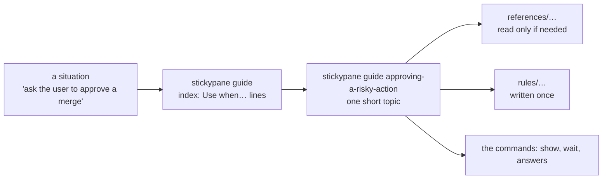
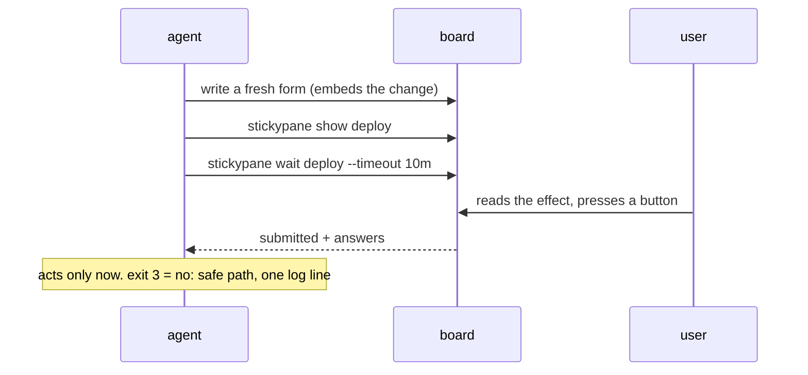

# proposal: 에이전트 가이드를 상황별로 나누고, 필요할 때 한 쪽만 읽게 한다

라벨: plugin, docs, proposal, needs triage
상위 이슈: 총괄 이슈 (워크트리를 보드에서 다룬다)
선행: 없음 (E로 효과를 잰다)

## 문제

에이전트가 보드로 들어가는 길은 스킬 다섯 개와 모양(shape) 열두 개다. 둘 다 이름이 "무엇인가"만 말하고, "언제 쓰는가"는 말하지 않는다. 모양이 있는 줄 모르는 에이전트는 아는 것, 곧 Markdown만 쓴다.

- 그림이 필요한데 글로 풀어 쓴다. mermaid 블록이 그려진다는 사실은 `plugin/rules/writing-notes.md`에 한 줄 있을 뿐이고, 언제 그려야 하는지는 어디에도 없다.
- 숫자는 문장 속에 들어가고, 시간에 따른 값도 chart 대신 글로 쓴다.
- 결정은 채팅 질문이 된다. form, `wait`, 답을 읽는 순서는 `asking-the-user`를 열어야 보이는데, 에이전트는 그 스킬을 열 이유를 모른다.
- 승인이 모양 사이에서 이어지지 않는다. form은 명령만 보여 주고 효과를 보여 주지 않는다. 시간 초과가 "동의"로 읽히고, 옛 `submitted` 답이 그대로 다시 쓰이기도 한다.
- script, api(`.http`), html, book은 `references/kinds.md`를 열어야 알 수 있다. 열 계기가 없다.
- 워크트리 안에서 무엇을 할지는 가이드에 한 줄도 없다. (총괄 이슈의 설계가 정해진 뒤에 쓸 수 있다. 열린 질문 참고.)

지금 가이드는 이미 한도에 닿아 있다. 테스트가 세는 `Guide()`가 지금 정확히 55줄이고, 한도도 55줄이다(`wc -l`로 세면 6+26+24=56이지만 규칙 파일의 제목 줄까지 센 값이다). 모양을 더 설명할 자리가 없다. 그래서 설명을 한 곳에 몰지 않고, 필요할 때 한 쪽만 읽게 바꾸자고 제안한다.

## 제안

가이드를 **상황(use case)** 별로 다시 자른다. 있는 장치를 그대로 쓰고, 새 명령은 만들지 않는다.

### 색인

`stickypane guide`는 이미 개요 뒤에 `harness.Index()`, 곧 스킬마다 `Use when …` 한 줄을 붙여 출력한다(`internal/usecase/api/guide.go`). MCP의 `guide` 도구와 프롬프트도 같은 스킬을 쓴다. 이 제안은 그 색인을 상황으로 다시 쓰는 일이다.

- 에이전트는 색인만 읽고, 맞는 상황의 주제 하나를 `stickypane guide <주제>`로 가져온다.
- 주제 하나가 하는 일은 한 가지다. 처음에 실행할 명령이 나오고, 이름은 실제 명령과 파일만 쓴다.
- 길거나 드물게 필요한 내용(모양 전체, 긴 예시)은 `references/`에 둔다. `Read`는 이 파일을 싣지 않는다(`harness_test.go`가 확인한다). 그래서 "필요할 때만 읽는다"가 지금 구조로 이미 성립한다.
- 규칙은 `plugin/rules/`에 한 번만 쓰고 주제는 가리키기만 한다. 주제끼리는 노트처럼 이름으로 서로 가리킨다.

### 주제의 꼴

주제는 지금 스킬과 같은 파일이다: `plugin/skills/<주제>/SKILL.md`. 새 장치가 없고, 이미 있는 테스트가 그대로 적용된다.

1. 머리에 `name`과, `Use when`으로 시작하는 `description`. 이 한 줄이 색인이 된다.
2. 제목 뒤 600자 안에 `stickypane …` 명령이 나온다.
3. 80줄 이하.
4. 이 주제가 쓰는 모양을 한 줄씩 밝힌다. 모양의 전체 형식은 `stickypane help <shape>`가 가리킨다.
5. 다른 주제로 넘길 때는 그 이름만 쓴다.

### "무엇을 보여 줄까 → 어떤 모양" 표

색인 맨 앞의 길잡이(`using-the-board`)에 둔다. `plugin/guide.md`나 규칙에 넣으면 55줄 한도에 걸린다. 처음 초안이다.

| 보여 줄 것 | 모양 | 한 줄 |
| --- | --- | --- |
| 구조, 흐름, 순서, 스키마 | note + mermaid 블록 | 글로 풀지 말고 그린다 |
| 단계, 해야 할 일 | checklist | `stickypane todo` |
| 단계가 칸으로 움직이는 일 | board | `stickypane card` |
| 시간에 따른 숫자, 분포, 진행률 | chart | `stickypane chart`, 진행률은 `from:` |
| 일어난 일을 순서대로 | log | `stickypane log` |
| 사용자가 고를 것, 승인할 것 | form | `stickypane wait` |
| 사용자에게 보내는 한 문장, 사용자의 한 문장 | chat | `stickypane say` |
| 사용자가 눌러서 실행할 명령 | script (`name.sh`) | 사용자가 yes를 해야 돈다 |
| HTTP/WebSocket/gRPC 요청과 검사 | api (`.http`) | `stickypane api` (실험 단계) |
| 읽기만 하는 비교표, 보고서 | html | 터미널에는 글만 보이므로 결론은 note에 한 줄 |
| 쪽이 여럿인 긴 글 | book | 탭 안의 폴더 |

### 선택과 승인은 모양 사이에서 이어진다

주제 `approving-a-risky-action`이 규칙을 한 번만 쓴다. 근거는 워크트리 이슈 초안의 R8과 use-case 문서의 "선택·승인이 다른 shape와 엮이는 패턴"이다.

1. **효과를 보여 주는 form.** 명령만 묻지 않는다. 본문에 변경 요약이나 로그 노트(`![[run]]`)를 임베드해서 사용자가 효과를 보고 누른다.
2. **행동 전에 `wait`.** 위험한 행동은 `stickypane wait <name> --timeout <시간>`이 끝난 뒤에만 한다.
3. **시간 초과는 no.** `wait`가 종료 코드 3이면 안전한 길로 가고, 로그에 남긴다: `stickypane log worklog --time "no answer, took safe path"`. 답을 추측하지 않는다.
4. **form은 매번 새로.** `submitted` 키가 남은 form은 옛 선택으로 바로 답한다. 새 승인은 새 form이고, 그 키를 빼고 쓴다.
5. **확인은 시각으로.** E는 위험한 행동이 `submitted_at` 뒤에 왔는지 본다. (키 이름: (확인 필요). 지금 `wait`는 `at:`을 출력한다.)

### 첫 주제 목록

열두 개다. 지금 스킬 다섯 개(`using-the-board`, `tracking-progress`, `asking-the-user`, `talking-in-chat`, `connecting-notes`)를 이 목록 안으로 다시 자른다. 출처 칸의 코드는 `docs/history/specs/2026-11-23-shape-usecases.md`의 사례 번호다.

| 주제 | Use when | 모양 | 출처 사례 |
| --- | --- | --- | --- |
| `using-the-board` | the user says "on the board", or something is better seen than read; and to pick a shape | 전부 (위의 표) | 근거: 모양 사용 조사 전체 |
| `tracking-the-work` | a task has more than a few steps, or the user asks "where are we" | checklist, board, log | C1, C2, C8, B3, L7 |
| `talking-while-working` | the user may send instructions while you work, or the answer you need is a sentence | chat | T2, T4, T8, T9 |
| `drawing-a-diagram` | you explain a structure, a flow, an order of calls or a schema | note + mermaid | N2, N3, N7 |
| `planning-before-code` | before a non-trivial change, to show the plan where the user can read it | note, checklist, form | N1, F2, C1 |
| `reporting-a-blocker` | you are stuck, or the choice is between ways forward | note, chat, form | N6, T5, C7 |
| `choosing-between-options` | the user must choose and the options can be listed | form, board, html | F1, F5, B4, H1 |
| `approving-a-risky-action` | an action is hard to undo: deploy, delete, push, migrate | form, log, script | F1, F3, F7, F8, B8, L5 |
| `showing-numbers` | you have numbers over time, a distribution or a progress rate | chart, log | C1, C5, C7 (chart); L9 |
| `handing-over-a-command` | a command should run on the user's yes, not by you | script, form, log | S1, S7, S10 |
| `checking-an-api` | you changed or learn an HTTP, WebSocket or gRPC API and want proof | api (`.http`), log | A1, A2, A3 |
| `reading-long-material` | a report, a comparison or a guide runs to many pages | book, html, note | B1, B2, B5, H1, H2, H3 |

`connecting-notes`(`[[링크]]`, `![[임베드]]`, `from:`, `stickypane watch`)는 위 열두 개에 들지 못해서, `using-the-board`의 표 한 줄과 `approving-a-risky-action`(`watch --type form.submitted`)에서 가리킨다. 이 자리는 열린 질문이다.

## 위키와 같은 점과 다른 점

LLM wiki 식의 읽기를 따른다. 색인 하나를 먼저 읽고, 필요한 쪽 하나만 끌어오고, 더 필요하면 `references/`로 내려간다.

| | 위키 | 이 제안 |
| --- | --- | --- |
| 입구 | 색인 쪽 | `stickypane guide`의 `Use when` 목록 |
| 읽는 때 | 필요할 때 당겨 읽는다 | 같다. 처음에는 색인만 싣는다 |
| 쪽 사이 | 서로 링크한다 | 주제 이름으로 가리킨다. 규칙은 `rules/`에 한 번 |
| 쓰는 사람 | 에이전트가 위키를 고쳐 쓴다 | **다르다.** 가이드는 에이전트에게 읽기 전용이다 |
| 에이전트가 쓰는 곳 | 위키 | **보드**(`.sticky/`). 가이드는 프로그램에 실려 있다 |
| 정리 순환 | 에이전트가 낡은 쪽을 고친다 | 없다. 가이드는 저장소에서 사람이 고치고 테스트가 지킨다 |

에이전트가 가이드를 고치지 않는 것은 여러 에이전트와 사용자가 같은 가이드를 읽기 때문이다. 에이전트가 쓰는 것은 노트이고, 노트는 이미 `stickypane` 명령으로만 바꾼다.

## 언어 정책

- **가이드와 스킬은 영어로 둔다.** `docs/translating.md`가 정한 대로, 읽는 쪽이 모델이고 모델은 영어를 가장 잘 읽는다. 이 제안은 가이드를 번역하지 않는다.
- **에이전트가 쓰는 노트는 사용자의 언어를 따른다.** `plugin/rules/writing-notes.md`에 이미 "Write in the user's language"가 있다. 새 주제의 예시 노트도 이 줄을 어기지 않게 하고, 이 규칙은 E의 한 사례로 잰다.
- 번역한 스킬이 더 잘하는지는 E에서 먼저 재고, 그 결과가 나오기 전에는 번역하지 않는다.
- 이 이슈의 본문이 한국어인 것은 가이드의 언어와 무관하다.

## 줄 수 한도

- 테스트는 `internal/usecase/initcmd/initcmd_test.go`의 `TestGuideIsShortAndCoversEveryShape`다. `Guide()`(`plugin/guide.md`에 규칙 두 개를 붙인 것, 표지 줄 포함)의 `"\n"` 수가 **55를 넘으면 실패**한다.
- 지금 `Guide()`는 55줄이다(`initcmd_test.go`가 세는 값, D에서 확인). `wc -l` 합계 56은 제목 줄까지 센 값이다.
- 색인과 주제는 이 한도에 들지 않는다. `stickypane guide`가 개요 뒤에 색인을 덧붙이고(`api/guide.go`), 그 덧붙인 부분은 `Guide()`가 돌려주는 글이 아니기 때문이다. 주제는 따로 80줄 한도(`test/plugin_test.go`)를 받는다.
- 그래서 모양 표는 `Guide()`에 넣지 않고 `using-the-board`에 둔다. `plugin/guide.md`와 규칙의 줄 수는 늘리지 않는다.

## 대안

- **가이드 본문에 모양 설명을 더 넣는다.** 한도 55줄에 이미 닿아 있고, 모든 에이전트가 모든 세션에서 읽는 줄이 늘어난다. 기각.
- **`references/kinds.md`를 처음부터 싣는다.** 모양 열두 개가 길 뿐 아니라 "언제"가 없다. `harness_test.go`도 싣지 않는 것을 검사한다. 기각.
- **모양마다 주제 하나(`chart`, `form`, …).** `stickypane guide <shape>`가 이미 있다. 에이전트에게는 모양 이름이 아니라 상황이 먼저 떠오른다. 모양별 쪽은 그대로 두고, 상황별 주제가 그리로 가리킨다.
- **가이드를 한국어로 낸다.** 위 언어 정책. E로 잰 뒤에 정한다.
- **에이전트가 가이드를 고쳐 쓰게 한다(진짜 위키).** 가이드가 사용자마다 달라지고 테스트가 지킬 수 없다. 기각.

## 바뀌는 것

- `plugin/skills/` 아래를 스킬 열두 개로 다시 자른다. 이름을 바꾸거나 합친 스킬은 `plugin/commands/*.md`(`/board:ask`, `/board:track`, `/board:say` …)가 가리키는 이름도 함께 고친다.
- `plugin/rules/`: 승인 규칙(위 다섯 가지)을 한 번 쓴다. 어디에 쓸지(새 규칙 파일이나 `touching-the-board.md`)는 열린 질문이다. 줄 수는 한도 안에 둔다.
- `plugin/skills/using-the-board/SKILL.md`: 모양 표와 색인의 길잡이.
- `test/plugin_test.go`의 `skillNames` 목록, 그리고 `harness_test.go`의 `len(skills) < 5` 같은 숫자.
- `docs/plugin.md`("Adding a skill", 규칙 설명), `docs/agents.md`의 계층 표(스킬 이름이 나오는 줄), README와 번역본(`docs/ko/`, `README.ko.md`; 해당 부분이 있는지 (확인 필요)), 에이전트 쪽 문구(MCP 프롬프트).
- 새 명령은 없다. `stickypane guide`, `stickypane guide <주제>`, MCP `guide` 도구는 그대로다.

## 하지 않을 것

- 가이드와 스킬을 번역하지 않는다.
- 같은 규칙을 주제 둘에 쓰지 않는다. 규칙은 `plugin/rules/`에 한 번이다.
- `references/`를 기본으로 싣지 않는다.
- `plugin/guide.md`와 규칙의 55줄 한도를 넘기지 않는다. 한도를 올리지도 않는다.
- 새 명령, 새 모양, 새 의존성을 만들지 않는다.
- 에이전트가 가이드를 고치게 하지 않는다.
- 사용자의 `.sticky/`를 건드리지 않는다.
- 위험한 행동을 가이드가 대신 막지는 않는다. 가이드는 순서를 말하고, 지켰는지는 E가 잰다.

## 열린 질문

1. 열두 개로 충분한가. `connecting-notes`를 독립 주제로 세우고 다른 주제를 합칠지, 지금 안대로 둘지.
2. 승인 규칙은 `plugin/rules/`의 새 파일이 맞는가, 기존 파일에 붙일 것인가. 합친 줄 수가 55줄을 넘으면 안 된다.
3. 모양 표를 `using-the-board` 아닌 곳에 두면 에이전트가 더 자주 보는가. E로 확인한다.
4. 워크트리 주제(여러 워크트리에서 누가 기다리는지, 내 폴더가 어디인지)는 총괄 이슈의 설계가 확정된 뒤에 추가한다. 이번 열두 개에는 넣지 않았다.
5. `submitted_at`이라는 키가 실제로 있는가. 지금 `wait` 출력은 `at:`이다. 승인 시각을 어디서 읽을지는 (확인 필요).
6. 주제가 `references/`를 갖게 될 때 MCP로는 읽히지 않는다(`Read`가 싣지 않으므로). 모양 전체는 `stickypane help <shape>`로 가는 것으로 충분한가.
7. 주제 이름의 영어 형식(`-ing` 동명사, `approving-a-risky-action` 같은 긴 이름)이 `stickypane guide <주제>`를 치기에 부담스럽지 않은가.
8. `api` 셰이프는 `stickypane api <file> <request>`가 묻지 않고 보낸다. 위험한 요청이 든 파일에서 가이드가 한 줄을 더 가져야 하는지(use-case 문서 A8).

## 테스트 계획

기존 테스트는 설명을 바꾸지 않고 그대로 통과해야 한다. 바꾸는 것은 스킬 이름과 개수뿐이다.

- `internal/usecase/harness`: 스킬이 열두 개이고 `using-the-board`가 처음이며, 모든 `Description`이 `Use when`으로 시작한다. `Index()`가 줄마다 주제 이름을 가진다. `Read`가 규칙은 한 번씩 싣고 `references/`는 싣지 않는다.
- `test/plugin_test.go`: 모든 주제가 80줄 이하이고 600자 안에 명령이 있다. 쓰인 파일은 모두 있고, `stickypane <명령>`은 모두 실제 명령이다. 모양 표가 `stickypane kinds`의 모든 모양을 한 번씩 다룬다(새 테스트. 모양 목록을 코드에서 읽는 방법은 (확인 필요)).
- `internal/usecase/initcmd`: `TestGuideIsShortAndCoversEveryShape`가 그대로 통과한다(55줄).
- 새 테스트: 승인 규칙의 핵심 문장(종료 코드 3은 no, 새 form)이 `plugin/rules/`에만 있고 주제 파일에는 되풀이되지 않는다.
- 위의 `go vet ./... && go test -race ./... && test -z "$(gofmt -l .)"` 세 개가 모두 통과한다.
- **E로 효과를 잰다.** 같은 상황 묶음을 옛 가이드와 새 가이드로 돌린다. 본다: 고른 모양이 맞는가(그림이 필요한 곳에 mermaid, 시간별 숫자에 chart), 위험한 행동이 `submitted` 시각 뒤에 왔는가, 종료 코드 3 뒤에 안전한 길을 택했는가, 승인 form이 새로 만들어졌는가, 노트가 사용자의 언어로 쓰였는가. 번역한 스킬과의 비교도 같은 틀로 잰다.

## 에이전트 브리프

- **목표:** 같은 명령을 상황으로 찾게 한다. 틀린 모양이 줄어든다.
- **먼저 읽을 것:** `docs/translating.md`, `internal/usecase/harness/harness.go`와 그 테스트, 루트의 `harness.go`, `internal/usecase/api/guide.go`, `test/plugin_test.go`, `plugin/skills/*`와 `references/`, `plugin/rules/*`, `plugin/guide.md`, `docs/plugin.md`, `docs/agents.md`, `docs/history/specs/2026-11-23-shape-usecases.md`(네 보고서 전부), 워크트리 이슈 초안의 "Revisions after the use-case research"(R8).
- **할 일:**
  1. 위 열두 주제를 `plugin/skills/<주제>/SKILL.md`로 쓴다. 한 주제에 사례 하나가 아니라, 출처 칸의 가장 강한 사례들을 한 상황으로 묶는다.
  2. 모양 표를 `using-the-board`에 넣고, 승인 규칙을 `plugin/rules/`에 한 번 쓴다.
  3. 이름이 바뀐 스킬을 가리키는 곳(`plugin/commands/`, 문서, 테스트의 `skillNames`)을 모두 고친다.
  4. 고치기 전과 후를 E로 같은 사례에서 잰다.
- **하지 말 것:** 가이드를 번역하지 않는다. 규칙을 두 주제에 되풀이하지 않는다. `references/`를 기본으로 싣지 않는다. 가이드의 줄 수 한도를 넘기지 않는다. 존재하지 않는 명령이나 파일을 쓰지 않는다. 확인하지 못한 것은 `(확인 필요)`로 둔다.
- **끝난 조건:** 위의 세 검사(`go vet`, `go test -race`, `gofmt`)가 통과하고, E에서 새 가이드의 올바른 모양 선택이 옛 가이드보다 늘었다.
