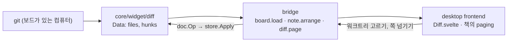

# proposal: 데스크톱 앱이 터미널이 보여 주는 것을 그린다

라벨: proposal, needs triage
상위 이슈: 총괄 이슈 (워크트리를 보드에서 다룬다)
선행: A, B, C

## 문제

A, B, C는 터미널을 먼저 정한다. 그런데 앱도 같은 보드를 그리고, VISION 5는 앱이 그리는 일 말고는 터미널이 못 하는 일을 하지 않는다고 말한다. 이 이슈가 없으면 앱은 워크트리를 그냥 폴더로 보여 주고, diff 노트를 읽지 못하고, 한 쪽씩 넘기지도 못한다. 어느 워크트리에서 무엇이 바뀌었는지, 누가 돌고 누가 기다리는지도 앱에서는 알 수 없다.

## 제안

앱은 그리기만 하고 로직은 Go에 남는다. 앱이 보는 Data는 터미널이 쓰는 것과 같다 (ADR-0005: shape마다 Data와 Act, Act는 `doc.Op`).

| 기능 | 앱에서 |
| --- | --- |
| A 워크트리 폴더 | 워크트리는 책이다. 앱은 이미 `board.load`의 `pages`로 책을 그린다 (`Board.svelte`, `view.ts`의 `pageOf`). 책 머리에 상태 배지를 단다 |
| A+R1 상태 | 저장하는 값은 `open`/`closed`. 보여 줄 때 `running`(git이 `locked`로 알림), `waiting`(답 없는 form 수)를 더 계산한다. 계산은 Go, 앱은 배지만 그린다 |
| B 한 쪽씩 | `note.arrange`가 노트의 `paging`을 받는다 (`size`, `rows`, `pin` 옆). 책 컴포넌트는 `paging: single`이면 한 쪽과 `n/N` 표시만 그리고, 키는 터미널과 같은 `,` `.`에 버튼을 더한다 |
| C diff | `diff` shape의 Data를 `Diff.svelte`가 그린다. 워크트리 고르기, 파일 목록, 한 파일의 색 입힌 줄 |
| D / F | 그릴 것 없음. 에이전트가 읽는 안내다 |

### 흐름



### 시안

```text
┌ 워크트리 책: fix-login ─────────── ● running ┐   ┌ diff ──────────────────────────┐
│ 00-개요      1 / 3        ‹  ›              │   │ 워크트리: [ fix-login  v ]  base: main │
│ (한 쪽만 보인다, paging: single)             │   │ ▸ src/auth.go        M  +12 -3  │
│                                              │   │   web/login.svelte   M   +4 -1  │
│ 대기: form 1                                 │   │   logo.png           binary     │
└──────────────────────────────────────────────┘   │ ── src/auth.go  (1 / 9쪽) ‹ › ──│
                                                   │ +  token := newToken()          │
                                                   │ -  token := ""                  │
                                                   └─────────────────────────────────┘
```

### bridge

지금 메서드는 `hello`, `board.load`, `note.act`, `note.create`, `note.arrange`, `tab.order`, `note.move`, `note.archive`, `note.trash`, `note.restore`, `kinds.list`, `board.index`, `note.open`, `note.run`, `note.send` (`internal/surface/bridge/bridge.go`). 새 것과 바뀌는 것은 이렇다.

| 무엇 | 내용 |
| --- | --- |
| `note.arrange`에 `paging` | `arrangeParams`에 `Paging *string` 하나. 값은 B가 정한다 (`single` 또는 빈 값). 책 노트의 `board.load` 응답에도 `paging`이 실린다 |
| `board.load`의 상태 | 책의 `Note`에 `state`(`open`·`closed`·`running`·`waiting`)와 `waiting` 수. 필드 이름은 구현 때 정한다 (확인 필요) |
| `diff.page` (새 메서드) | 인자 `{note, file, page}`. 한 파일의 한 쪽만 돌려준다. 큰 diff를 `board.load`에 통째로 싣지 않으려고 둔다 |
| `board.load`의 diff Data | 목록만 싣는다: `{worktree, base, worktrees:[…], files:[{path,status,add,del}]}`. 줄은 싣지 않는다 |
| 워크트리 고르기 | 별도 메서드 없이 `note.act`의 `Act`로 한다 (ADR-0005). 고른 워크트리는 노트의 `doc.Op`로 남는다 (확인 필요: 파일에 남길지, 창 상태로 둘지) |

`Protocol`은 지금 `1`이고, 맞지 않는 화면은 업데이트하라고 한다. 필드만 더하는 일(`paging`, `state`)은 옛 화면이 모르는 키를 무시할 테니 올리지 않아도 된다 (확인 필요). 새 메서드 `diff.page`는 옛 본체에는 없으니, 앱은 `hello`의 `protocol`로 확인해야 한다. 올릴지는 열린 질문이다.

### 컴포넌트

- `desktop/frontend/src/shapes/Diff.svelte` (새 파일). `Shape.svelte`에 `diff` 분기를 더한다. 워크트리 고르기 상자, 파일 목록, 한 파일의 줄. 줄 색은 `Palette`의 `good`·`bad`를 쓴다.
- 책 컴포넌트는 따로 파일이 없다. 책은 `Board.svelte`와 `board/view.ts`(`pageOf`, `goToPage`), `board/keys.ts`가 그린다. `paging: single`을 여기서 읽는다 (확인 필요: 책 그리기를 따로 떼어낼지).
- 상태 배지는 책 머리(`NoteFrame.svelte`)에 단다 (확인 필요: 머리가 맞는 자리인지).
- 쪽 넘기기는 앱에 `‹ 2 / 5 ›`, `[` `]`, 스와이프가 이미 있다 (10-terminal-parity 10.1). 터미널은 `,` `.` `<` `>`다. 새 키를 더하지 않는다.

### 원격 보드

원격 보드는 ssh 너머에서 `stickypane bridge`를 돌린다 (02 §2.10, `desktop/internal/remote`). diff는 보드가 있는 컴퓨터에서 읽으므로, 원격 워크트리의 diff는 원격에서 읽어 같은 프로토콜로 온다. 앱은 git을 부르지 않는다. 원격 stickypane이 옛 버전이면 `diff.page`가 없다. 이때 앱은 "원격 stickypane을 업데이트하세요"라고 알린다. 연결 확인이 이미 bridge 유무를 본다.

### 홈 화면

`~/.stickypane`은 `registry.Read`가 읽고(`internal/adapter/registry/read.go`), 앱의 색인은 읽기만 한다 (`registryfs`). 홈 화면이 보드의 워크트리와 열림·닫힘을 나열하는 일은 처음엔 하지 않는다 (열린 질문).

### 말 (i18n)

`desktop/frontend/src/i18n/en.json`과 `ko.json`에 같은 키를 넣는다. 둘이 어긋나면 `words.test.ts`가 잡는다.

| 키 | en | ko |
| --- | --- | --- |
| `diff.worktree` | Worktree | 워크트리 |
| `diff.base` | Base: {name} | 기준: {name} |
| `diff.files` | {n} files changed | 파일 {n}개 바뀜 |
| `diff.none` | No changes | 바뀐 것 없음 |
| `diff.binary` | Binary file | 바이너리 파일 |
| `diff.gone` | This worktree is gone | 이 워크트리는 없어졌어요 |
| `diff.page` | Page {n} of {total} | {n} / {total}쪽 |
| `state.running` | Running | 일하는 중 |
| `state.waiting` | Waiting for you ({n}) | 기다리는 중 ({n}) |
| `state.closed` | Closed | 닫힘 |

문구는 초안이고 구현 때 다듬는다. 기존 `note.page` (`{n} / {m}`), `ui.page.*`를 먼저 다시 쓴다.

## 대안

- **diff를 `board.load`에 통째로 싣기.** 가장 간단하다. 하지만 큰 diff가 갱신할 때마다 오가고, 원격에서는 매번 ssh로 흐른다. 기각.
- **앱이 git을 직접 부르기.** 앱의 로직이 둘이 되고 VISION 5와 ADR-0010(터미널이 먼저)에 어긋난다. 기각.
- **홈 화면에 워크트리 목록 먼저.** 보기에는 좋지만 색인과 레지스트리 읽기가 넓어진다. diff 노트 안에서 시작하고 홈은 나중에.
- **`paging`을 `view`에 합치기.** `sticky.json`의 `view`는 보드의 배치라 이름이 겹친다 (ADR-0004). 그래서 노트의 설정은 `paging`이다.

## 바뀌는 것

- `internal/surface/bridge/protocol.go`: `arrangeParams.Paging`, 새 메서드의 인자, `Protocol` (올린다면)
- `internal/surface/bridge/load.go`: 책 `Note`의 `paging`과 상태, diff 목록 Data
- `internal/surface/bridge/bridge.go`: 메서드 표에 `diff.page` 한 줄
- `desktop/frontend/src/shapes/Diff.svelte` (새 파일), `Shape.svelte`, `Chart.svelte`처럼 `data.ts`의 Data 타입
- `desktop/frontend/src/board/Board.svelte`, `view.ts`, `keys.ts`, `NoteFrame.svelte`: `paging`과 배지
- `desktop/frontend/src/i18n/en.json`, `ko.json`
- `desktop/frontend/src/demo/ShapesDemo.svelte` (`?demo=shapes`)와 `shapes/fixtures/board.json`, `shapes.fixtures.test.ts`. 픽스처는 `desktop/scripts/shape-fixtures.sh`로 다시 만든다
- `docs/desktop/02-system-architecture.md` 2.4.2 표(diff 한 줄), `docs/desktop/10-terminal-parity.md`(워크트리, `paging`, diff 줄), 아키텍처 문서

## 하지 않을 것

- 프런트엔드에서 diff나 워크트리 상태를 계산하지 않는다.
- 터미널에 없는 키나 선택지를 앱에 더하지 않는다.
- 큰 diff를 `board.load`에 통째로 싣지 않는다.
- 앱에서 워크트리를 만들거나 지우지 않는다. 읽고 그린다.
- 홈 화면의 워크트리 목록은 이 이슈에서 하지 않는다.
- 다른 shape의 `Data`를 바꾸지 않는다. 시각은 `internal/core/when`으로만 쓴다.

## 열린 질문

1. `Protocol`을 2로 올릴까, 1에 머물며 `hello`로 기능을 알릴까? 올리면 옛 앱이 새 본체와 못 만나고, 안 올리면 앱이 `diff.page`가 없을 때를 알아야 한다.
2. 고른 워크트리는 노트 파일에 남을까, 이 컴퓨터의 창 상태일까? (R5: 복사된 `.sticky/`가 겹칠 수 있다.)
3. 상태 `running`은 git의 `locked`에서 온다. Claude Code가 아닌 도구는 확인하지 않았다.
4. 책 그리기를 `Board.svelte`에서 컴포넌트로 떼어낼까?
5. 홈 화면 워크트리 목록은 어느 이슈에서?
6. R10: 워크트리마다 `api.http`의 포트가 부딪친다. 이 이슈에서 한 줄 안내만 더할까?

## 테스트 계획

- **Go (bridge).** 책에 `paging`이 실리고 `note.arrange`로 쓰인다. `diff.page`는 쪽 범위 밖, 없는 파일, 사라진 워크트리에 `bad_request`·`not_found`를 돌려준다. 옛 요청은 그대로 통한다 (`bridge_test.go`와 같은 방식).
- **픽스처 (상태마다 `desktop/scripts/shape-fixtures.sh`로 진짜 bridge에서 만든다).** 파일 많음, 파일 하나, 바이너리, 바뀐 것 없음, 워크트리 없어짐, 책 `single` 한 쪽, 배지 넷(`open`, `closed`, `running`, `waiting`). `shapes.fixtures.test.ts`가 요약으로 물러서지 않고 모두 그리는지 본다.
- **vitest.** 쪽 넘기기 키와 버튼, `n/N` 표시, 워크트리 고르기가 `note.act`로 가는지, 말이 en과 ko에 다 있는지.
- **진짜 앱.** 실제로 빌드해서 밝은 테마와 어두운 테마를 캡처한다. 둘째 워크트리의 diff를 터미널이 보여 주는 것과 나란히 놓는다. 큰 diff(수백 파일, 긴 한 파일)를 열어 느려지지 않는지 본다. 원격 보드도 한 번 연다.
- **끝낼 때.** `go vet ./... && go test -race ./... && test -z "$(gofmt -l .)"`와 데스크톱 테스트가 통과한다.

## 에이전트 브리프

- **목표:** 앱이 워크트리 책, 한 쪽씩 보기, 워크트리 고르기가 있는 diff, 상태 배지를 터미널과 같은 Data로 그린다.
- **먼저 읽기:** `docs/desktop/02-system-architecture.md` (2.4, 2.6, 2.10), `docs/desktop/10-terminal-parity.md`, `docs/desktop/adr/0004`, `0005`, `0006`, `internal/surface/bridge/` (`protocol.go`, `load.go`), `desktop/frontend/src/shapes/` (`Shape.svelte`, `Html.svelte`, `Chart.svelte`, `shapes.fixtures.test.ts`), `desktop/frontend/src/board/`.
- **할 일:** Go 쪽을 먼저(Data와 bridge 메서드, 테스트와 함께). 다음에 컴포넌트와 픽스처. en과 ko 말을 함께 더한다. 진짜 앱에서 밝음과 어둠, 큰 diff를 확인하고 캡처한다.
- **하지 말 것:** 프런트엔드에서 diff나 상태를 계산하기, 터미널에 없는 키 더하기, 큰 diff를 `board.load`에 싣기, `(확인 필요)`를 짐작으로 채우기.
- **끝난 기준:** `go vet ./... && go test -race ./...`와 데스크톱 테스트가 통과하고, 앱이 진짜 둘째 워크트리의 diff를 터미널과 같게 보여 준다.
