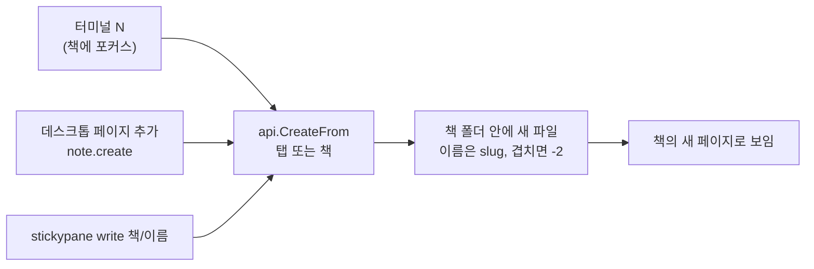

# proposal: 책 안에서 페이지를 바로 더한다

라벨: proposal, needs triage
상위 이슈: 총괄 이슈 (워크트리를 보드에서 다룬다)
선행: 없음

## 문제

책은 폴더 하나가 노트 하나로 보이는 것이고, 그 안의 파일이 페이지다. 페이지를 늘리는 길은 지금 둘뿐이다.

- 이미 있는 노트를 책에 넣는다. `m` 키, `stickypane mv plan deploy/`, 데스크톱의 이동 대화창(`note.move`).
- 이름에 폴더를 붙여 만든다. `stickypane write deploy/notes` (책에도 되는지는 확인 필요).

책을 보다가 페이지를 하나 더 붙이려면 불편하다. 노트를 맨 위에 만들고, 책으로 옮기고, 이름을 맞춘다. 세 번이다.
`N`과 데스크톱 만들기 대화창은 `CreateFrom`의 첫 인자에 빈 문자열을 넘겨서 맨 위에 만든다(`internal/surface/app/create.go`).
`CreateFrom`은 탭 이름만 받고, 탭 안의 책(하위 폴더)은 모른다(`internal/usecase/api/create.go`).

워크트리마다 책 한 권을 두면(#141) 이 불편이 커진다. 워크트리가 열 개면 책도 열 개이고, 사용자는 책 이름을 직접 쳐야 한다.

## 제안

**책 안에 바로 만든다.** `CreateFrom`의 첫 인자를 "탭"에서 "탭 또는 책(폴더 경로)"으로 넓힌다. 세 화면이 같은 길을 쓴다.

| 화면 | 동작 |
| --- | --- |
| 터미널 | 책에 포커스가 있으면 `N`이 그 책 안에 새 페이지를 만든다. 책이 아니면 지금처럼 맨 위 |
| 데스크톱 | 책의 페이지 영역에 "페이지 추가". 만들기 대화창이 그 책을 기본 위치로 쓴다. 브리지의 `note.create`는 이미 `Tab` 값을 받는다 |
| CLI | `stickypane write <책>/<이름>`이 책 안에 만들어진다. 지금 되는지 확인하고, 안 되면 고친다 |

**옮기기에서 책을 고르기 쉽게 한다.** `m` 목록과 데스크톱 이동 대화창의 후보에 책을 보인다.
워크트리 책(#141)은 이름 옆에 브랜치와 상태(열림, 닫힘)를 달아 보인다.
후보 목록은 보드가 가진 폴더 목록에서 만들고, 워크트리 정보는 있을 때만 덧붙인다. 레지스트리가 꺼져 있어도 동작해야 한다.

**설정이 노트를 따라간다.** `sticky.json`의 키가 노트의 전체 이름(`deploy/build.log`)이라서, 옮기면 키가 바뀐다.
크기, 열림, 고정, 색, 그리고 한 페이지씩 보기(#142의 `paging`)가 옮긴 노트에 남는지 확인한다. 남지 않으면 `mv`가 항목을 같이 옮긴다.
이것은 지금도 있는 문제일 수 있다 (확인 필요).

## 대안

- **지금 그대로 두기.** 세 번의 동작은 책이 하나일 때는 견딘다. 워크트리마다 책이 생기면 견디기 어렵다.
- **책에서 `N` 대신 새 키를 만들기.** 키를 하나 더 외워야 한다. 포커스한 것이 책이면 `N`이 책 안에 만든다는 규칙이 더 단순하다.
- **데스크톱에만 두기.** VISION 5가 막는다. 앱은 터미널이 못 하는 것을 하지 않는다.

## 바뀌는 것

- `internal/usecase/api/create.go`: `CreateFrom`의 첫 인자를 탭 또는 책으로. 없는 폴더는 `fs.ErrNotExist`로 거절하는 지금 규칙을 책에도 적용.
- `internal/surface/app/create.go`: 포커스한 노트가 책이면 그 책을 넘긴다.
- `internal/surface/bridge`: `note.create`가 책 경로를 받는지 (확인 필요).
- `desktop/frontend/src/create/CreateDialog.svelte`, `board/MoveDialog.svelte`: 기본 위치, 후보 목록.
- `internal/surface/app/` 이동 목록, `desktop/frontend/src/i18n/{en,ko}.json`의 새 글.
- `docs/usage.md`, `docs/shapes.md`(Books), README.

## 하지 않을 것

- 책을 새로 만드는 방법을 바꾸지 않는다. 폴더를 만들면 책이다.
- 책이 아닌 노트 안에 노트를 만들지 않는다.
- 워크트리 정보를 이 이슈에서 만들지 않는다. 있으면 보여줄 뿐이다.

## 열린 질문

- `stickypane write <책>/<이름>`이 지금 책 안에 만드는지 (확인 필요).
- 책 안의 새 페이지 이름은 slug이고, 책의 순서에서 어디에 놓이는지. 끝에 놓는 것을 권한다 (확인 필요).
- 탭 안의 책만 되는지, 탭 안의 탭(깊은 폴더)도 되는지 (확인 필요).
- 설정이 `mv`를 따라가는지, 아니면 이 이슈에서 고쳐야 하는지.

## 테스트 계획

- `CreateFrom`: 탭, 책, 없는 폴더, 이름 겹침(`-2`), 맨 위. 기존 탭 동작이 그대로인지.
- 터미널: 책에 포커스했을 때와 아닐 때의 `N`.
- 브리지: `note.create`에 책 경로.
- `mv` 뒤 `sticky.json` 항목이 따라가는지.
- 데스크톱: 페이지 추가와 이동 후보에 대한 화면 시험, 실제 앱에서 확인.

## 에이전트 브리프

- **목표:** 책 안에서 페이지를 한 번에 만든다. 터미널, 데스크톱, CLI가 같은 길을 쓴다.
- **먼저 읽을 것:** `internal/usecase/api/create.go`, `internal/surface/app/create.go`, `internal/surface/bridge/bridge.go`(`noteCreate`), `docs/shapes.md`의 Books, `docs/desktop/10-terminal-parity.md`, `desktop/frontend/src/create/`, `desktop/frontend/src/board/MoveDialog.svelte`.
- **할 일:** 테스트 먼저. `CreateFrom`부터 넓히고, 화면은 그 위에 얹는다. 터미널을 먼저 하고 데스크톱이 따른다.
- **하지 말 것:** 노트 파일을 직접 쓰기(`store.Apply`와 `doc.Op`만), 터미널에 없는 키를 앱에 더하기, 새 모듈.
- **끝난 조건:** `go vet ./... && go test -race ./... && test -z "$(gofmt -l .)"`와 데스크톱 시험이 통과하고, 실제 앱에서 책 안에 페이지를 더한 화면을 캡처해 확인한다.
