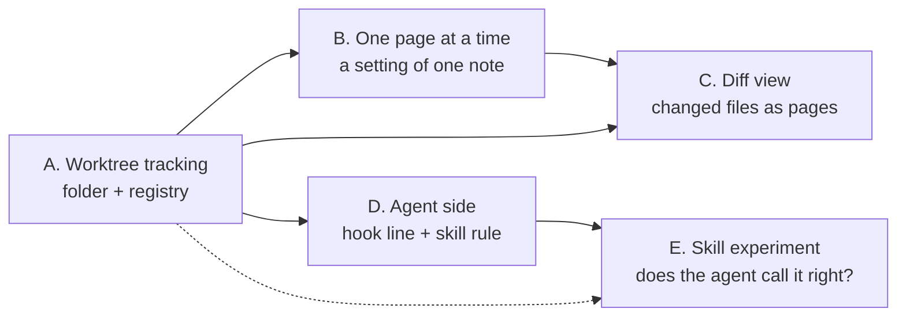
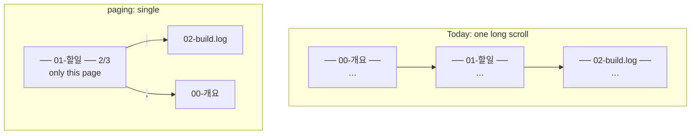
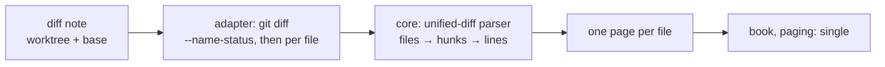
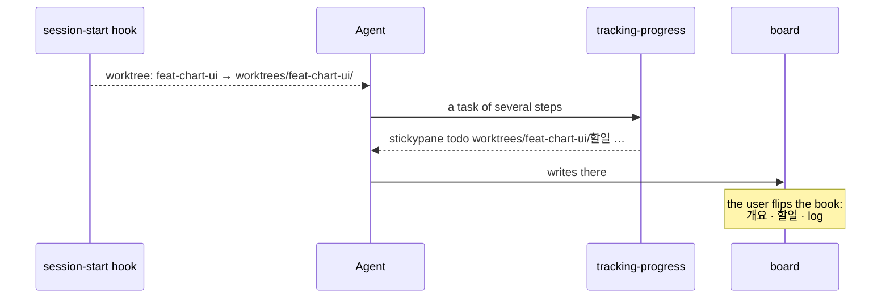
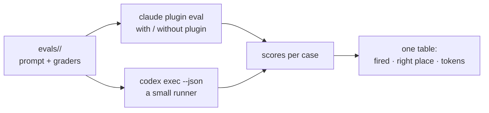
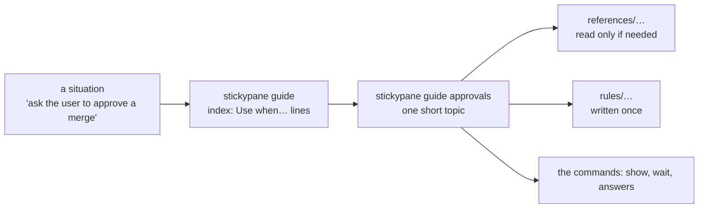
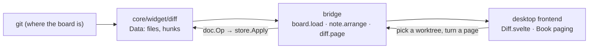

# Issue drafts: worktrees on the board

Draft, 2026-11-23. Not posted. One umbrella proposal and seven child issues (A to G),
in the repository's `proposal` form (title `proposal: …`, labels `proposal`,
`needs triage`). Each child ends with an **Agent brief**: what an agent
that picks it up needs, so it can start without the chat that produced it.

Things marked **(check)** were read from the code or inferred and not run.

---

## Umbrella: `proposal: worktrees on the board`

### The problem

An agent often works in a git worktree, one per branch, several at once.
The board does not know a worktree exists:

- `.sticky/` is gitignored, so a new worktree has no board; the agent starts
  empty or runs `init` for a board nobody watches.
- The only trace of a branch is a `@feat/chart-ui` tag typed on a kanban
  card; where the worktree is, and whether it still exists, is nowhere.
- A user watching three agents in three worktrees has no one place to see
  each worktree's work, and cannot flip through a worktree's notes in one
  view.
- To review what a worktree changed, the user leaves the board for `git
  diff`.

### The proposal

One board per repository, shared by its worktrees. Inside it, each worktree
is a **book** (a folder shown as one note; its files are **pages**, each of
its own shape). The board follows git: it reads `git worktree list`, makes
the folder, notices a move or a removal. Two features of the board that
other things need are added on the way: a note can be viewed **one page at
a time**, and a worktree's changes can be read in a **diff** book.



What the user sees, in a tab:

```
┌ worktrees/feat-chart-ui · 01-할일.md ────────── 2/4 ┐
│ [ ] 차트 색 고치기                                   │
│ [x] 막대 간격 맞추기                                 │
│ [ ] 범례 위치                                        │
│                                                      │
│ ,  .  previous / next page                           │
└──────────────────────────────────────────────────────┘
 pages: 00-개요.md (note) · 01-할일.md (checklist)
        02-build.log (log) · diff (changed files)
```

### Alternatives

- **A board in every worktree.** `.sticky/` is gitignored: the notes die
  with the worktree, and the user watches several boards.
- **A registry only, no folders.** Cheapest, but gives no page per worktree.
- **Where a worktree is, stored as** YAML or TOML (a new module each, for a
  file the board writes), SQLite (a binary file and a module for a handful
  of rows), or front matter in a note (a path is a fact of one computer,
  and git already knows it).

### What it changes

New: `worktrees/<name>/` folders, `~/.stickypane/worktrees.json`, a `paging`
setting in `sticky.json`, a `diff` shape. Changed: how every command finds
`.sticky/` in a worktree, the session hook, one rule in
`plugin/rules/touching-the-board.md`. Fits VISION.md: the folder stays the
product; what is one computer's (paths) stays in `~/.stickypane`; nothing
to configure; the agent learns one line.

### Order

A → B → C, D with A, E after A and D. Each is its own issue and its own
pull request.

---

## A. `proposal: the board follows git worktrees`

### The problem

See the umbrella. The board has no idea where a worktree is or that it was
removed.

### The proposal

**Which board.** `git worktree list --porcelain` names the main worktree
first; a repository's board is that worktree's `.sticky/`. A process in
another worktree uses it, unless that worktree has a `.sticky/` of its own
at its root, which wins.

**The folder.** `worktrees/<name>/` with `00-개요.md` (what the branch is
for, its state) and `01-할일.md`. `<name>` is the branch with `/` as `-`; a
detached worktree takes the last element of its path; a collision gets a
short hash of the path. The main worktree gets no folder.

**Where a worktree is.** `~/.stickypane/worktrees.json` (state now:
`{name, path, branch, state}` per board, keyed by the main worktree's
`git rev-parse --git-common-dir`) and `events/<date>.jsonl` (`worktree.open`
`.close` `.move`). JSON, standard library only. Written only where the
registry already writes (the app's `overlay.json` is there); with it off the
board reads git every time and keeps `closed` in `00-개요.md`.

```mermaid
sequenceDiagram
  participant Ag as Agent (in a worktree)
  participant B as board / command
  participant G as git
  participant S as .sticky/ (main)
  participant R as ~/.stickypane
  Ag->>B: stickypane … (or the board opens)
  B->>G: worktree list --porcelain
  G-->>B: paths, branches, prunable
  B->>S: lock; folder missing? make worktrees/<name>/
  B->>S: gone/prunable? set 00-개요 state: closed (doc.Op)
  B->>R: worktrees.json + events line (best effort)
  B-->>Ag: worktree: <name> → worktrees/<name>/
```

| Git says | The board does |
| --- | --- |
| a worktree with no folder | makes the folder and its notes; records `open` |
| same branch, new path | updates the path; `worktree.move` |
| gone or `prunable` | `closed` in the registry and the note; keeps the folder |
| a folder with no worktree and no record | leaves it (a person made it) |
| `locked`, or only unmounted | stays `open` |

Layers: the git calls and the registry write are `adapter` (a new package
for running git beside `runner`; the registry's writer in
`adapter/registry`); the sync rule is a use case; `core` only learns the
note's state field. **(check)** whether the folder is made by `store` or a
use case.

### What it changes

`internal/adapter/registry`, a git adapter, the root-finding code (one
place, **check**), `docs/architecture.md`, README.

### Agent brief

- **Goal:** the board follows worktrees as in the table; nothing else.
- **Read first:** VISION.md, AGENTS.md, `docs/architecture.md`
  (layers, the registry), `internal/adapter/registry/registry.go`,
  `internal/adapter/store/store.go`, `internal/adapter/filelock`.
- **Do:** tests first: a fake `git worktree list --porcelain` in `testdata`,
  a golden `worktrees.json` like the registry's golden home. Every change to
  a note is a `doc.Op` through `store.Apply`; times through
  `internal/core/when`; new package gets a rank and a line in the
  architecture table.
- **Do not:** write a note's file directly; read `time.Now` where a stamp is
  made; add a module; delete a closed folder; change a note the user made.
- **Done when:** `go vet ./... && go test -race ./... && test -z "$(gofmt -l .)"`
  pass, and in a real second worktree the folder appears, moves with the
  worktree and closes when it is removed (capture it; see the project's
  rule to verify in the real app).

---

## B. `proposal: a note can be viewed one page at a time`

### The problem

A book draws all its pages one after another as one long scroll; `,` and `.`
only jump the scroll to a page's first line. To look through a folder of
related pages (a worktree's overview, tasks, log; a set of design notes) the
user scrolls, where a flip would do. This is a choice of one note, not a
rule that long text is split.

### The proposal

A setting of one note, in its `sticky.json` entry, beside `size` and `open`:
`"paging": "single"`. Default (no value) is today's behaviour. A key toggles it
on the focused book; the board writes it as the user arranges, never by
hand. In `pages` view only the current page is drawn, `,` and `.` change the
page, and the border keeps `2/4`. A page longer than the pane still scrolls
with `j`/`k`. Pages may be of different shapes; each takes its own keys.



### What it changes

`store.View` gets a field (`internal/adapter/store/view.go`; unknown keys
are already kept, so older boards are safe); `internal/surface/app/book.go`
`Draw` draws `b.current()` alone in this view; `turn`
(`reload.go`) resets the scroll to 0 instead of a page's start; one action
in `keymap.go` (named, so `keys.json` can change it). The desktop app reads
the same `sticky.json`: **(check)** it ignores a value it does not know.

### Agent brief

- **Goal:** the setting above, default unchanged.
- **Read first:** `internal/surface/app/book.go`, `reload.go` (`turn`),
  `keymap.go`, `internal/adapter/store/view.go`, `docs/shapes.md` (Books),
  `books_test.go`.
- **Do:** test the default first (it must not change), then the toggle, the
  border `n/N`, a mixed-shape book, the long page. Update `docs/usage.md`'s
  key table and the README. A key nobody uses yet: **(check)** `keymap.go`.
- **Do not:** split a note's text into pages by itself; add a config file.
- **Done when:** the three checks pass; a recording or capture of the toggle
  in a real board; the desktop app opens the same board unharmed.

---

## C. `proposal: a diff book for a worktree's changes`

### The problem

To see what a worktree changed, the user leaves the board. Wanted: the
changed files, and the code of each, in a view inside the board.

### The proposal

A `diff` shape. A note `diff` in a worktree's book names the worktree and a
base (default `main`; the note can say another) and shows its changes as a
book: one page per changed file, the file's change drawn with added and
removed lines in colour. Read from git when shown, never stored, so it never
disagrees with the repository. With `paging: single` (B) the user flips through
files with `,` `.`; a file longer than the pane scrolls.



```
┌ feat-chart-ui · diff ───────────────── 3/7 ┐
│ M internal/core/widget/chart/view.go  +12 −3│
│ @@ -41,7 +41,9 @@ func (m Model) bar(…      │
│   width := m.width                          │
│ - gap := 1                                  │
│ + gap := max(m.width/40, 1)                 │
└────────────────────────────────────────────┘
```

Reads: `git diff --name-status <base>...HEAD` plus `git status --porcelain`
(uncommitted and untracked), then `git diff <base>...HEAD -- <file>` for the
file on screen; big diffs are read per page, binary files say "binary".
Parser: standard library, in `core/widget/diff` (draws text it is given;
`core` reads no environment); git runs in an adapter. How a book takes pages
that are not files is the open design question: write them as derived files
under the worktree's folder, or let the book take a source of pages
**(check which; recommended: the source, so nothing derived is kept)**.
Function-level views are out of scope (a parser per language).

**Choosing the worktree.** The diff is not tied to one worktree. The first
page of the diff book lists every worktree git knows, with what each
changed, and the user picks one; the pages after it are that worktree's
files. The choice is the user's, so the board keeps it (and the base) in
the note's entry in `sticky.json`, like the other things the user arranges;
a note may still name a worktree in its front matter to pin it. With no
choice made, the default is the worktree the board was started in.

```
┌ diff · pick a worktree ──────────────────────────── 1/8 ┐
│ ▸ feat/chart-ui        main…  7 files  +128 −41  open   │
│   refactor/widget      main…  3 files   +22 −19  open   │
│   feat/api-widget      main…  —  merged            closed│
│                                                         │
│ j k choose · enter open · b change base (main)          │
└─────────────────────────────────────────────────────────┘
        enter │  (pages 2…8 are the files of feat/chart-ui)
              ▼
┌ feat/chart-ui · diff ─────────────────────────────── 3/8 ┐
```

The list comes from `git worktree list` and `git diff --shortstat`, read
when shown, not from the registry (A), so it works with the registry off,
and a worktree that is gone is listed as closed from the folder A keeps.
Each row's counts are read only for rows on screen. **(check)** the keys
(`enter`, `b`) are free on a book page, and whether the list is a page of
the diff book or a form-like shape of its own; the first is simpler.

### Agent brief

- **Goal:** changed files as pages, each file's change drawn; read-only.
- **Read first:** `docs/architecture.md` ("A shape of note"), the `html` and
  `logview` shapes (view-only), `internal/surface/app/book.go`, B's design.
- **Do:** the parser first, with fixtures of real diffs (rename, binary, no
  newline at end, mode change). The shape has `kind.go`, `format.go`,
  `model.go`, `ops.go`, `view.go`, `events.go` and a line in
  `internal/core/kinds`.
- **Do not:** write to a note from the diff; shell out from `core`; read a
  whole large diff at once.
- **Done when:** the three checks pass, and a diff of this repository's own
  last commit looks right in the real app.

---

## D. `proposal: the agent learns its worktree in one line`

### The problem

The board can have a folder per worktree, but the agent has to know its name
without learning anything new. The guide is held to 55 lines
(`plugin/guide.md` with `plugin/rules/`), and **(check)** the three files
add up to 56 now.

### The proposal

No new skill and no command that changes. The session hook that prints the
board (`plugin/scripts/session-start.sh`, for Claude Code and Codex) prints
one more line in a worktree: `worktree: feat-chart-ui → worktrees/feat-chart-ui/`.
`tracking-progress` gets one line (notes of this work go in that folder, with
the commands as they are, e.g. `stickypane todo worktrees/feat-chart-ui/할일
add "…"`); the rule is written once in `rules/touching-the-board.md`, and a
line is cut elsewhere to stay within the budget. **(check)** `todo` and the
other commands take a folder in the note's name.



### Agent brief

- **Goal:** the line, the rule, the skill line; nothing the agent must learn
  beyond them.
- **Read first:** `plugin/scripts/session-start.sh`, `plugin/guide.md`,
  `plugin/rules/`, `plugin/skills/tracking-progress/SKILL.md`,
  `test/plugin_test.go` (the skills are tested: short, open with a command,
  name only real commands and files).
- **Do not:** add a skill; repeat a rule in a skill; pass 55 lines.
- **Done when:** the plugin tests pass, and E's worktree case passes.

---

## E. `proposal: an experiment that measures whether agents call the board right`

### The problem

Skills and the hook line are text an agent may or may not follow. There is
no measure of whether Claude Code or Codex calls them, calls them right, or
does better with them than without.

### The proposal

Cases split by use case, run on both agents, scored the same way.

| Case | What is measured |
| --- | --- |
| start in a worktree | uses the hook's folder, not the board's root |
| a task of several steps | calls `tracking-progress`; ticks when done |
| a decision for the user | `asking-the-user` (a form), not a chat question |
| talking with the user | `talking-in-chat` |
| notes that count each other | `from:`, not hand-kept numbers |
| a request that needs no board | does not touch the board (false positives) |

Per case: skill fired, the right command and place, steps and tokens, and
the same case with the plugin and without.



Claude: `claude plugin eval` reads `evals/**/case.yaml` (or `prompt.md` and
`graders/*.md`), has a `with-without` baseline and a `tool_used: Skill`
grader. Codex: `codex exec --json`, events graded by the same rules.
**(check)** both against `--help` and a first run. Runs are real model calls
and cost money: the first run is the maintainer's to approve.

Open: use the CLIs as above (recommended: no dependency, little code), or
build on the Agent SDK for finer traces (a new module; AGENTS.md asks for a
reason and a licence check).

### Agent brief

- **Goal:** the cases above, runnable by one command each, results in a
  table; no run without the maintainer's yes.
- **Read first:** `claude plugin eval --help`, `codex exec --help`,
  `plugin/skills/*/SKILL.md`, D.
- **Do not:** commit results containing a person's paths or keys; run the
  suite in CI before its cost is agreed.
- **Done when:** a dry list of the cases prints, and one agreed run produces
  the table.

---

## F. `proposal: the agent guide is organised by situation, and read on demand`

### The problem

The agent's way into the board is five skills and twelve shapes, named by
what they are, not by when the agent needs them. An agent that does not
know a shape exists writes Markdown, which is what it knows: diagrams go in
a note as text, numbers in a sentence, a decision as a chat question.
Nothing tells it which shape fits a situation, how a choice or an approval
should run (a form, a wait, the answer read back), or what to do in a
worktree.

### The proposal

Re-cut the guide by **use case** (the situations researched for each shape;
see the use-case document), keeping the machinery that is there:

- A topic is a situation with a `Use when …` line (as the skills do now:
  `internal/usecase/harness` tests for it). `stickypane guide` prints the
  index of those lines; `stickypane guide <topic>` and the MCP `guide` tool
  give one topic. The agent fetches the one it needs; nothing is loaded up
  front beyond the index.
- A topic is short, opens with a command, names only real commands and
  files (the existing skill tests), and points to `references/` for what is
  read only when needed (the shapes in full, long examples).
- Topics link to each other the way notes do; a rule is written once in
  `plugin/rules/`.
- A table in the index maps "what to show" to a shape (diagram → a note
  with a mermaid block, numbers over time → chart, a decision → form, …),
  and one topic describes how a choice or approval runs across shapes (a
  form that embeds the thing to approve; `wait` before acting).
- **Language: English.** The guide and skills stay English, as
  `docs/translating.md` says (the reader is a model). The notes an agent
  writes follow the user's language; that is a rule and a case in the
  experiment (E), not a translation of the guide. Whether a translated
  skill does better is measured in E before anything is translated.



### What it changes

`plugin/skills/` and `plugin/rules/` (re-cut), the 55-line budget of the
guide (the index adds lines, topics do not count: **(check)** how the test
counts), `stickypane guide`'s index, the MCP prompts. No new command.

### Agent brief

- **Goal:** the same commands, found by situation; fewer wrong shapes.
- **Read first:** `docs/translating.md`, `internal/usecase/harness`,
  `test/plugin_test.go`, `plugin/skills/*`, the use-case document.
- **Do:** one topic per use case the research found strongest; measure with
  E before and after (the same cases, with the old guide and the new).
- **Do not:** translate; repeat a rule in two topics; load references by
  default; pass the guide's line budget.
- **Done when:** the plugin tests pass and E shows the right shape chosen
  more often than with the old guide.

---

## G. `proposal: the desktop app draws what the terminal shows`

### The problem

A, B, C and D are decided for the terminal first, but the desktop app draws
the same board for those who want it, and VISION 5 says the app does
nothing the terminal cannot, except draw. Without this issue the app shows
a worktree as a plain folder, the diff as a note it cannot read, and offers
no way to flip pages one at a time.

### The proposal

The app follows each feature, drawing only; the logic stays in Go.

| Feature | In the app |
| --- | --- |
| A worktree folders | a worktree is a book (the app already draws books from `pages` in `board.load`); `~/.stickypane` is read through `registry.Read`, so the home screen can list a board's worktrees with open/closed |
| B one page at a time | `note.arrange` gains the note's `paging` (beside `size`, `rows`, `pin`); the book component draws one page and a `n/N` mark, with the same `,` `.` keys and a button |
| C diff | the `diff` shape's Data (`{worktree, base, worktrees:[…], files:[{path,status,add,del}], page}`) drawn by `Diff.svelte`: the worktree list, then a file list beside the coloured lines of one file |
| D / F | nothing to draw: the guide is for the agent |



What it rests on, read from `docs/desktop/02-system-architecture.md`
and the code: each shape has a **Data** (what it says) and an **Act** (what
a click does, as a `doc.Op`); the frontend is one Svelte component per
shape in `desktop/frontend/src/shapes/`; the bridge speaks a numbered
protocol (`bridge.Protocol`), and a remote board runs the bridge where the
board is, so the diff of a remote worktree is read on the remote machine.
The words on the screen go in `desktop/frontend/src/i18n/{en,ko}.json`.

Decisions to make in the design (**check**):

- A new bridge method for the diff (`diff.page`), so a large diff is read
  per page, not sent whole with `board.load`; whether adding it, and the
  `paging` field, bumps `Protocol` (an old screen must not break).
- The list of worktrees in the app's home screen, or only inside a diff
  note. Recommended: inside the diff first; the home list later.
- Terminal parity (`docs/desktop/10-terminal-parity.md`): every key and
  every choice the app gives must exist in the terminal.
- Names: the root `sticky.json` already has `view` (the board's layout);
  the note's page setting is `paging` to stay clear of it.

### What it changes

`internal/surface/bridge` (protocol, load, a method), `desktop/frontend/src/shapes/Diff.svelte`
(new) and the book component, `i18n/{en,ko}.json`, the dev page
`?demo=shapes` and `shapes.fixtures.test.ts` (a fixture for every state:
many files, one file, binary, no changes, a worktree gone), the architecture
and desktop docs.

### Agent brief

- **Goal:** the app draws a worktree book, one page at a time, and the diff
  with a worktree picker, from the same Data the terminal uses.
- **Read first:** `docs/desktop/02-system-architecture.md` (2.4, 2.6),
  `docs/desktop/10-terminal-parity.md`, `internal/surface/bridge`,
  `desktop/frontend/src/shapes/` (`Shape.svelte`, `Html.svelte`, the book
  and chart components), ADR-0004 and ADR-0005.
- **Do:** Go side first (Data and the bridge method, with tests), then the
  component with fixtures; add the words in both languages; check the
  screen in the real app, in light and dark, with a large diff, and capture
  it.
- **Do not:** compute a diff or a worktree's state in the frontend; add a
  key the terminal lacks; send a whole large diff in `board.load`.
- **Done when:** `go vet ./... && go test -race ./...` and the desktop tests
  pass, and the app shows a real second worktree's diff next to the
  terminal showing the same.

---

## Revisions after the use-case research

Read from the four research files (`uc-*.md`); each item says which issue it
changes. Claims about other tools carry the source in the research file;
nothing here was run except what is marked.

- **R1 (A): state is more than `open|closed`.** What the user asks first is
  "who is waiting for me". Keep `state: open|closed` as stored, and derive
  two more when the board is shown: `running` (git reports the worktree
  `locked`; Claude Code locks a worktree while its agent runs, other tools
  not checked) and `waiting` (the count of forms in the worktree's folder
  that are not answered). Nothing new for the agent to write.
- **R2 (A): name the folder by the worktree's directory name**, not the
  branch (Claude Code's branches are `worktree-<name>` in
  `.claude/worktrees/<name>`); the branch stays what a worktree is matched
  by. A collision still gets a short hash.
- **R3 (A): the folder is made at the first write**, not at the first sync.
  Claude Code's subagents make temporary worktrees and delete them when
  clean; making a folder for each would fill the board with closed ones.
  Sync records every worktree in the registry; a folder appears when an agent
  or the user writes there. A folder that exists is never deleted by the board.
- **R4 (D): the hook finds the worktree from the `cwd` in its input**, not
  `CLAUDE_PROJECT_DIR`, which stays at the project root inside a worktree.
- **R5 (A, C): a `.worktreeinclude` can copy a gitignored `.sticky/` into a
  worktree** (not checked). "A worktree's own board wins" then reads a stale
  copy; decide in the plan whether a copied board is ignored.
- **R6 (C): the base is not always `main`.** Default to the merge-base with
  the repository's default branch; `worktree.baseRef: head` in Claude Code
  branches from the current HEAD.
- **R7 (C): split.** First the list of changed files per worktree, a warning
  for a file two worktrees both changed
  (`git diff --name-only <base>...HEAD`), and one overview line for the pull
  request; the diff body and its pages after.
- **R8 (F, E): approvals.** `wait` exiting 3 (timeout) means "no". A form
  that still holds an old `submitted` answers at once with the old choice,
  so an approval form is made fresh each time; E checks that a risky action
  comes after `submitted_at`.
- **R9 (E): `chart set` replaces the earlier value** and keeps no trend. The
  experiment records with `chart add` or `log`.
- **R10 (G or docs): two worktrees sharing one `api.http` clash on the port**
  in `@base`; keep an environment file per worktree. One line in
  `docs/shapes.md`.
- **R11: one source did not open** (`docs.langchain.com/oss/python/human-in-the-loop`,
  404); it is marked in the use-case document.
