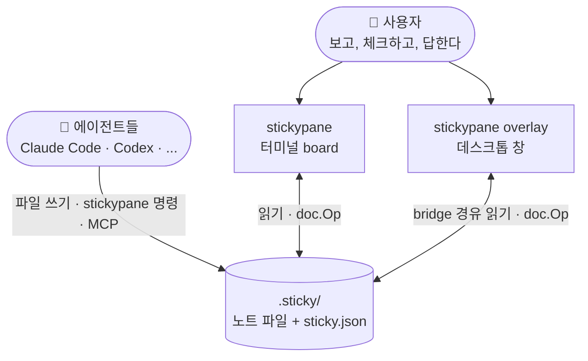
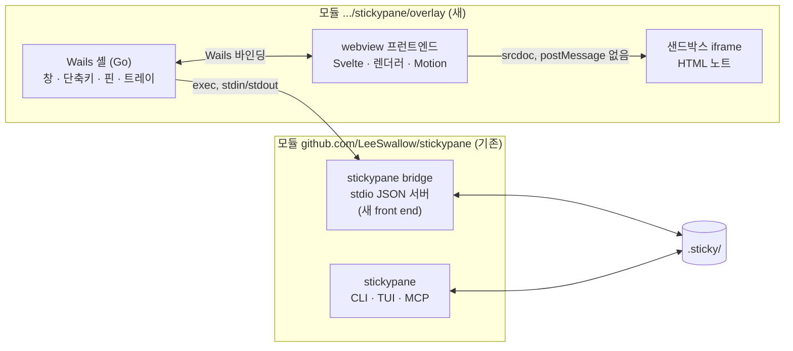
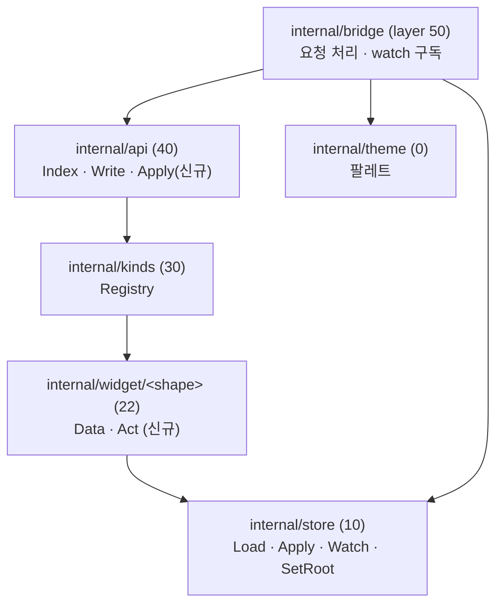
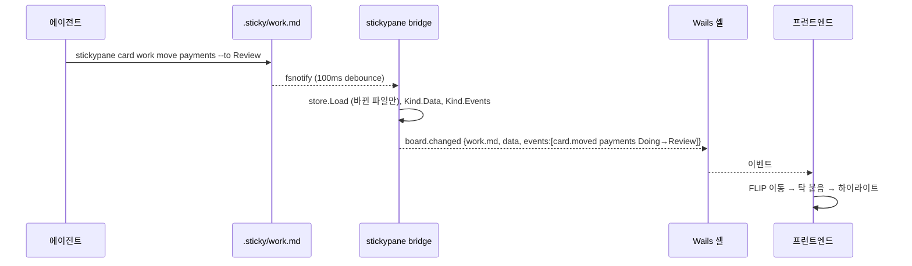
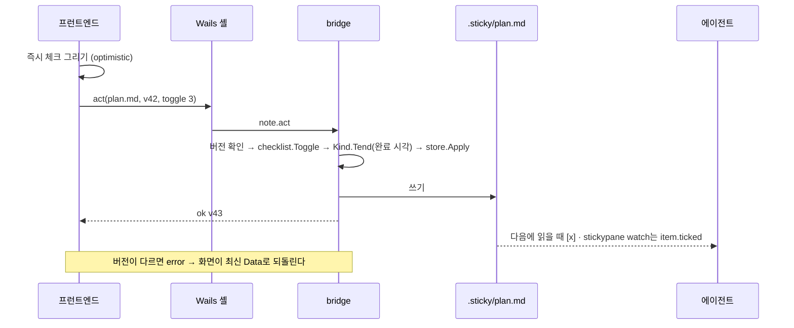
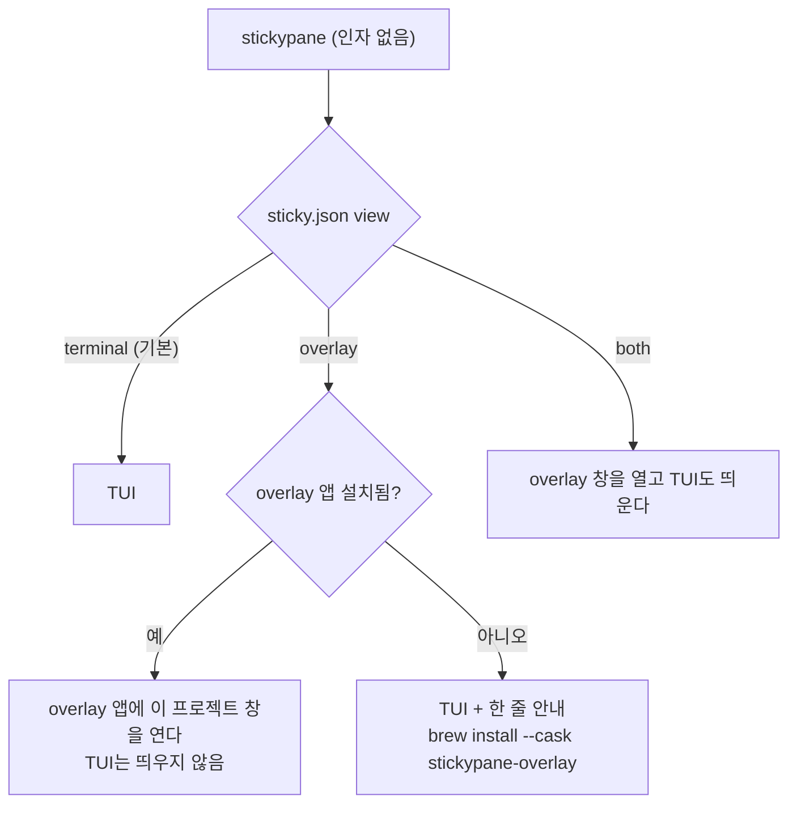
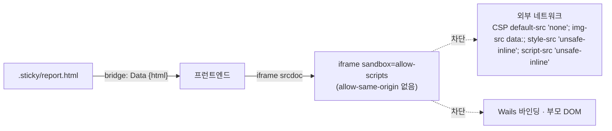

# 02. 시스템 아키텍처

> 상태: Draft · 2026-10-28 · 양식: [C4 Model](https://c4model.com/) (Context → Container → Component) + [arc42](https://arc42.org/) (Building Block View, Runtime View, Deployment View, Crosscutting Concepts)

## 2.1 아키텍처 스타일 요약

| 관점 | 선택 | 근거 |
|---|---|---|
| overlay의 정체 | **같은 폴더의 두 번째 화면**. 자기 데이터 모델이 없다 | VISION 1, [ADR-0001](adr/0001-second-screen-of-the-same-folder.md) |
| 본체와의 연결 | overlay 앱이 **`stickypane bridge`를 자식 프로세스로 띄우고 stdio JSON으로 대화**한다 | `internal/`은 다른 모듈에서 import할 수 없다. 네트워크 listener를 열지 않는다 ([ADR-0002](adr/0002-bridge-over-stdio.md)) |
| shape의 계약 | `widget.Kind`에 **`Data`(무엇을 말하는가)와 `Act`(클릭을 어떤 Op로 바꾸는가)** 두 필드를 더한다 | 쓰기는 지금처럼 `doc.Op` → `store.Apply` 하나 ([ADR-0005](adr/0005-kind-data-and-act.md)) |
| 앱 셸 | **Wails**(Go + 시스템 webview), 별도 모듈 `overlay/` | 언어 하나(Go), 서버 없음, MIT ([ADR-0003](adr/0003-wails-app-shell.md)) |
| 프런트엔드 | **Svelte 5 + Vite + TypeScript**, 렌더러는 unified · Shiki · Mermaid · KaTeX · rough.js | [ADR-0012](adr/0012-frontend-stack.md) |
| HTML 노트 | **샌드박스 iframe**, 보기 전용 | [ADR-0006](adr/0006-html-notes-view-only.md) |
| 설정 | 보기 방식 `view`, 스타일 `style`을 `sticky.json` 루트에. 색은 기존 `theme` | [ADR-0004](adr/0004-view-mode-in-sticky-json.md), [ADR-0008](adr/0008-two-theme-axes.md) |
| 홈과 세션 | 본체가 `~/.stickypane/events/*.jsonl`·`run/*.json`에 기록, 앱이 SQLite로 색인 | [08](08-app-home-and-sessions.md), [ADR-0013](adr/0013-home-registry-events-and-sqlite.md) |
| 플랫폼 | overlay 앱은 macOS·Linux | [ADR-0014](adr/0014-macos-and-linux-only.md) |

## 2.2 C4 Level 1 — 시스템 컨텍스트



에이전트와 overlay 사이에는 화살표가 없다. 둘은 **폴더를 통해서만** 만난다(VISION 2·3).

## 2.3 C4 Level 2 — 컨테이너



| 컨테이너 | 책임 | 하지 않는 것 |
|---|---|---|
| `stickypane bridge` | board를 읽어 JSON으로 내보내고, 바뀌면 알리고, 행동을 `doc.Op`로 적용한다 | 창·렌더링 |
| Wails 셸 | 창 생성, 전역 단축키, 핀(always-on-top), 프로젝트별 창 관리, bridge 프로세스 수명 | 노트를 읽거나 쓰기 (전부 bridge로) |
| 프런트엔드 | 그리기, Motion, 클릭을 행동으로 바꿔 셸에 전달 | 파일 접근, 네트워크 |
| 샌드박스 iframe | `.html` 노트 표시 | 부모 창·바인딩·네트워크 접근 |

## 2.4 C4 Level 3 — 본체 쪽 컴포넌트



### 2.4.1 `Kind`에 더하는 두 필드

```go
// Data, when set, is what a note of this kind says, as a value that
// encodes to JSON: the items of a checklist, the columns of a board.
// A screen other than the terminal draws from it.
Data func(d doc.Document) any

// Act, when set, turns an action a screen asks for, such as ticking the
// third item, into the change to make. It is what a key does in Update,
// for a screen without keys.
Act func(d doc.Document, a Action) (doc.Op, error)
```

```go
// Action is a request from a screen: Name is the shape's own verb
// ("toggle", "move", "choose"), Args what it applies to.
type Action struct {
	Name string            `json:"name"`
	Args map[string]string `json:"args,omitempty"`
}
```

- `Data`는 각 shape가 이미 갖고 있는 `read()` 결과를 export 가능한 구조로 옮기는 수준이다. 예: checklist는 `{items:[{text, checked, done}], done, total}`.
- `Act`는 `ops.go`에 이미 있는 Op(`checklist.Toggle`, `board.MoveCard`, `form.Choose`/`Fill`/`Submit` 등)를 고른다. 새 쓰기 로직은 없다.
- 행동은 **위치(index)로** 가리킨다. 이름으로 가리키는 CLI(`widget.Pick`)와 달리 화면은 무엇을 눌렀는지 정확히 안다. 다만 파일이 그사이에 바뀌었을 수 있으므로, 행동에 노트의 **버전**(파일 크기·수정 시각 또는 내용 해시)을 함께 보내고, 다르면 거절한 뒤 화면이 다시 그린다.

### 2.4.2 shape별 Data와 Act

| shape | Data (요지) | Act |
|---|---|---|
| note | `{markdown}` | — |
| checklist | `{items:[{text,checked,done}], done, total}` | `toggle(i)`, `add(text)` |
| board | `{columns:[{title, cards:[{text, details, who, moved, stalled}]}]}` | `move(col,i,to,at)`, `add(col,text)` |
| chart | `{kind, series:[{label, value}]}` 등 | — |
| form | `{fields:[...], submitted, answers}` | `choose(field,option)`, `fill(field,text)`, `submit(label)` |
| logview | `{lines:[...], tail:true}` | — |
| script | `{source, lang, lastRun}` | `run` (사용자 확인 후) |
| chat | `{messages:[{who, at, text}]}` | `say(text)` |
| api | `{requests:[...], last}` | `send(i)` (사용자 확인 후) |
| **html (신규)** | `{html}` | — |

정확한 필드는 구현자가 정한다. 원칙은 **파일에서 읽을 수 있는 것만** 담는다는 것이다(VISION 1).

### 2.4.3 `stickypane bridge` 프로토콜

한 줄에 JSON 하나(newline-delimited JSON). 요청에는 `id`가 있고, 알림에는 없다.

| 방향 | 메시지 | 내용 |
|---|---|---|
| → | `board.load` | 탭·노트 목록, 각 노트의 kind·크기(`size`, `rows`)·색·고정·버전·`Data`. 책은 `pages`(같은 형식의 노트 목록, 파일 이름순) |
| → | `note.act` `{note, version, action}` | `Kind.Act` → `store.Apply`. 결과로 새 버전 |
| → | `note.create` `{tab, kind, title, body}` | "+ 생성"(카탈로그에서 모양과 제목을 고른 뒤). `api.Write`와 같은 경로 |
| → | `note.view` `{note, size?, rows?, open?, pin?}` | 노트의 보기 설정(`sticky.json`)을 `store.SetView`로 바꾼다. 터미널 배치도 같이 바뀐다 |
| → | `note.open` `{note}` | 편집기로 연다(O2). bridge는 GUI 앱의 자식이라 터미널이 없다: `$VISUAL`이 GUI 편집기(`code`, `zed`, `subl` 등 `env`가 아는 목록)면 그것으로, 아니면 macOS `open -t`, Linux `xdg-open`. 기다리지 않는다. 바뀐 내용은 watch로 돌아온다 |
| → | `settings.get` / `settings.set` `{theme \| style \| view \| language}` | `store.SetTheme` / `SetRoot` / 기존 language 저장 |
| ← | `board.changed` `{notes:[...]}` | `store.Watch` 신호마다, 바뀐 노트만 다시 읽어 `Data`와 `Kind.Events`의 사건을 함께 |
| ← | `error` | 버전 불일치, 알 수 없는 행동 등 |

사건(`Kind.Events`)을 함께 보내는 이유: "카드가 Doing에서 Review로 갔다"를 화면이 직접 비교해 추측하지 않고, `stickypane watch --json`과 같은 사건을 그대로 받아 Motion을 고른다([04](04-motion.md)).

## 2.5 핵심 시퀀스

### 2.5.1 에이전트가 카드를 옮긴다



### 2.5.2 사용자가 overlay에서 체크한다



### 2.5.3 보기 방식에 따라 띄우기



overlay 앱이 이미 떠 있으면 같은 프로세스에 창만 하나 더 연다(단일 인스턴스). 앱을 찾고 호출하는 방법(PATH의 `stickypane-overlay`, macOS의 `open -a`)은 `internal/env`가 안다.

## 2.6 레이어와 모듈

| 변경 | 위치 | 레이어 |
|---|---|---|
| `Kind.Data`, `Kind.Act`, `widget.Action` | `internal/widget` | 20 (기존) |
| 각 shape의 `Data`·`Act` | `internal/widget/<shape>/` | 22 (기존). 파일 규칙상 `model.go`(Data)와 `ops.go`(Act)에 둔다 |
| `html` shape | `internal/widget/html/` (신규) | 22. `kind.go` … `events.go` 6파일 규칙을 따르고 `internal/kinds`에 한 줄 |
| `api.Apply(name, version, action)` | `internal/api` | 40 |
| `internal/bridge` | 신규 | 50, `internal/app`·`internal/mcp`와 나란히 |
| `internal/registry` | 신규 | 5. `internal/when`만 쓰는 잎 패키지에 가깝다. 명령 표(60)와 front end(50)가 부른다 |
| `bridge` 명령 | `cmd/stickypane` 명령 표에 한 줄 | 60 |
| overlay 앱 | `overlay/` 별도 `go.mod` | 본체 레이어 표 밖. 본체를 import하지 않는다 |

주의할 점 두 가지(구현자 확인 필요):

- 스크립트 실행은 지금 `internal/app`(50)에 있다. bridge도 50이라 import할 수 없다. 실행 부분을 낮은 레이어(예: `internal/env` 옆 새 패키지)로 내리는 리팩터가 먼저 필요하다.
- `Kind.Tend`(완료 시각 기록)는 지금 `api`가 부른다. `api.Apply`도 같은 경로를 타야 한다. 시각은 `internal/when`으로만 쓴다(AGENTS.md).

## 2.7 HTML 노트 격리



- `allow-same-origin`이 없으므로 iframe은 불투명 origin이다. 부모의 바인딩·저장소·DOM에 닿지 않는다.
- CSP를 `<meta>`로 주입해 외부 요청을 막는다. 이미지는 `data:`만.
- 높이는 iframe 안의 작은 스크립트가 `postMessage`로 알려 줄 수 있지만, **부모는 숫자 하나만 받는다.** 그 외 메시지는 무시한다.
- 터미널 쪽 `html` shape의 `view.go`는 태그를 걷어낸 텍스트와 "overlay에서 열기" 줄을 그린다(VISION 6: 숨기지 않는다).

## 2.8 배포

| 산출물 | 내용 | 배포 |
|---|---|---|
| `stickypane` | 기존 바이너리 + `bridge` 명령 | 기존 (Homebrew formula, GitHub release) |
| `Stickypane Overlay.app` / `stickypane-overlay` | Wails v3 앱, 글꼴·렌더러 번들 | macOS: 손그림 DMG, `brew install --cask stickypane-overlay`. Linux: tar.gz. Windows는 만들지 않는다([09](09-distribution.md), [ADR-0014](adr/0014-macos-and-linux-only.md)) |

overlay 앱은 실행 시 `stickypane` 바이너리를 PATH에서 찾는다. 버전이 맞지 않으면(bridge 프로토콜 버전) 창에 업데이트 안내를 띄운다.

## 2.9 교차 관심사

| 관심사 | 결정 |
|---|---|
| 네트워크 | overlay는 listener를 열지 않는다. 프런트엔드 CSP는 번들 자원만 허용 |
| 상태 | 창 위치·크기·핀은 앱 자체 설정(OS 표준 위치). 노트와 화면 배치는 `sticky.json`뿐 |
| 언어 | 화면 문구는 `internal/i18n`의 언어 선택(`language` 키)을 따른다. 번역 문자열은 bridge가 함께 내려 준다 |
| 접근성 | `prefers-reduced-motion`, 키보드 탐색, 대비([03 §3.10](03-design-system.md#310-접근성)) |
| 라이선스 | 본체 `scripts/licenses.sh`는 그대로. overlay 모듈과 npm 의존성은 별도 검사, 글꼴은 `THIRD_PARTY_NOTICES.md`에 |
