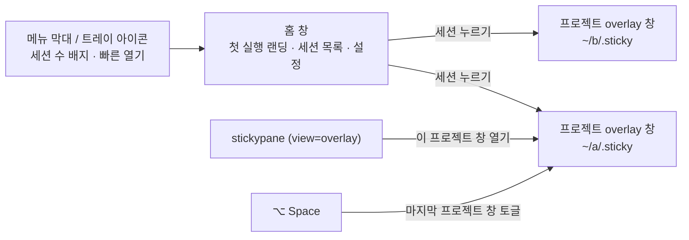
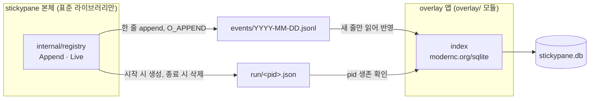
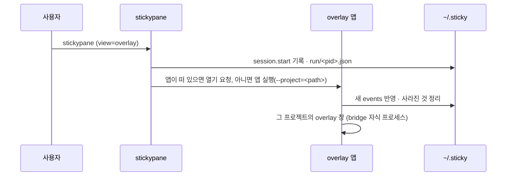

# 08. 앱 홈 · 첫 실행 · 세션 레지스트리

> 상태: Draft · 2026-10-28 · 관련 요구: R-26, R-27, R-28, R-29, R-30
>
> 참고: macOS 메뉴 막대 앱(Raycast, 1Password 8의 첫 실행), Excalidraw의 빈 캔버스 안내, SQLite WAL 문서, XDG Base Directory.

## 8.1 앱의 표면

overlay 앱에는 창이 두 종류 있다.



| 표면 | 언제 | 내용 |
|---|---|---|
| 홈 창 | 앱을 처음 실행하거나 Dock·트레이에서 열 때 | 첫 실행이면 랜딩, 그 뒤로는 세션 목록 |
| 프로젝트 overlay 창 | 세션을 누르거나 `stickypane`이 열 때 | [03 §3.6](03-design-system.md#36-창-구성)의 board |
| 트레이 아이콘 | 앱이 떠 있는 동안 | 활성 세션 수, 최근 프로젝트 5개, 홈 열기, 종료 |

## 8.2 첫 실행 — 앱 안의 랜딩

[사용자 결정] 앱은 기본 시작 화면과 랜딩을 갖는다(R-26). 웹사이트가 아니라 **홈 창 안의 첫 화면 한 장**이다. 구조는 HeyMoa 랜딩·데스크톱 온보딩에서 빌렸다(§8.7).

```text
┌──────────────────────────────────────────────────────────────────┐
│ [아이콘] stickypane                                                │
│  (말풍선) "에이전트가 뭐 했는지 터미널 스크롤 올려 보는 중이죠?"         │
│                                                                   │
│  에이전트는 ~~쪽지로~~ 남기고,             ┌ 점 모눈 종이 ─────────┐   │
│  나는 보드에서 읽어요.                     │ 쪽지가 하나씩 붙는     │   │
│  .sticky/ 폴더의 평범한 파일이              │ 대본 데모 (파랑·빨강·  │   │
│  이 보드에 붙어요.                         │ 노랑) ↖ "방금 쓴 쪽지" │   │
│                                           └───────────────────────┘   │
│  01 프로젝트 폴더 고르기      [.sticky 있음 ✓ / 없음]   [폴더 고르기]   │
│  02 에이전트에게 알려 주기    stickypane init  [복사]   [대신 실행]     │
│  03 첫 쪽지 기다리기          (파일이 생기면 자동 체크)                 │
│                                                                   │
│  [ 보드 열기 ]   파일만 읽어요. 아무것도 보내지 않아요.                 │
│                  나중에 설정에서 이 화면을 다시 볼 수 있어요.            │
└──────────────────────────────────────────────────────────────────┘
```

| 구간 | 목적 | 근거(HeyMoa) |
|---|---|---|
| 말풍선 훅 | 지금의 고통을 한 줄 농담으로 | 히어로 말풍선 |
| 제목 + 리드 | 무엇인지 한 줄, 강조어 하나는 손그림 형광펜 | 질문형 제목 + `<mark>` 하나 |
| 혼자 도는 데모 | 실제 board 조각이 대본대로 한 바퀴. 끝 상태에서 멈춘다. 동작 줄이기면 끝 상태 한 장. 일시정지 버튼 | `use-demo.ts`, `hero-stage.tsx` |
| 번호 카드 01–03 | 시작 방법. 각 카드는 **실제 상태로** 체크된다: 01은 `.sticky/` 존재, 02는 `stickypane`이 PATH에 있고 init이 됐는지, 03은 첫 노트 파일이 생겼는지 | 데스크톱 온보딩, 체크리스트 |
| 안심 각주 | 네트워크·권한 걱정을 덜어 준다 | "여기에서는 녹음을 시작하지 않아요" |
| CTA 하나 | "보드 열기". 03이 체크되면 자동으로 그 프로젝트 창으로 넘어가고 훅을 받아 닫는다: "이제 스크롤 안 올려도 돼요" | 마무리 CTA가 히어로 농담을 다시 꺼냄 |

- 02에서 `stickypane`이 없으면 설치 한 줄(`brew install --cask LeeSwallow/tap/stickypane`)과 복사 버튼을 보인다. "대신 실행"은 앱이 그 폴더에서 `stickypane init`을 실행한다.
- 레지스트리(§8.4)에 이미 프로젝트가 있으면 카드 아래에 "이 컴퓨터에서 찾은 프로젝트 n개 → 열기"를 보인다.
- 말투는 "~해요" 체. 창 안 데모는 실제 overlay 색과 글꼴을 그대로 쓰고(두 목소리 규칙), 창 밖 주석만 손그림 화살표·도장을 쓴다.
- 랜딩은 한 번 본 뒤에는 세션 목록이 홈이 된다. 설정의 "처음 화면 다시 보기"로 돌아갈 수 있다.

## 8.3 세션 목록 — 홈

[사용자 결정] stickypane이 있는 활성 세션들을 볼 수 있다(R-27).

```text
┌ stickypane ─────────────────────────────────────── [+ 프로젝트] ┐
│ 지금 움직이는 중                                                 │
│  ● stickypane   ~/Projects/Personal/stickypane  @claude @codex  │
│                 Auth sprint 카드 6 · 멈춤 1 · 2분 전              │
│  ● keyharbor    ~/Projects/Personal/KeyHarbor   터미널 board    │
│ 오늘                                                            │
│  ○ ts-voca      ~/Projects/Personal/ts-voca     14:02 마지막     │
│ 10월 27일 (어제)                                                 │
│  ○ escape-room  …                                               │
│ 사라진 프로젝트 2개 정리함 · 실행 취소                              │
└─────────────────────────────────────────────────────────────────┘
```

| 묶음 | 기준 |
|---|---|
| 지금 움직이는 중 | 살아 있는 stickypane 프로세스(TUI · bridge · mcp · watch)가 있거나, 지난 30분 안에 `.sticky/`가 바뀐 프로젝트 |
| 날짜별 | 마지막 활동 날짜로 묶는다(오늘, 어제, 그 전은 날짜). 프로젝트당 한 줄 |
| 사라진 프로젝트 | 폴더나 `.sticky/`가 없어져 자동으로 정리된 것. 한 번 알리고 실행 취소할 수 있다 |

각 줄에는 프로젝트 이름(`sticky.json`의 title 또는 폴더 이름), 경로, 활동 중인 에이전트(board 카드의 `@담당자`), 요약(카드 수, 정체 수), 마지막 활동이 보인다. 누르면 그 프로젝트의 overlay 창이 열린다.

## 8.4 레지스트리 — `~/.sticky/`

[사용자 결정] 홈 폴더에 `.sticky` 같은 폴더를 만들어 관리한다(R-28). JSON으로는 관리가 힘들 수 있으니 SQLite를 고려한다(R-28).

```text
~/.sticky/                       (STICKYPANE_HOME으로 바꿀 수 있다)
├── events/
│   ├── 2026-10-27.jsonl        stickypane 본체가 덧붙이는 기록, 날짜별
│   └── 2026-10-28.jsonl
├── run/
│   └── 48211.json              살아 있는 stickypane 프로세스 하나에 파일 하나
├── stickypane.db               overlay 앱의 SQLite 색인 (WAL)
└── overlay.json                창 위치 · 크기 · 핀 · 단축키 (앱 설정)
```

### 8.4.1 누가 무엇을 쓰나



- **본체**는 SQLite를 모른다. 프로젝트에서 무엇인가 할 때(`init`, TUI 시작·종료, `bridge`, `mcp`, `watch`, 노트를 바꾸는 명령) 그날의 `events/*.jsonl`에 한 줄을 덧붙이고, 오래 사는 프로세스는 `run/<pid>.json`을 만든다. 실패해도 명령은 실패하지 않는다(best-effort).
- **overlay 앱**이 SQLite 색인을 소유한다. 시작할 때와 `events/`가 바뀔 때 새 줄만 읽어 반영한다.

이렇게 나누는 이유:
1. 본체는 "표준 라이브러리 먼저" 규칙을 지키고 바이너리가 커지지 않는다(반목표 X5).
2. 여러 프로세스가 동시에 쓰는 곳은 append-only 파일이라 잠금 다툼이 없다. 한 줄은 `PIPE_BUF`(4KiB)보다 짧게 유지한다.
3. 날짜별 기록이 파일 자체로 남는다(R-29). `stickypane.db`를 지워도 `events/`에서 다시 만든다. **진실의 원천은 파일이고 SQLite는 색인이다**(VISION 1의 정신).

### 8.4.2 사건 형식

```json
{"v":1,"at":"2026-10-28T14:02:11+09:00","type":"session.start","project":"/Users/min/Projects/Personal/stickypane","pid":48211,"kind":"tui"}
{"v":1,"at":"2026-10-28T14:05:40+09:00","type":"project.touch","project":"/Users/min/Projects/Personal/stickypane","cmd":"card"}
{"v":1,"at":"2026-10-28T15:30:02+09:00","type":"session.end","project":"/Users/min/Projects/Personal/stickypane","pid":48211}
```

| type | 언제 |
|---|---|
| `project.init` | `stickypane init` |
| `project.touch` | 노트를 바꾸는 명령. 같은 프로젝트·같은 명령은 1분에 한 번만 |
| `session.start` / `session.end` | TUI, `bridge`, `mcp`, `watch`의 시작과 정상 종료 |

시각은 `internal/when`으로 쓴다(AGENTS.md).

### 8.4.3 SQLite 스키마

```sql
CREATE TABLE project (
  id          INTEGER PRIMARY KEY,
  path        TEXT NOT NULL UNIQUE,     -- 프로젝트 루트(.sticky의 부모), 정규화된 절대 경로
  title       TEXT,                     -- sticky.json title 또는 폴더 이름
  first_seen  TEXT NOT NULL,            -- RFC 3339
  last_seen   TEXT NOT NULL,
  removed_at  TEXT                      -- 사라진 것으로 정리한 시각. NULL이면 살아 있음
);
CREATE TABLE day (                      -- 날짜별 기록 (R-29)
  project_id  INTEGER NOT NULL REFERENCES project(id) ON DELETE CASCADE,
  date        TEXT NOT NULL,            -- YYYY-MM-DD, 로컬 날짜
  events      INTEGER NOT NULL DEFAULT 0,
  first_at    TEXT NOT NULL,
  last_at     TEXT NOT NULL,
  PRIMARY KEY (project_id, date)
);
CREATE TABLE session (
  pid         INTEGER NOT NULL,
  project_id  INTEGER NOT NULL REFERENCES project(id) ON DELETE CASCADE,
  kind        TEXT NOT NULL,            -- tui | bridge | mcp | watch
  started_at  TEXT NOT NULL,
  ended_at    TEXT,
  PRIMARY KEY (pid, started_at)
);
CREATE TABLE ingest (                   -- 어디까지 읽었나
  file        TEXT PRIMARY KEY,         -- events/2026-10-28.jsonl
  offset      INTEGER NOT NULL
);
CREATE TABLE meta (key TEXT PRIMARY KEY, value TEXT);  -- schema_version 등
```

### 8.4.4 지워진 것 처리

[사용자 결정] 중간에 삭제되는 문제를 모두 해결한다. 처음 불러올 때 삭제된 것은 자동으로 제거한다(R-29).

| 상황 | 처리 |
|---|---|
| 프로젝트 폴더나 `.sticky/`가 없어짐 | 앱 시작과 홈을 열 때마다 확인 → `removed_at`을 기록하고 목록에서 뺀다. 홈에 "사라진 프로젝트 n개 정리함 · 실행 취소"를 한 번 보인다. 30일 뒤 행을 지운다 |
| 사라졌던 폴더가 다시 생김 | 다음 사건이나 확인 때 `removed_at`을 비운다 |
| 프로젝트 폴더를 옮김 | 옛 경로는 사라진 것으로, 새 경로는 새 프로젝트로 잡힌다. [설계자 판단] 같은 `sticky.json` title과 같은 노트 목록이면 "옮긴 것 같아요 · 합치기"를 제안한다(나중 단계) |
| 프로세스가 죽어 `run/<pid>.json`이 남음 | pid가 살아 있지 않거나, 살아 있어도 다른 프로그램이면(시작 시각 비교) 파일을 지우고 `session.ended_at`을 채운다 |
| `events/*.jsonl` 마지막 줄이 잘림 | 줄바꿈으로 끝나지 않은 마지막 줄은 다음에 읽는다(offset을 그 앞에 둔다). JSON이 깨진 줄은 건너뛰고 세어 둔다 |
| `events/` 파일을 사용자가 지움 | `ingest` 행을 지운다. 이미 반영한 기록은 남는다 |
| `stickypane.db`가 깨지거나 지워짐 | 이름을 바꿔 두고 `events/` 전체에서 다시 만든다 |
| 오래된 기록 | `events/`는 90일 뒤 앱이 지운다. `day` 표는 남는다 |
| 스키마 변경 | `meta.schema_version`으로 순서대로 이전. 실패하면 다시 만들기 |

## 8.5 앱이 띄워지는 길



열기 요청은 단일 인스턴스 앱에 두 번째 실행의 인자를 넘기는 방식으로 한다(Wails v3 single instance). macOS는 `open -a "Stickypane Overlay" --args --project=<path>`, Linux는 PATH의 `stickypane-overlay --project=<path>`.

## 8.6 플랫폼

[사용자 결정] 지원은 **macOS와 Linux**로 줄인다(R-30). Windows는 본체 터미널 board만 지금처럼 지원하고, overlay 앱은 만들지 않는다.

| | macOS | Linux |
|---|---|---|
| webview | WKWebView | WebKitGTK |
| 전역 단축키 | 지원 | X11 지원, Wayland는 컴포지터에 따라 안 될 수 있다 [미검증] → 트레이와 `stickypane`으로 대신 연다 |
| 트레이 | 메뉴 막대 | StatusNotifierItem(데스크톱 환경에 따라) [미검증] |
| 배포 | DMG, Homebrew cask | tar.gz + `.desktop`, AppImage는 나중 |
| 이번 확인 | 이 Mac에서 직접 | CI의 빌드와 테스트만 [미검증 → 실기 확인 필요] |

## 8.7 HeyMoa 자산에서 빌린 것

`/Users/min/Projects/HeyMoa`(별도 제품, 읽기만 함)의 랜딩과 데스크톱 온보딩을 분석했다. **구조·말투·기법만 빌리고 브랜드는 빌리지 않는다.**

| 빌린 것 | HeyMoa 위치 | stickypane에서 |
|---|---|---|
| 농담 → 고통 해소 → 실제 작동 데모 → 같은 농담으로 닫기 | `heymoa-web/components/heymoa/landing/landing.tsx`, `closing.tsx`, `messages/ko/landing.json` | §8.2 훅·제목·데모·CTA |
| 대본대로 혼자 도는 실제 앱 조각, 첫 렌더 = 대본 시작, reduced-motion이면 끝 장면 | `use-demo.ts`, `hero-stage.tsx` | 목업 v3의 재생 장면을 그대로 데모로 |
| 쪽지·테이프·손글씨·손 그림 화살표·형광펜·"예시" 도장·말풍선 주석 | `components/heymoa/landing/marks.tsx` | 손그림 스타일의 주석 부품(rough.js로 다시 그림) |
| keyframe은 `prefers-reduced-motion: no-preference` 안에만, 기본은 끝 상태 | `motion.tsx` | [04 §4.6](04-motion.md#46-동작-줄이기)과 같은 규칙 |
| 두 목소리: 창 안은 실제 앱 색, 창 밖 주석만 랜딩 색 | `heymoa-web/DESIGN.md` | 데모는 실제 테마 토큰으로 |
| 번호 카드 + 상태 배지 + 안심 각주 + 주 CTA 하나 | `apps/desktop/renderer/onboarding.html` | 01–03 카드 |
| 실제 데이터로 판정하는 체크리스트, 누를 수 있는 CTA만 가리키기 | `lib/onboarding/checklist.ts`, DESIGN.md 빈 상태 | 03 "첫 쪽지 기다리기" 자동 체크 |
| "~해요" 체 | `messages/ko/help.json` | 앱 안 모든 문구 |

빌리지 않은 것: 마스코트(픽셀 앵무새), 라벤더 팔레트, 로그인, 팀·FAQ·회의 앱 띠 같은 마케팅 섹션. 앱 안 화면이라 스크롤 랜딩 대신 한 화면 + 세 걸음으로 줄였다.
