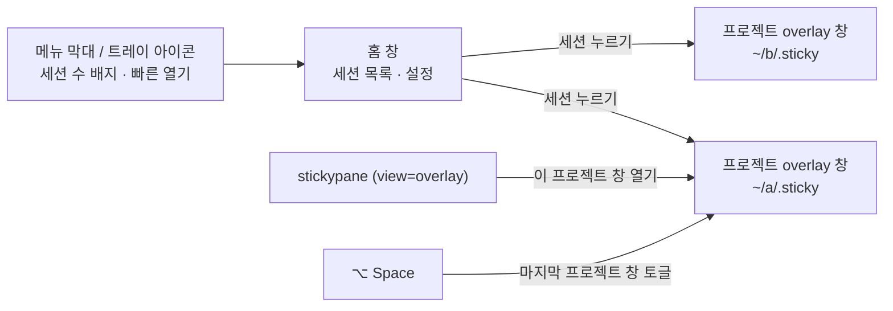
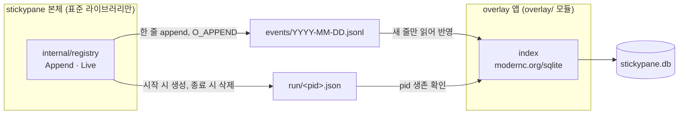
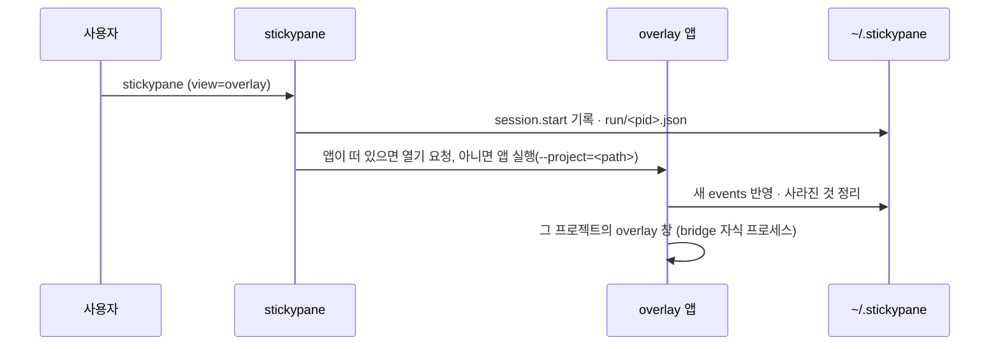

# 08. 앱 홈 · 세션 레지스트리

> 상태: Draft · 2026-10-28 · 관련 요구: R-26, R-27, R-28, R-29, R-30, R-32
>
> 참고: macOS 메뉴 막대 앱(Raycast, 1Password 8의 첫 실행), Excalidraw의 빈 캔버스 안내, SQLite WAL 문서, XDG Base Directory.

## 8.1 앱의 표면

overlay 앱에는 창이 두 종류 있다.



| 표면 | 언제 | 내용 |
|---|---|---|
| 홈 창 | 앱을 실행하거나 Dock·트레이에서 열 때 | 세션 목록(비어 있으면 빈 상태 한 장) |
| 프로젝트 overlay 창 | 세션을 누르거나 `stickypane`이 열 때 | [03 §3.6](03-design-system.md#36-창-구성)의 board |
| 트레이 아이콘 | 앱이 떠 있는 동안 | 활성 세션 수, 최근 프로젝트 5개, 홈 열기, 종료 |

## 8.2 첫 실행 — 설명 없이 바로 목록

[사용자 결정] 초반 랜딩·설명 화면은 두지 않는다(R-32). 앱을 열면 처음부터 §8.3의 세션 목록이 홈이다.

- 첫 실행에 앱은 `~/.stickypane/`을 만든다(§8.4.1). 이때부터 본체가 기록을 남긴다.
- 목록이 비어 있으면 빈 상태 한 장만 보인다: 손그림 메모지 하나에 "아직 붙은 보드가 없어요" 한 줄과 **[폴더 고르기]** 버튼. 고른 폴더에 `.sticky/`가 없으면 그 자리에서 `stickypane init --view overlay`를 실행한다. 설명 문단·단계 카드·데모는 없다.
- `stickypane`을 찾지 못하면 빈 상태 메모지에 설치 한 줄(`brew install --cask LeeSwallow/tap/stickypane`)과 복사 버튼을 보인다.
- 말투는 "~해요" 체.

## 8.3 세션 목록 — 홈

[사용자 결정] stickypane이 있는 활성 세션들을 볼 수 있다(R-27).

```text
┌ stickypane ──────────────────────────────── [+ 프로젝트 추가] ⋯ ┐
│ 지금 움직이는 중                                                 │
│  ● stickypane   ~/Projects/Personal/stickypane  @claude @codex  │
│                 Auth sprint 카드 6 · 멈춤 1 · 2분 전              │
│  ● keyharbor    ~/Projects/Personal/KeyHarbor   터미널 board    │
│ 오늘                                                            │
│  ○ ts-voca      ~/Projects/Personal/ts-voca     14:02 마지막     │
│ 10월 27일 (어제)                                                 │
│  ○ escape-room  …                                               │
│ 사라진 프로젝트 2개 정리함 · 실행 취소                              │
└─────────────────────────────────────────────────────────────────┘
```

| 묶음 | 기준 |
|---|---|
| 지금 움직이는 중 | 살아 있는 stickypane 프로세스(TUI · bridge · mcp · watch)가 있거나, 지난 30분 안에 `.sticky/`가 바뀐 프로젝트 |
| 날짜별 | 마지막 활동 날짜로 묶는다(오늘, 어제, 그 전은 날짜). 프로젝트당 한 줄 |
| 사라진 프로젝트 | 폴더나 `.sticky/`가 없어져 자동으로 정리된 것. 한 번 알리고 실행 취소할 수 있다 |

각 줄에는 프로젝트 이름(`sticky.json`의 title 또는 폴더 이름), 경로, 활동 중인 에이전트(board 카드의 `@담당자`), 요약(카드 수, 정체 수), 마지막 활동이 보인다. 누르면 그 프로젝트의 overlay 창이 열린다.

화면은 디자인 시스템(03 §3.11)으로 짓는다: 제목줄은 TitleBar(⋯에 창 닫기·stickypane 종료), 줄은 테이프로 붙인 메모지(기울지 않음) 안에 이름(손글씨)·에이전트 Chip·실행 중인 것 Badge·시각·경로 한 줄, 빈 목록은 EmptyState. 셸의 알림과 창 자신의 실패는 제목줄 아래 Toast로, "사라진 프로젝트 N개를 정리했어요 · 되돌리기"와 한 번만 나오는 "트레이에 남아 있어요 · stickypane 종료"도 Toast다. 폴더에 보드를 만들기 전에는 Confirm으로 묻는다.

## 8.4 레지스트리 — `~/.stickypane/`

[사용자 결정] 홈 폴더에 `.sticky` 같은 폴더를 만들어 관리한다(R-28). JSON으로는 관리가 힘들 수 있으니 SQLite를 고려한다(R-28).

[설계자 판단] 이름은 `~/.sticky`가 아니라 **`~/.stickypane/`**이다. `store.Find`는 현재 폴더에서 위로 올라가며 처음 만나는 `.sticky`를 board로 쓰므로, `~/.sticky`가 있으면 홈 아래에서 `.sticky`가 없는 모든 프로젝트가 레지스트리를 board로 열고 자동 `init`도 멈춘다.

[설계자 판단] 기록은 **`~/.stickypane/`이 있을 때만** 남긴다. 폴더는 overlay 앱이 첫 실행에 만든다(`STICKYPANE_HOME`을 직접 정해도 된다). 터미널만 쓰는 사람의 홈에는 아무것도 생기지 않고, 오래된 기록 정리는 앱이 맡는다.

```text
~/.stickypane/                       (STICKYPANE_HOME으로 바꿀 수 있다)
├── events/
│   ├── 2026-10-27.jsonl        stickypane 본체가 덧붙이는 기록, 날짜별
│   └── 2026-10-28.jsonl
├── run/
│   └── 48211.json              살아 있는 stickypane 프로세스 하나에 파일 하나
├── stickypane.db               overlay 앱의 SQLite 색인 (WAL)
└── overlay.json                창 위치 · 크기 · 핀 · 단축키 (앱 설정)
```

### 8.4.1 누가 무엇을 쓰나



- **본체**는 SQLite를 모른다. `~/.stickypane/`이 있으면, 프로젝트에서 무엇인가 할 때(`init`, TUI 시작·종료, `bridge`, `mcp`, `watch`, 노트를 바꾸는 명령) 그날의 `events/*.jsonl`에 한 줄을 덧붙이고, 오래 사는 프로세스는 `run/<pid>.json`을 만든다. 실패해도 명령은 실패하지 않는다(best-effort).
- **overlay 앱**이 SQLite 색인을 소유한다. 시작할 때와 `events/`가 바뀔 때 새 줄만 읽어 반영한다.

이렇게 나누는 이유:
1. 본체는 "표준 라이브러리 먼저" 규칙을 지키고 바이너리가 커지지 않는다(반목표 X5).
2. 여러 프로세스가 동시에 쓰는 곳은 append-only 파일이라 잠금 다툼이 없다. 한 줄은 `PIPE_BUF`(4KiB)보다 짧게 유지한다.
3. 날짜별 기록이 파일 자체로 남는다(R-29). `stickypane.db`를 지워도 `events/`에서 다시 만든다. **진실의 원천은 파일이고 SQLite는 색인이다**(VISION 1의 정신).

### 8.4.2 사건 형식

```json
{"v":1,"at":"2026-10-28T14:02:11+09:00","type":"session.start","project":"/Users/min/Projects/Personal/stickypane","pid":48211,"kind":"tui"}
{"v":1,"at":"2026-10-28T14:05:40+09:00","type":"project.touch","project":"/Users/min/Projects/Personal/stickypane","cmd":"card"}
{"v":1,"at":"2026-10-28T15:30:02+09:00","type":"session.end","project":"/Users/min/Projects/Personal/stickypane","pid":48211}
```

| type | 언제 |
|---|---|
| `project.init` | `stickypane init` |
| `project.touch` | 노트를 바꾸는 명령. 같은 프로젝트·같은 명령은 1분에 한 번만 |
| `session.start` / `session.end` | TUI, `bridge`, `mcp`, `watch`의 시작과 정상 종료 |

시각은 `internal/when`으로 쓴다(AGENTS.md).

### 8.4.3 SQLite 스키마

```sql
CREATE TABLE project (
  id          INTEGER PRIMARY KEY,
  path        TEXT NOT NULL UNIQUE,     -- 프로젝트 루트(.sticky의 부모), 정규화된 절대 경로
  title       TEXT,                     -- sticky.json title 또는 폴더 이름
  first_seen  TEXT NOT NULL,            -- RFC 3339
  last_seen   TEXT NOT NULL,
  removed_at  TEXT                      -- 사라진 것으로 정리한 시각. NULL이면 살아 있음
);
CREATE TABLE day (                      -- 날짜별 기록 (R-29)
  project_id  INTEGER NOT NULL REFERENCES project(id) ON DELETE CASCADE,
  date        TEXT NOT NULL,            -- YYYY-MM-DD, 로컬 날짜
  events      INTEGER NOT NULL DEFAULT 0,
  first_at    TEXT NOT NULL,
  last_at     TEXT NOT NULL,
  PRIMARY KEY (project_id, date)
);
CREATE TABLE session (
  pid         INTEGER NOT NULL,
  project_id  INTEGER NOT NULL REFERENCES project(id) ON DELETE CASCADE,
  kind        TEXT NOT NULL,            -- tui | bridge | mcp | watch
  started_at  TEXT NOT NULL,
  ended_at    TEXT,
  PRIMARY KEY (pid, started_at)
);
CREATE TABLE ingest (                   -- 어디까지 읽었나
  file        TEXT PRIMARY KEY,         -- events/2026-10-28.jsonl
  offset      INTEGER NOT NULL
);
CREATE TABLE meta (key TEXT PRIMARY KEY, value TEXT);  -- schema_version 등
```

### 8.4.4 지워진 것 처리

[사용자 결정] 중간에 삭제되는 문제를 모두 해결한다. 처음 불러올 때 삭제된 것은 자동으로 제거한다(R-29).

| 상황 | 처리 |
|---|---|
| 프로젝트 폴더나 `.sticky/`가 없어짐 | 앱 시작과 홈을 열 때마다 확인 → `removed_at`을 기록하고 목록에서 뺀다. 홈에 "사라진 프로젝트 n개 정리함 · 실행 취소"를 한 번 보인다. 30일 뒤 행을 지운다 |
| 사라졌던 폴더가 다시 생김 | 다음 사건이나 확인 때 `removed_at`을 비운다 |
| 프로젝트 폴더를 옮김 | 옛 경로는 사라진 것으로, 새 경로는 새 프로젝트로 잡힌다. [설계자 판단] 같은 `sticky.json` title과 같은 노트 목록이면 "옮긴 것 같아요 · 합치기"를 제안한다(나중 단계) |
| 프로세스가 죽어 `run/<pid>.json`이 남음 | pid가 살아 있지 않거나, 살아 있어도 다른 프로그램이면(시작 시각 비교) 파일을 지우고 `session.ended_at`을 채운다 |
| `events/*.jsonl` 마지막 줄이 잘림 | 줄바꿈으로 끝나지 않은 마지막 줄은 다음에 읽는다(offset을 그 앞에 둔다). JSON이 깨진 줄은 건너뛰고 세어 둔다 |
| `events/` 파일을 사용자가 지움 | `ingest` 행을 지운다. 이미 반영한 기록은 남는다 |
| `stickypane.db`가 깨지거나 지워짐 | 이름을 바꿔 두고 `events/` 전체에서 다시 만든다 |
| 오래된 기록 | `events/`는 90일 뒤 앱이 지운다. `day` 표는 남는다 |
| 스키마 변경 | `meta.schema_version`으로 순서대로 이전. 실패하면 다시 만들기 |

## 8.5 앱이 띄워지는 길



열기 요청은 단일 인스턴스 앱에 두 번째 실행의 인자를 넘기는 방식으로 한다(Wails v3 single instance). macOS는 `open -a stickypane --args --project=<path>`, Linux는 PATH의 `stickypane-app --project=<path>`.

## 8.6 플랫폼

[사용자 결정] 지원은 **macOS와 Linux**로 줄인다(R-30). Windows는 본체 터미널 board만 지금처럼 지원하고, overlay 앱은 만들지 않는다.

| | macOS | Linux |
|---|---|---|
| webview | WKWebView | WebKitGTK |
| 전역 단축키 | 지원 | X11 지원, Wayland는 컴포지터에 따라 안 될 수 있다 [미검증] → 트레이와 `stickypane`으로 대신 연다 |
| 트레이 | 메뉴 막대 | StatusNotifierItem(데스크톱 환경에 따라) [미검증] |
| 배포 | DMG, Homebrew cask | tar.gz + `.desktop`, AppImage는 나중 |
| 이번 확인 | 이 Mac에서 직접 | CI의 빌드와 테스트만 [미검증 → 실기 확인 필요] |

## 8.7 HeyMoa 자산 분석 (참고로만 남김)

첫 실행 랜딩을 위해 `/Users/min/Projects/HeyMoa`의 랜딩(`heymoa-web/components/heymoa/landing/`, `DESIGN.md`)과 데스크톱 온보딩(`apps/desktop/renderer/onboarding.html`)을 분석했으나, 랜딩을 두지 않기로 해(R-32) 구조는 쓰지 않는다. 남겨 쓰는 것은 두 가지다.

| 쓰는 것 | HeyMoa 위치 | stickypane에서 |
|---|---|---|
| keyframe은 `prefers-reduced-motion: no-preference` 안에만, 기본은 끝 상태 | `components/heymoa/landing/motion.tsx` | [04 §4.6](04-motion.md#46-동작-줄이기) |
| "~해요" 체, 누를 수 있는 CTA 하나만 두는 빈 상태 | `messages/ko/help.json`, `DESIGN.md` 빈 상태 | §8.2 빈 상태 |
