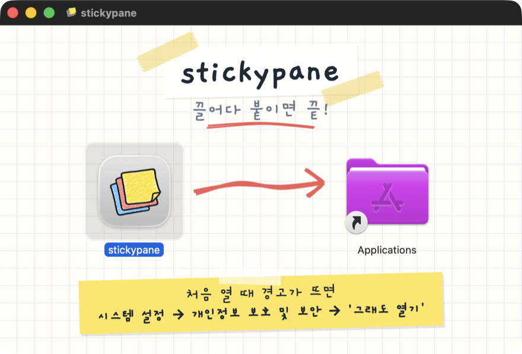

# 09. 배포와 설치 화면

> 상태: Draft · 2026-10-29 · 관련 요구: R-30, R-31, R-43

## 9.1 산출물

[사용자 결정] 제품 이름에서 "overlay"를 뺀다. 앱 이름은 **stickypane**이다. 저장소의 `overlay/` 폴더와 Go 모듈 경로는 안쪽 이름이라 그대로 둔다.

| 플랫폼 | 산출물 | 만드는 법 |
|---|---|---|
| macOS (arm64, amd64) | `stickypane-<버전>-<arch>.dmg`, 볼륨 이름 `stickypane`, 안에 `Stickypane.app` | `wails3 package` → `scripts/overlay-dmg.sh`(hdiutil + 배경 + 아이콘 배치) |
| macOS | Homebrew cask | 같은 DMG를 가리킨다([미결정]: 이름과 본체 cask와의 관계) |
| Linux (amd64, arm64) | `stickypane-app-<버전>-linux-<arch>.tar.gz` (앱 + `stickypane` + `.desktop` + 아이콘 + 라이선스) | Linux에서 `wails3 build` → `scripts/overlay-linux.sh`. WebKitGTK 4.1이 필요하다 |

| 이름 | 값 |
|---|---|
| 번들 | `Stickypane.app`, `CFBundleName`·`CFBundleDisplayName` = `stickypane` |
| 번들 id | `io.github.leeswallow.stickypane` (단일 실행 UniqueID도 같다) |
| 앱 실행 파일 | `Contents/MacOS/stickypane-app`, Linux는 `stickypane-app` (CLI `stickypane`와 겹치지 않게) |
| `.desktop` | `Name=stickypane`, `Exec=stickypane-app %u`, `Icon=stickypane` |
| 버전 | 하나뿐: `overlay/build/config.yml`의 `info.version`. `Info.plist`·`Info.dev.plist`의 `CFBundleShortVersionString`·`CFBundleVersion`이 같은 값을 되풀이하고 `TestVersionsAgree`가 지킨다. `overlay-dmg.sh`는 `.app`의 버전이 다르면 멈춘다 |

[사용자 결정] **앱만 깔면 다 된다.** 앱 안에 `stickypane` 명령을 넣는다. macOS는 `Stickypane.app/Contents/Helpers/stickypane`, Linux는 앱 바이너리 옆 `stickypane`. 같은 체크아웃의 `./cmd/stickypane`을 앱과 같은 버전(`-X main.version=<CFBundleShortVersionString>`), 같은 아키텍처로 `overlay-dmg.sh`·`overlay-linux.sh`가 빌드해 넣는다. 앱은 bridge를 찾을 때 이 번들 사본을 **먼저** 보고(`bridge.BundledCLI()`), 그다음 `STICKYPANE_BIN`, PATH, `/opt/homebrew/bin`·`/usr/local/bin`·`~/go/bin` 순이다. 터미널에서 쓰도록 PATH에 링크를 거는 버튼은 따로 한다.

본체 `stickypane`은 지금처럼 goreleaser로 배포한다. 앱은 같은 태그에 산출물을 더한다(CGO와 WebKit 때문에 macOS·Linux 러너에서 따로 빌드한다. 릴리스 워크플로 연결은 [미결정]). [설계자 판단] 앱은 Windows용을 만들지 않는다(R-30).

## 9.2 DMG 설치 화면

[사용자 결정] DMG 설치 화면도 doodle 양식이 드러나게 꾸민다(R-31). 앱 아이콘을 오른쪽 Applications 바로가기로 끌어 놓으면 설치된다.



```text
┌──────────────────────────── stickypane ──────────────────────────────┐
│   (격자 노트, 테이프 붙은 손글씨 제목)                                  │
│                 stickypane                                            │
│             "끌어다 붙이면 끝!"                                         │
│                                                                       │
│     ┌─────────┐      ~~~~~~~~~~~~~~~~~~~~~~>      ┌─────────┐          │
│     │ [앱 아이콘]│    (손으로 그린 크레용 화살표)    │Applications│        │
│     └─────────┘                                   └─────────┘          │
│     stickypane                                     Applications        │
│                                                                       │
│   ┌ 노란 메모지 (살짝 기울어짐) ──────────────────────┐                  │
│   │ 처음 열 때 경고가 뜨면                             │                  │
│   │ 시스템 설정 → 개인정보 보호 및 보안 → '그래도 열기' │                  │
│   └────────────────────────────────────────────────┘                  │
└───────────────────────────────────────────────────────────────────────┘
```

| 요소 | 규칙 |
|---|---|
| 창 크기 | 내용 660×420 pt(창 틀은 제목 막대만큼 더 높다). 배경은 @1x 660×420과 @2x 1320×840을 `tiffutil -cathidpicheck`로 `background.tiff` 하나로 합친다 |
| 배경 | 밝은 종이(`stickypane-light`의 종이 `#fffdf7`) + 격자 노트. Finder 아이콘 이름 글자가 검은색이라 밝은 배경을 쓴다 |
| 제목 | "stickypane", Gaegu Bold, 테이프 두 조각. 아래에 "끌어다 붙이면 끝!"과 크레용 밑줄 |
| 화살표 | rough.js로 그린 크레용 화살표(아이콘의 빨강), 앱 아이콘에서 Applications로. seed를 고정해 늘 같은 획 |
| 아이콘 위치 | 앱 (170, 210), Applications 바로가기 (490, 210), 아이콘 크기 112, 글자 13 |
| 메모지 | 서명·공증이 없는 동안 Gatekeeper 안내: "처음 열 때 경고가 뜨면 / 시스템 설정 → 개인정보 보호 및 보안 → '그래도 열기'". macOS 15부터 우클릭 → 열기로는 넘어가지 않는다 |
| 볼륨 아이콘 | 앱 아이콘과 같은 `.icns`(`.VolumeIcon.icns` + `SetFile -a C`) |

배경 이미지는 손으로 그리지 않고 **코드로 만든다**: `overlay/build/dmg/background.html`(rough.js + Gaegu, 앱의 `frontend/node_modules`에 있는 자원만)을 `overlay/build/dmg/render.sh`가 헤드리스 Chrome으로 두 배율 PNG로 찍고 TIFF로 합친다. 그래서 테마·문구를 바꿔도 다시 만들 수 있다. 결과 PNG·TIFF는 저장소에 넣어 두어 DMG를 만들 때 Chrome이 필요 없다.

`scripts/overlay-dmg.sh <app> <out.dmg>`의 순서:

1. `.app`을 검사한다(Info.plist와 그 `CFBundleExecutable`, 버전이 `config.yml`과 같은지). 같은 이름의 볼륨이 이미 마운트돼 있으면 멈춘다.
2. 임시 폴더에 `Stickypane.app`으로 복사하고, `stickypane` CLI를 빌드해 `Contents/Helpers/`에 넣고(Apple 규칙상 `Resources`에는 실행 코드를 두지 않는다), 안쪽부터 ad-hoc 서명한다(CLI → 앱). `/Applications` 심볼릭 링크와 `.background/background.tiff`를 둔다.
3. `hdiutil create -format UDRW` → `hdiutil attach`(Finder가 볼 수 있게 `-nobrowse` 없이).
4. AppleScript로 그 디스크 이미지의 Finder 창만 정리한다: 아이콘 보기, 도구 막대·상태 막대 숨김, 창 경계, 아이콘 크기·위치, 배경. Finder가 `.DS_Store`를 쓸 때까지 기다린다.
5. `.VolumeIcon.icns`와 사용자 정의 아이콘 속성, `bless --openfolder`. Apple Silicon에서는 `bless --openfolder`가 지원되지 않아 실패할 수 있고, 그러면 경고만 내고 계속한다. 마운트하면 창이 저절로 열리는지는 [미검증]이다.
6. 분리 → `hdiutil convert -format UDZO`. `trap`이 어떤 경우에도 분리하고 임시 파일을 지운다.

## 9.3 서명과 공증

- 지금 본체 바이너리도 공증하지 않는다(README의 cask가 quarantine을 지운다). 앱도 **ad-hoc 서명**(`codesign --force -s -`)만 한다. 번들 안의 `stickypane`을 먼저, 앱을 나중에 서명하고 `codesign --verify --deep --strict`로 확인한다.
- 내려받은 ad-hoc 앱을 처음 열면 macOS가 "확인할 수 없음" 경고를 띄운다. 사용자는 **시스템 설정 → 개인정보 보호 및 보안**에서 **그래도 열기**를 누른다(메모지 문구).
- Developer ID와 공증은 [미결정]. 하게 되면 DMG의 메모지 문구를 "끌어다 놓으면 끝"으로 바꾸고 cask의 quarantine 단계를 뺀다.

## 9.4 첫 실행 연결

1. 사용자가 DMG에서 앱을 Applications로 끌어 놓고 연다.
2. 앱은 `~/.stickypane/`을 만들고 세션 목록을 보인다. 비어 있으면 빈 상태 한 장([08 §8.2](08-app-home-and-sessions.md#82-첫-실행--설명-없이-바로-목록)).
3. bridge는 앱에 든 `stickypane`으로 연다(9.1). 그것이 없거나 지워졌을 때만 PATH 등에서 찾고, 그래도 없으면 `brew install --cask LeeSwallow/tap/stickypane`을 보인다.

## 9.5 트레이 아이콘

[사용자 결정] 트레이 아이콘도 앱 아이콘의 세 장 메모지 모양이다(R-43).

| 플랫폼 | 파일 | 규칙 |
|---|---|---|
| macOS | `overlay/build/darwin/tray-template.svg` → `tray-template.png`(18×18)·`tray-template@2x.png`(36×36) | 템플릿 이미지: 검정 + 알파만. 위 메모지가 아래 메모지에 틈을 낸다. Wails `SystemTray.SetTemplateIcon`으로 넣어 메뉴 막대 색을 따른다. Wails가 막대 두께에 맞춰 크기를 정하므로 앱은 @2x 한 장을 넣는다 |
| Linux | `overlay/build/tray.png`(44×44, 컬러) | `SetIcon` |

`overlay/build/darwin/tray.sh`가 두 가지를 다시 만든다. 어느 쪽을 쓸지는 `shell.trayIcon`이 정하고 테스트가 지킨다(darwin이면 템플릿 + 템플릿 플래그).

## 9.6 검증

| 항목 | 방법 |
|---|---|
| DMG 레이아웃 | 만든 DMG를 `open`으로 마운트해(사용자와 같이) Finder 창만 `screencapture -l <창 id>`로 찍는다. 이 문서의 그림이 그것이다 |
| DMG 스크립트 | `overlay/scripts/dmg_test.sh`: 없는 `.app`, 빈 `.app`, `.dmg`가 아닌 출력, 버전이 `config.yml`과 다른 `.app`에 0이 아닌 코드로 끝나고, 이미지를 쓰지 않고, 아무것도 마운트하지 않는다 |
| 번들 CLI | 마운트한 볼륨의 `Stickypane.app/Contents/Helpers/stickypane version`이 앱 버전을 말한다. `bridge` 테스트가 가짜 번들 배치에서 번들 사본을 먼저 고르는지 본다 |
| 앱 실행 | Applications에 복사 후 실행, 세션 목록이 뜨는지 |
| 격리된 첫 실행(수동) | 내려받은 것과 같은 상태를 만들어 본다: 마운트한 볼륨에서 `ditto /Volumes/stickypane/Stickypane.app /tmp/qa/Stickypane.app`, `xattr -w -r com.apple.quarantine "0081;$(printf %x $(date +%s));Safari;" /tmp/qa/Stickypane.app`, `open /tmp/qa/Stickypane.app`. Gatekeeper 경고 → 시스템 설정의 **그래도 열기**로 열리는지, 보드를 열 때 bridge가 번들 CLI로 뜨는지(`ps -o command= -p $(pgrep -f 'Helpers/stickypane bridge')`가 `/tmp/qa/Stickypane.app/Contents/Helpers/stickypane`을 가리키는지) 본다. 사람이 한다 |
| Linux | CI(ubuntu)에서 빌드와 Go 테스트. 실기 실행은 [미검증] |
