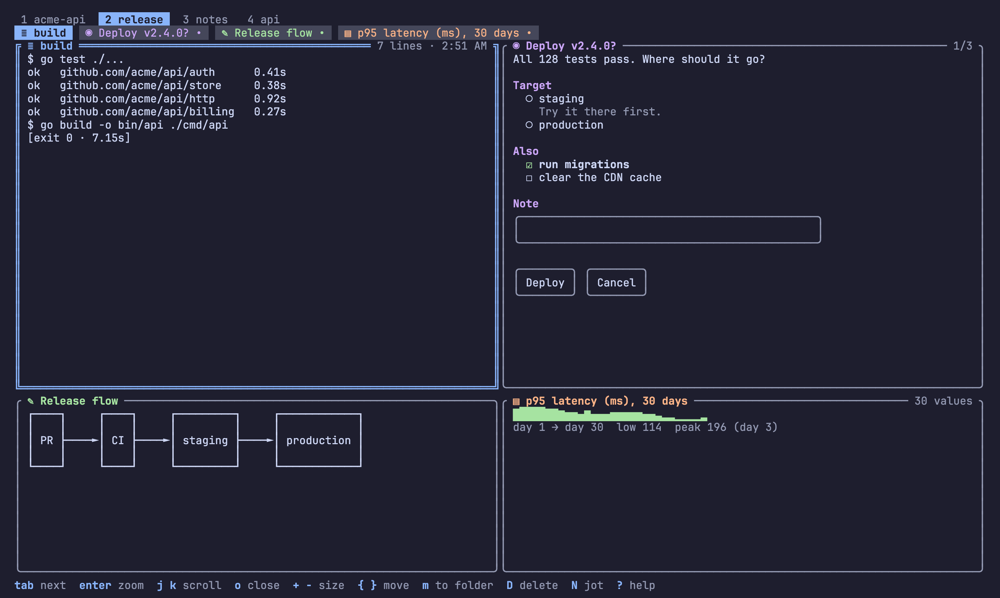
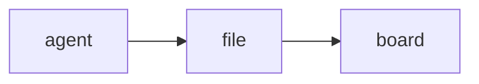
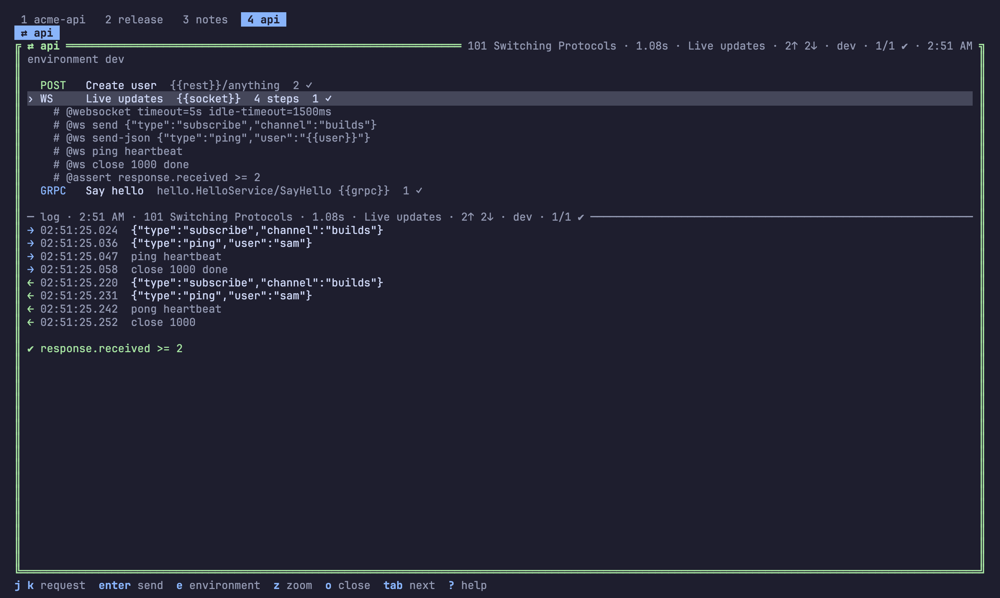
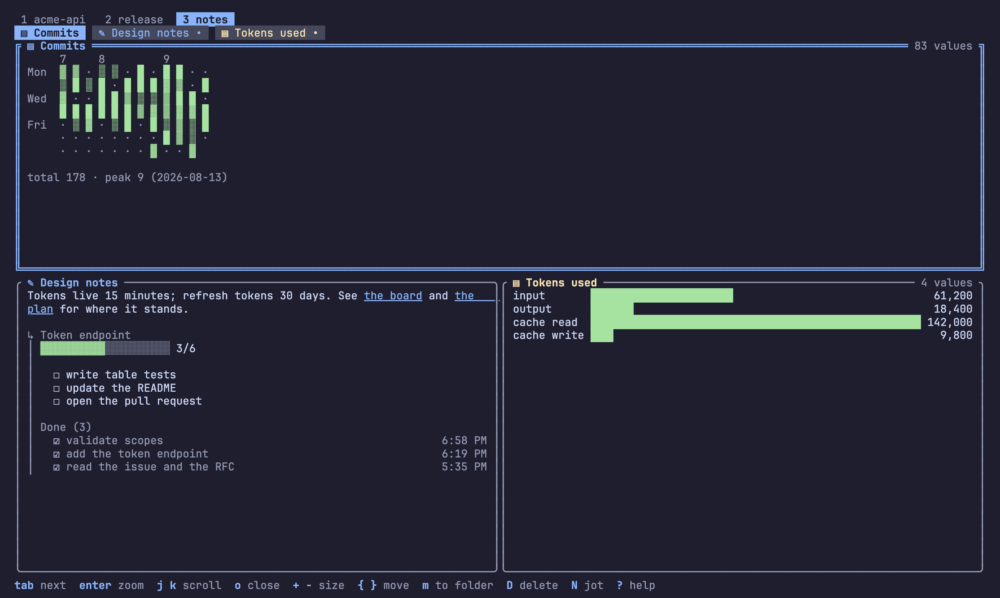

# The folder and the shapes of a note

How `.sticky/` becomes a board, and every shape a note can take.
`stickypane kinds` lists the shapes and `stickypane help <shape>` prints
one in full. Back to the [README](../README.md).

- [The folder is the board](#the-folder-is-the-board): files, tabs, books, scripts
- [Front matter](#front-matter)
- Shapes: [board](#board), [checklist](#checklist), [log](#log),
  [chart](#chart), [diagrams](#diagrams), [chat](#chat), [form](#form),
  [API requests](#api-requests-experimental)
- [Notes that link](#notes-that-link): `[[links]]`, embeds, charts computed from other notes

## The folder is the board

One file in `.sticky/` is one note. Create a file to pin a note, edit it to
update the note, delete it to take the note down. A one-line file is a
complete note:

```markdown
check env before deploy
```

What a file is depends on its name:

| File | Is |
| --- | --- |
| `*.md` | a note; its front matter may give it a shape (below) |
| `*.log` `*.txt` `*.out` | a log: shown as it is and followed as it grows |
| `*.sh` `*.ps1` | a script: shown with a Run button, run with sh or PowerShell |
| `*.html` `*.htm` | a web page, to look at: the terminal shows its text |
| a folder | a tab: a screen of its own, with the files in it as notes |
| a folder in a tab | a book: one note whose pages are the files in it |
| anything else | not shown |

```text
.sticky/
  sticky.json         the board: theme, language, which tab is open, the root tab's layout
  10-plan.md          a note of the root tab, named after your project
  build.log           a log, followed live
  deploy/             a tab
    sticky.json       this tab's title and layout
    run.sh            a script; its output goes to run.log
    docs/             one note with three pages
      01-intro.md
      02-usage.md
      03-faq.md
```

A number in front of a name orders the notes, the pages and the tabs and
is not part of the title: `10-plan.md` is shown as "plan" and a folder
`20-release` as the tab "release", until front matter or `sticky.json`
gives it a title of its own. Notes are ordered by file name, pinned ones
first, until you move them. A file that does not fit its shape is still
shown, never hidden.

**Tabs.** Each folder of `.sticky/` is a tab, listed on the first line of
the screen with its number; the files in the folder are its notes, and the
root folder is the first tab, named after the project. `1`–`9`, `(` `)` or
a click switch tabs; the active tab is remembered. A tab's folder can hold
its own `sticky.json` with a `title` and the layout of its notes, so one
folder is one complete, shareable screen. `stickypane show deploy/run.sh`
switches to that tab.

**Books.** A folder inside a tab is shown as one pane that scrolls like one
long note: its files follow one another, each under a rule with its name,
and the border says which page the view is on (`docs · usage  2/3`).
`j` `k`, the wheel and the paging keys scroll through all of it; `,` and
`.` jump to the page before or after; every other key acts on the page the
view is on. `stickypane link docs` puts a folder of your project on the
board as a tab without copying it, and `stickypane link README.md` does the
same for a file; both make a symbolic link, so what you change on the board
is changed in the real file.

**Scripts.** `enter` on a script asks first (`Run deploy.sh in myproject?`),
then runs it with `sh` in the project folder. The output is written to a log
of the same name next to the script, which the board opens and follows while
the script runs. A script never runs without that yes, each time: it is a
file your agent may have written.

Where a note sits on the screen is kept apart from the note, in
`sticky.json`; see [configuration](configuration.md#stickyjson-how-the-board-is-arranged).

## Front matter

Front matter says what a Markdown note is. Every key is optional.

| Key | Values |
| --- | --- |
| `type` | `note` (default), `board`, `checklist`, `log`, `chart`, `chat`, `form` |
| `title` | shown in the title bar and the note's border |
| `view` | for a chart: `bar`, `spark`, `heat` |
| `summary` | a line that says what the note is, shown in the [index](usage.md#the-index) |
| `from` | for a chart: the notes it is counted from ([below](#notes-that-link)) |

A note may also carry `open`, `size`, `rows`, `color` and `pin`: that is
the note's own proposal, and what `sticky.json` says wins.

Below, a release tab with four shapes: a log, a form, a Mermaid diagram and
a chart.



## Board

Each `## Heading` is a column and each top-level list item is a card.
Indented lines under a card are its details. Any other line under a column
shows up as a card too, and text before the first heading is the board's
description.

```markdown
---
type: board
title: Auth work
open: true
---
## To do
- payments
## Doing
- login API
  - refresh tokens come later
## Done
- schema
```

## Checklist

`- [ ]` and `- [x]` lines, shown with a progress bar.

## Log

One entry per line. Next to other notes it asks for ten lines, and it
follows its end as the file grows until you scroll up. A `.log` file is the
same thing without front matter.

## Chart

Each `label: number` line is a value; any other line is shown as text above
the chart. `view` picks the drawing: `bar` (default), `spark` for a line
chart as wide as the pane (six rows; one line for a single value), or
`heat` for a calendar of days when the labels are dates. Both grow with the
pane, and most when the note is zoomed.

```markdown
---
type: chart
title: Tokens per day
view: heat
---
2026-09-28: 41,200
2026-09-29: 8,900
2026-09-30: 0
```

```text
app       ████████████████████████ 61        9 10
board     ████████████▏            31   Mon  █ ·
checklist ████████▎                21        ▒ ▓
store     ██████▎                  16   Wed  ·
```

## Diagrams

A `mermaid` code block in a plain note is drawn as a diagram instead of
being shown as source. Flowcharts (`graph`, `flowchart`), sequence diagrams
and entity-relationship diagrams (`erDiagram`) are drawn; a block that
cannot be drawn keeps its source.

````markdown

````

```text
┌───────┐     ┌──────┐     ┌───────┐
│ agent ├────►│ file ├────►│ board │
└───────┘     └──────┘     └───────┘
```

## Chat

A conversation with your agent, kept in the folder. Each message is
`@name HH:MM text` under a heading for its day; the board writes the time.
You press `n` to answer, as `$STICKYPANE_USER`, git's `user.name` or your
login name; the agent says things with `stickypane say` and hears you with
`stickypane watch --once --note chat --type message.added`.

```markdown
---
type: chat
---
## 2026-10-03
@min 14:02 can you rerun the tests?
@claude 14:03 41/41 pass
```

## Form

A document that asks. Your agent writes the questions; you answer on the
board; the answers land in the same file.

```markdown
---
type: form
title: Deploy now?
open: true
---
The build is green. Where should it go?

## Target
- ( ) staging
  Try it there first.
- ( ) production

## Also
- [ ] run migrations
- [ ] clear the cache

## Note
> 

[ Deploy ] [ Cancel ]
```

```text
  ○ staging                      ╭──────────────────────────────╮
      Try it there first.        │ after lunch                  │
› ◉ production                   ╰──────────────────────────────╯
  ☑ run migrations               ┏━━━━━━━━┓ ╭────────╮
  ☐ clear the cache              ┃ Deploy ┃ │ Cancel │
                                 ┗━━━━━━━━┛ ╰────────╯
```

| Line | Is |
| --- | --- |
| `- ( ) text` | an option; choosing one clears the others |
| `- [ ] text` | an option; choose as many as you like |
| indented line below | the option's description |
| `> text` | a line to fill in |
| `[ Label ] [ Label ]` | buttons; a form without any gets `[ Submit ]` |

Everything else is Markdown and is drawn as such. Options of one kind in a
row are one question, named by the heading above it. Pressing a button
writes `submitted: <label>` and `submitted_at` into the front matter;
changing an answer afterwards takes them out again. The agent reads the
answers from the file, or waits for them:

```sh
stickypane wait deploy --timeout 10m
# submitted: Deploy
# at: 2026-10-02T14:03:05+09:00
# Target: production
# Also: run migrations
# Note: after lunch
```

## API requests (experimental)

A `.http` note is an API client on the board, in the format resterm and the
VS Code REST Client read, so the same file works there too: REST requests,
WebSocket sessions and gRPC calls side by side. `enter` sends the picked
one after a yes; under the list, the board shows what that request got last
time.



```http
# @env dev

### Create user
POST {{rest}}/users
Content-Type: application/json

{"name": "{{user}}"}
# @assert response.statusCode == 201
# @capture file id {{response.json.id}}

### Live updates
# @websocket timeout=5s idle-timeout=1s subprotocols=json
# @ws send {"type":"subscribe","channel":"builds"}
# @ws wait 500ms
# @ws close 1000 done
# @assert response.received >= 1
GET {{socket}}/events

### Get user
# @grpc users.v1.Users/Get
# @grpc-plaintext true
# @grpc-metadata x-trace-id: demo-1
# @assert response.grpc.status == "OK"
GRPC {{grpc}}

{"id": "{{id}}"}
```

| | REST | WebSocket | gRPC |
| --- | --- | --- | --- |
| written as | a method and a URL | a `ws://` URL, or `# @websocket`, and `# @ws` steps: `send`, `send-json`, `send-base64`, `ping`, `pong`, `wait`, `close` | `GRPC host:port`, `# @grpc package.Service/Method`, a JSON body |
| the log shows | the body | the transcript, `→` sent and `←` received, to the millisecond | the messages; a stream as a list |
| checks read | `response.statusCode`, `response.json("a.b")`, `response.header("X")` | `response.received`, `response.json("[0].type")` | `response.grpc.status`, `response.json("name")` |

**gRPC without generated code.** Messages are written as JSON. The
descriptors come from `# @grpc-descriptor api.protoset` (what `protoc
--descriptor_set_out` or `buf build -o` writes), else from the server's
reflection service, else fields go by number (`{"1": 7}`), as
`protoc --decode_raw` shows them. `# @grpc-plaintext true` speaks HTTP/2
without TLS. Unary calls and server streams are sent; a status other than
OK ends the request like an HTTP error (`404 NOT_FOUND · user 7 not found`).

**Environments.** `{{name}}` works in the URL, headers, body, `@ws` steps,
gRPC metadata and target. Values come from `@name = value` lines, captures
of earlier responses, `rest-client.env.json` or `resterm.env.json` (the
`$shared` block, then the environment chosen with `# @env`, which `e` on the
board changes), `env:NAME`, and the project's `.env`. Credentials in
headers and metadata are hidden in the log.

**For agents.** `stickypane api api` lists the requests (`#2  WS  Live
updates`), `stickypane api api "live" --env dev` sends one and `--all`
every one, printing each log; the MCP tool `api` does the same and returns
the logs of a failed run too. Each request's last result stays in `api.log`
under its title, a line such as `[101 Switching Protocols · 1.1s · Live
updates · 2↑ 2↓ · 1/1 ✔]` at its end, so `stickypane watch --note api.log`
hears when one is sent.

## Notes that link

Notes name each other with `[[name]]`, as in Obsidian: `[[plan]]`,
`[[plan#write tests]]`, `[[deploy/run|the run]]`. A link is drawn as its
name or alias, and a name finds its note with or without `.md` and its
folder. `f` on a note lists the notes it links to and the notes that link
to it, and `enter` goes there; the index shows how many notes link to each
one, and `stickypane index --json` lists `links` and `backlinks`.



A line that is only `![[plan]]` shows that note there, in its own shape and
read only: a checklist with its progress, a board with its columns. It
follows the note it shows. Embeds go one level deep.

A chart can be computed from another note: give it `from:` and stickypane
fills in its values and keeps them up to date, in the file itself.

```markdown
---
type: chart
title: Progress
from: plan          # one note: done and open (a board: cards per column)
---
```

With `from: plan, release` it draws one bar per note: percent done for a
checklist, cards for a board, answered questions for a form, lines for a
log. That is the whole list; anything else is a `stickypane watch --exec`
recipe (see [usage](usage.md#notes-that-react)).

## Adding a shape

A shape is one package under `internal/core/widget/`; see
[architecture](architecture.md#a-shape-of-note).
