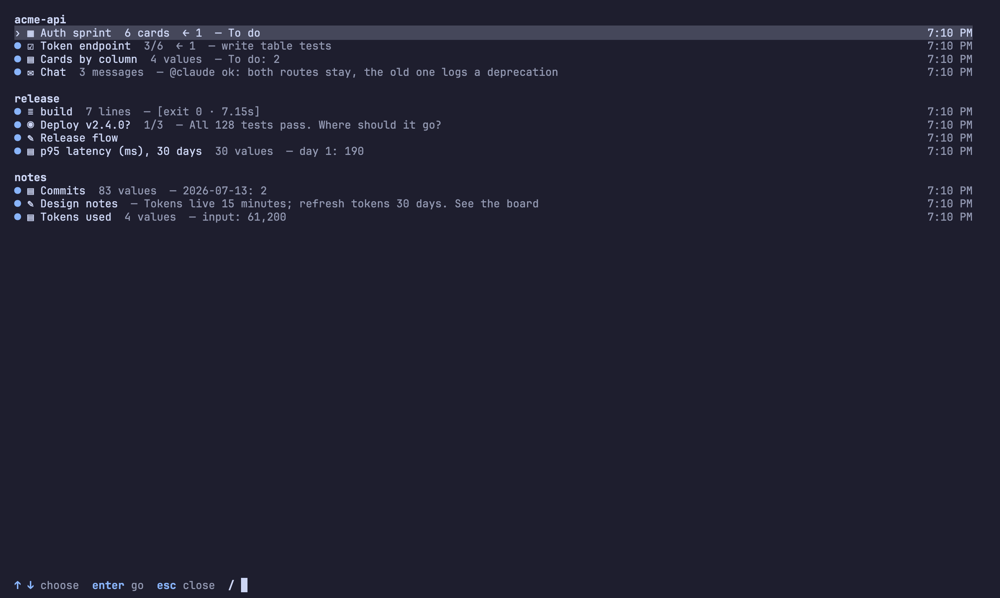

# Using the board

Keys, the mouse, the editor, the index, moving notes, and watching what
happens. Every command has its own help in the program: `stickypane help
<command>` prints one with its examples, and `stickypane help --all`
prints every command with every option on one page. Back to the
[README](../README.md).

- [Keys](#keys) and [how the screen is shared](#how-the-screen-is-shared)
- [Mouse](#mouse)
- [Editing a note](#editing-a-note)
- [The index](#the-index)
- [Deleting and moving](#deleting-and-moving)
- [Notes that react](#notes-that-react): `stickypane watch`
- [How edits are written](#how-edits-are-written)

For the commands an agent uses, see [agents.md](agents.md). For the shapes
of a note, [shapes.md](shapes.md).

## Keys

| Any note | | Open board or checklist | |
| --- | --- | --- | --- |
| `tab` / `shift+tab` | next, previous note | `h` `l` | change column |
| `enter` | open, then zoom | `j` `k` | change card or item |
| `o` | open or close | `H` `L` | move a card sideways |
| `+` / `-` | wider, narrower | `J` `K` | reorder a card |
| `shift+up` / `down` | taller, shorter (`pgup` `pgdn`: by five) | | |
| `0` | as tall as its content | | |
| `N` | jot a note | `space` | tick an item |
| `a` | add by shape | `n` | new card or item |
| `p` / `c` / `R` | pin, color, rename | **Open script** | |
| `{` / `}` | move earlier, later | `enter` | run, after a yes |
| `,` / `.` | turn a book's pages | | |
| `m` | move to a folder | | |
| `x` / `D` / `u` | archive, delete, undo | **Zoomed note** | |
| `e` / `E` | edit here, in `$EDITOR` | `esc` | back |
| `r` / `?` / `q` | reload, help, quit | `j` `k` `g` `G` | scroll |
| `T` | next theme | | |
| `z` | zoom | **Open form** | |
| `[` / `]` | previous, next screen | `j` `k` | change control |
| `1`–`9` / `(` `)` | switch tab | `enter` / `space` | choose, type, press |
| `i` / `/` | the index | `S` | settings |

The focused open note takes the keys in the right-hand column where it is;
you do not have to zoom in first. When the focused note has no cursor of its
own, `j` `k` `g` `G` and the paging keys (`pgdn` `pgup`, `space` `b`,
`ctrl+f` `ctrl+b`, `ctrl+d` `ctrl+u`) scroll it inside its pane; a note with
a cursor scrolls to keep the cursor in view. A form uses `enter` itself, so
`z` is the way to zoom into one.

### How the screen is shared

Open notes are placed left to right by `size`, a share of the screen's
width (`1` takes a row, two `1/2` notes share one, four `1/4` notes sit side
by side; on a narrow screen a share under 20 cells takes the next one up),
and each row is stretched to the full width, its notes growing by their
shares. The rows then share the height: a short note takes what it needs
and the long ones split the rest, so the screen is always full and never
scrolls as a whole. A note gets at least six lines, or all it needs if that
is less; notes that would get less go to the next screen, shown as `2/3`
under the title bar.

`+` and `-` step a note through the shares and its border says the new one
for a moment; `shift+up` and `shift+down` make it a line taller or shorter
(`shift+pgup` and `shift+pgdn` five), and `0` lets it be as tall as its
content again. The sizes are kept in
[sticky.json](configuration.md#stickyjson-how-the-board-is-arranged).

## Mouse

| Do this | And |
| --- | --- |
| click a title in the bar | a closed note opens, an open one takes the focus, the focused one closes |
| click a note | it takes the focus |
| click an item, option, button or card | it is ticked, chosen, pressed or selected |
| double-click a note | zoom; on a script, run it after a yes |
| click Yes or No on a question | answer it; a click anywhere else is no |
| wheel | scroll the note under the pointer |
| drag a note's right edge | its width, snapped to the nearest share |
| drag a note's bottom edge | its height in lines |
| double-click a bottom edge | as tall as its content again |

In tmux the mouse reaches stickypane only with `set -g mouse on`.

## Editing a note

`e` opens the focused note's file in a small editor that works like vi, so
you can fix a note without leaving the board. `E` hands the file to your own
editor instead: `$VISUAL` or `$EDITOR`, any of them. Terminal editors (vim,
nvim, helix, nano, emacs -nw, micro) take the terminal until you quit; GUI
editors (VS Code, Cursor, Zed, Sublime, JetBrains, Kate, TextMate) are told
to wait until you close the file, so you need not add `--wait`. With neither
variable set, the first of nvim, vim, vi and nano found is used.

| Keys | Do |
| --- | --- |
| `i` `a` `I` `A` `o` `O` | insert text; `esc` goes back |
| `h` `j` `k` `l` `w` `b` `e` `0` `^` `$` `gg` `G` | move |
| `ctrl+f` `ctrl+b`, `ctrl+d` `ctrl+u` | a page, half a page |
| `x` `dd` `dw` `D` `cc` `cw` `C` `r` `J` | delete, change, replace, join |
| `yy` `p` `P`, `u` `ctrl+r` | copy and paste, undo and redo |
| `/text` `n` `N`, `:12` | search, go to a line |
| `:w` `:q` `:wq` `ZZ` `:q!` | save, quit, both, quit without saving |

The border shows the cursor's line and column and which page of the file it
is on. If the file changes on disk while it is open, usually because your
agent wrote to it, a buffer you have not touched follows the file. One with
your changes is kept, you are told, and `:w` does not overwrite the file:
`:w!` does, and `:e!` loads it again. Counts (`3dd`) and visual mode are not
there.

## The index

A board with many notes stays easy to read: `i` or `/` opens the index,
every note of every tab in a line, the way a wiki's index page lists its
pages. Each line has the note's shape, title, what it counts (`2/5`,
`7 cards`), a gist and when it changed; open notes are marked `●`. Type to
filter, choose with the arrows, and `enter` goes to the note, switching tab
and opening it.



The gist is the note's own `summary:` from its front matter when it has
one, so a note can say in a line what it is; otherwise it is what to look
at first: the next open item of a checklist, the latest line of a log, the
first line of anything else.

`stickypane index` prints the same index as Markdown (`--json` for
programs), and the MCP tool `index` gives it to agents, which read it
instead of every note.

## Deleting and moving

Nothing you do on the board erases a file.

- `D` asks, then moves the note to `.sticky/.trash/`. `x` moves it to
  `.sticky/archive/` without asking. `u` takes back whichever you did last.
- `m` lists the folders: pick one and the note becomes a page of that book,
  pick the top level to take a page out of its book, or name a new folder.
- `{` and `}` swap the note with its neighbor; the order is kept in
  `sticky.json`.
- `R` renames what you see, not the file: a Markdown note's `title`, or for
  a book, a log or a script the `title` in `sticky.json`.

From the command line:

```sh
stickypane mv plan deploy/       # into the tab deploy
stickypane mv deploy/plan .      # back to the first tab
stickypane mv plan roadmap       # a new name; it keeps its place on the screen
stickypane rm roadmap            # to .sticky/.trash/
stickypane restore roadmap       # and back
stickypane archive roadmap       # to .sticky/archive/
stickypane link README.md        # show a project file without copying it
```

None of these writes over another note or reaches outside `.sticky/`.

## Notes that react

Everything that happens on the board is an event: a note made or removed,
an item ticked, a card moved, a form sent, a line logged, a message said, a
chart value changed. `stickypane watch` prints them as they happen, one a
line, and runs a command for each with `--exec`, so one note can answer
another and anything outside can listen:

```sh
stickypane watch                                   # 14:02:05  plan.md  item.ticked  write tests
stickypane watch --json | jq .                     # for programs
stickypane watch --note plan --type item.ticked \
  --exec 'stickypane chart progress add done 1'    # a chart that counts the ticks
stickypane watch --type card.moved \
  --exec '[ "$STICKY_TO" = Done ] && printf "\a"'  # a bell when a card is done
stickypane watch --once --note deploy --type form.submitted   # wait for the user
```

`--note` and `--type` filter (`--type card` takes every card event), and
`--once` ends at the first event, which is how an agent waits for the user
to do something. The command given to `--exec` runs in your own shell with
the event in `STICKY_EVENT` (JSON) and in `STICKY_NOTE`, `STICKY_KIND`,
`STICKY_TYPE`, `STICKY_ITEM`, `STICKY_FROM`, `STICKY_TO` and `STICKY_TIME`.
Nothing reacts unless you start a watch: the board itself never runs
anything without asking. Over MCP the same events come from `wait_event`.

## How edits are written

The board never overwrites a file with what it last saw. An edit is an
intent ("move this card to that column") applied to the file as it is at
that moment, and the file is then replaced in one step. If your agent
changed that card in the meantime, nothing is written and the board tells
you. A note that is a symlink is edited where it really lives.

Replacing the file has two limits:

- A program that keeps a note open and keeps appending to it
  (`some-command >> .sticky/log.md`) goes on writing to the old file after
  you edit that note from the board. Writing a line at a time, the way agents
  do, is fine.
- A write that lands in the instant between the board reading a file and
  replacing it is lost.

In the code, the intent is a `doc.Op` and `store.Apply` applies it; see
[architecture](architecture.md#reading-and-writing).
